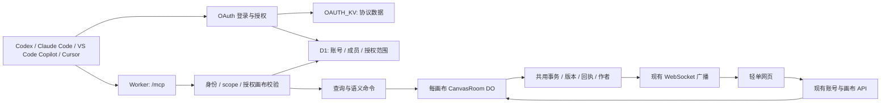

# 轻单 MCP 接入设计方案

日期：2026-10-27。代码基线：`develop`，`4b68c8e`。状态：本地实现与自动验证已完成；独立 preview 部署、四客户端真实授权/读写/重连/撤销验收、生产迁移与发布均未执行。结果、设计裁决与待办见 [验收记录](../../mcp-acceptance.md)，接入见 [指南](../../mcp-setup.md)。

设计检查：已由独立工程审阅 agent 检查实施所需信息，反馈没有尚待回答的重要问题。此结论仅针对设计完整性，不代表代码、协议或四端联调已经通过。

## 1. 目标与已确认范围

让用户在 Codex、Claude Code、VS Code 中的 GitHub Copilot、Cursor 中，通过 MCP 读取和修改轻单里的内容，改动同步到现有网页。

用户已确认：

- 首版功能为读取搜索、待办管理、便签编辑。
- 用户本人及其他用户均可授权各自的 agent；使用各自轻单账号的权限。
- Copilot 指 VS Code 中的 GitHub Copilot。
- 基于远程 MCP、现有 Cloudflare Worker 和 OAuth 的建议形成设计方案。

本方案的实现目标是：同一套业务工具、一个稳定的 HTTPS MCP 地址、四份接入说明，以及可撤销的账号授权。自然语言理解、总结和任务拆分由调用方 agent 完成；项目负责查询、校验和持久化。

以下是本方案提出的默认设计，并非用户已经逐项指定：

| 事项           | 本方案默认值                                             | 理由                                        |
| -------------- | -------------------------------------------------------- | ------------------------------------------- |
| 内容权限       | 按画布选择只读或读写；一次授权的选定画布共用同一权限级别 | 待办与便签共用段落数据，见第 3 节           |
| 画布范围       | 明确勾选，可全选当前画布；以后新增或加入的画布不自动授权 | 让用户知道本次连接可访问哪些内容            |
| 搜索范围       | 每次搜索限定一个已授权画布                               | 数据边界清楚，避免扫描所有画布              |
| 删除待办       | 保存 30 天恢复记录，允许原操作用户在网页恢复             | 当前浏览器撤销历史无法恢复远程 agent 的删除 |
| 访问令牌与授权 | 访问令牌 15 分钟；授权最长 30 天，刷新不延长绝对期限     | 与现有账号体验协调，并支持明确撤销          |
| 新建内容位置   | 显式指定已有灵感板、已有便签，或“未分组”                 | 远程 agent 没有可靠的“当前浏览器视图”       |

## 2. 方案比较与选择

| 方案                        | 构成                                            | 取舍                                                       | 结论                             |
| --------------------------- | ----------------------------------------------- | ---------------------------------------------------------- | -------------------------------- |
| A：本地桥接                 | 本地 Node.js MCP 进程调用轻单服务               | 适合单人验证；各设备需要安装配置，仍需补业务写入口         | 本期不采用                       |
| B：现有 Worker 增加远程 MCP | 同一 Worker 提供网页、现有 API、OAuth 与 `/mcp` | 可复用账号、D1、画布 DO 和部署流程；需要隔离路由及鉴权方式 | 本方案采用                       |
| C：独立 MCP 网关            | 另一个 Worker 或服务通过业务 API 操作轻单       | 可独立发布，但增加部署、服务间授权和接口维护               | 多项目接入或独立团队维护时再考虑 |

MCP 层使用 Streamable HTTP。画布的实时协作继续使用现有 WebSocket，两种协议通过相同的业务提交逻辑连接。

推荐采用 Cloudflare Agents 的 `createMcpHandler` 和与其兼容的 MCP TypeScript SDK，并使用 `@cloudflare/workers-oauth-provider` 的单 Worker `OAuthProvider`。官方仍支持该单 Worker 方式；本项目目前只有一个资源服务，部署更直接。新增 `OAUTH_KV` 保存库管理的 OAuth 协议数据，D1 保存应用的授权范围与撤销状态。实现时固定经过验证的版本及锁文件；本设计没有安装依赖。[Cloudflare MCP handler](https://developers.cloudflare.com/agents/model-context-protocol/apis/handler-api/)、[OAuth Provider](https://github.com/cloudflare/workers-oauth-provider)

## 3. 现有项目约束

| 代码位置                       | 当前行为                                                                             | 对设计的影响                                          |
| ------------------------------ | ------------------------------------------------------------------------------------ | ----------------------------------------------------- |
| `worker/index.ts`              | 账号会话、画布目录、成员检查、邀请、图片和快照路由                                   | 复用成员模型，MCP 使用独立 Bearer 鉴权                |
| `worker/room.ts`               | 每画布一个 SQLite DO；WebSocket 消息内完成校验、版本检查、事务、作者归属、回执与广播 | 提取共用提交内核；MCP 写入必须经过它                  |
| `shared/canvas-contract.js`    | 共享对象与段落校验                                                                   | 保持校验和正文存储格式                                |
| `src/canvas/todoPages.js`      | 每个 `note.blocks` 都会出现在排列待办中，包括普通文字便签                            | 便签正文与待办不是独立权限域                          |
| `src/sync/useRoomWorkspace.js` | 草稿、撤销、回收记录和视图偏好在浏览器端                                             | MCP 不依赖这些本地状态；恢复删除需单独持久化          |
| `src/ops/model.js`             | 运维数据保存在 localStorage                                                          | 不属于本期 MCP 数据范围                               |
| `wrangler.jsonc`               | 仅 `/api/*` 配置为先进入 Worker                                                      | 新增协议和授权路由必须调整资源分发，防止返回 SPA HTML |

概念映射：MCP 的 `canvas_id` 对应 `rooms.id`，也对应对象里的 `boardId`；`section_id` 对应现有灵感板或分组 `frame.id`；`note_id` 对应便签对象 ID；`task_id` 对应便签内的 `block.id`。单个任务以 `(canvas_id, note_id, task_id)` 定位，不按文字或标题猜测。

原先讨论过三个独立权限开关。根据上述实际数据结构，首版调整为两个内容 scope：`qingdan:read` 和 `qingdan:write`。写权限包括待办和便签的创建、编辑、删除；授权页直接说明这一范围。三个功能类别仍分别组织工具。`offline_access` 仅表示保持连接，不是额外内容权限。

## 4. 服务结构

MCP handler 本身不保留业务会话状态。业务内容、操作结果和恢复记录放在画布 DO 中，授权状态放在 D1；请求换 Worker 实例后仍能继续工作。

首版仅依赖 MCP Tools，输出结构化数据并附简短文字摘要。Resources、Prompts、MCP Apps、通知订阅和长任务不是四端完成本期操作的前提。协议版本兼容交由 SDK/handler，验证当前协议及四端实际使用的旧版本；不自行编写 JSON-RPC 会话状态机。

## 5. OAuth 与多用户授权

### 5.1 用户流程

1. 在客户端添加轻单 MCP 地址。
2. 客户端发现授权服务，打开轻单授权入口。
3. 未登录时显示现有登录界面；登录后继续原授权请求。
4. 显示当前账号、客户端名称及标识、请求的权限、可访问画布。用户选择只读或读写，并勾选画布。
5. 用户明确允许或拒绝。允许后完成授权码交换，客户端获得自己的令牌。
6. 在“账号设置 → Agent 连接”查看授权名称、画布、权限、到期时间、最近使用时间并撤销。

授权页按轻单现有视觉样式实现，不新增独立身份系统。客户端名称属于展示信息，不能仅凭名称认定其是某个品牌；内部记录真实 OAuth `client_id`。同一用户、同一 `client_id`、同一 MCP resource 重新授权时替换旧授权；不同客户端各自独立。同一客户端多设备若使用相同 client ID，可能共享该授权，管理页需说明。

### 5.2 协议与存储职责

- OAuth 2.1 授权码流程，桌面公共客户端使用 PKCE S256。MCP resource 固定为部署后的完整 `/mcp` HTTPS 地址。
- 提供 OAuth 授权服务发现与受保护资源元数据；令牌验证必须检查目标 resource/audience。[MCP 授权规范](https://modelcontextprotocol.io/specification/latest/basic/authorization)
- 支持 Client ID Metadata Documents；保留 Dynamic Client Registration 作为四端兼容路径，并支持需要时预注册客户端。公共客户端不配置共享 client secret。
- 客户端注册、回调匹配、授权码、刷新轮换、协议撤销由 provider 处理；注册请求限流。CIMD 获取启用 `global_fetch_strictly_public`，仅接受符合库校验的公开 HTTPS 元数据。回调以实际注册值为准，loopback 端口遵循库的标准规则，不通过宽泛通配放行。
- 使用 provider 的一次性 consent handle 及 CSRF 防护保存原始授权请求，10 分钟过期；前端不回传可任意改写的 redirect URI。登录切换后重验账号与画布清单，旧账号的待提交表单失效。[Provider 授权页](https://github.com/cloudflare/workers-oauth-provider/blob/main/docs/consent-page.md)
- 授权页可缩小 scope；只读凭据调用写工具必须失败。缺少写 scope 时返回标准 scope 提示，用户通过重新授权升级；客户端说明提供重新连接方法。
- 建议访问令牌 15 分钟、授权绝对上限 30 天；有 `offline_access` 时使用库的刷新轮换。D1 授权到期独立生效，刷新不能扩大画布范围或续过本方案的绝对期限。[Provider token lifecycle](https://github.com/cloudflare/workers-oauth-provider/blob/main/docs/authorization-server.md)
- OAuth `props` 至少关联 `account_id` 和应用生成的 `grant_id`。工具参数不接受调用者自行指定的账号或客户端身份。

### 5.3 每次调用的权限判定

有效权限为：令牌 scope ∩ D1 中仍有效的授权 scope ∩ 授权画布集合 ∩ 当前账号成员权限。

读取和写入都检查当前成员关系。现有 owner/editor 均可按授权编辑内容；本期不开放账号、邀请和成员管理。检索、统计、引用展开和操作回执查询也必须执行同样检查。

撤销时先标记 D1 grant 已撤销，再调用 provider 撤销协议凭据。即使 KV 状态传播有延迟，后续业务调用仍由 D1 拒绝。DO 在写入前再次检查 grant 和成员关系；已通过最后一次校验的在途调用可能完成，撤销不回滚已经提交的操作。

修改密码或通过找回密码重设密码时，一并撤销该账号全部 MCP grants；普通网页退出登录不撤销独立授权。授权管理界面提供显式撤销入口。

### 5.4 路由与浏览器边界

| 路由                                               | 用途                       | 鉴权                                        |
| -------------------------------------------------- | -------------------------- | ------------------------------------------- |
| `/mcp`                                             | MCP 协议入口               | OAuth Bearer；不以网页 Cookie 替代          |
| `/.well-known/oauth-authorization-server`          | 授权服务发现               | 公开元数据                                  |
| `/.well-known/oauth-protected-resource/mcp`        | MCP resource 元数据        | 公开元数据；具体匹配由 provider 完成        |
| `/oauth/authorize`                                 | 解析请求、进入登录与授权页 | provider consent handle + 网页登录          |
| `/oauth/token`、`/oauth/revoke`、`/oauth/register` | token、撤销、兼容注册      | provider 的协议校验                         |
| `/api/mcp/consent/*`                               | 前端读取/提交授权选择      | 现有账号 Cookie、同源检查、一次性 CSRF 校验 |
| `/api/profile/mcp-grants` 及子路径                 | 列出、撤销本人连接         | 现有账号 Cookie、同源检查                   |
| `/api/rooms/:id/mcp-operations` 及恢复子路径       | 查看本人操作、恢复删除     | 账号 Cookie、当前成员权限、操作归属         |

`/oauth/authorize` 使用 provider 保存请求后转至 `/mcp/consent?handle=<opaque-handle>`。`src/App.jsx` 在登录完成后优先处理此授权页，结束后清理它，再恢复正常首页逻辑；不把 OAuth 参数当作邀请或画布跳转。实施时采用这个专用页面路径，以保证请求先进入 Worker，最终 SPA 文档也能设置防嵌入、无 Referer 和禁止缓存的响应头。只有这一精确页面路由先于 provider 的 `/mcp` 前缀处理；敏感授权 API 仍须 Cookie、原始账号会话绑定和 CSRF 校验，MCP 协议入口仍只接受 Bearer。

`wrangler.jsonc` 的 Worker 优先路由覆盖 `/api/*`、`/mcp`、`/mcp/*`、`/oauth/*`、`/.well-known/*`，生产和 preview 一致。OAuth/MCP 路由在原 `sameOrigin()` 与 Cookie 分支之前分发；现有网页 API 保留原同源要求。MCP 接受无 Origin 的原生客户端；有 Origin 时按明确配置的允许来源处理，预检不放宽 Cookie API。

## 6. 首版工具合同

以下名称是本方案建议。所有读工具要求 `qingdan:read`；写工具要求 read + write。

| 工具             | 主要输入                                                                                                                 | 返回与语义                                                        |
| ---------------- | ------------------------------------------------------------------------------------------------------------------------ | ----------------------------------------------------------------- |
| `list_canvases`  | `cursor?`、`limit?`                                                                                                      | 当前授权与成员关系交集中的画布 ID、名称、角色                     |
| `get_canvas`     | `canvas_id`                                                                                                              | 名称、现有灵感板/分组列表、未分组入口、内容计数、数据版本         |
| `search_content` | `canvas_id`、`query?`、`kind?`、`done?`、`due_from?`、`due_to?`、`created_by?`、`section_id?`、`include_archived?`、分页 | 便签或任务的 ID、片段、状态、日期、作者、容器、对象版本           |
| `get_content`    | `canvas_id`、`note_id`、`task_id?`、分页                                                                                 | 一个便签的完整段落分页，或指定任务详情；包含引用与 note revision  |
| `create_tasks`   | `canvas_id`、明确的目标、`items[]`、`expected_revision?`、`request_id`                                                   | 创建一批任务，返回 note/task ID 和新 revision；一次请求全成或全败 |
| `update_task`    | `canvas_id`、`note_id`、`task_id`、`expected_revision`、字段 patch、`request_id`                                         | 修改指定任务的文字/引用、备注、完成状态、日期                     |
| `delete_task`    | 同上定位、`expected_revision`、`request_id`                                                                              | 删除指定段落，返回新 revision、操作 ID 和恢复截止时间             |
| `create_note`    | `canvas_id`、目标分组或未分组、初始段落、`note_kind?`、`color?`、`request_id`                                            | 新建便签，返回对象与段落 ID、revision                             |
| `update_note`    | `canvas_id`、`note_id`、`expected_revision`、指定段落编辑、`note_kind?`、`color?`、`request_id`                          | 修改便签段落、引用、颜色及文字/清单呈现方式                       |

### 6.1 查询规则

- 首版关键词搜索使用大小写归一后的子串匹配；包含文字、引用显示文字和备注，不声称支持语义搜索。
- `kind=task` 对应所有便签段落，与现有排列视图一致；`kind=note` 返回便签。任务筛选字段在 note 模式使用时返回参数错误，避免含糊的“任一段落匹配”规则。
- `created_by` 指创建者，不是负责人；当前项目没有待办负责人、优先级或依赖模型。
- `include_archived` 默认 false：任何祖先为 collection 的内容不进入普通检索；true 时可检索授权画布内的收纳内容，并返回 archived 标记。写工具首版不修改收纳中的内容，需要用户先在网页取出。
- 日期筛选针对 `dueAt`，采用 `[due_from, due_to)`；未设置日期的任务不匹配该范围。排序固定为创建时间、对象 ID、段落 ID，避免同名内容漂移。
- 查询默认 20 条，上限 50 条。`get_content` 默认每页 50 段、上限 100 段，并限制结果体积；单个任务最多返回其完整允许大小，不返回整个画布快照。
- 新增 DO `room_sequence`，共用提交内核的每次成功内容提交递增。查询游标包含画布、过滤条件摘要、序号和位置；数据变化后返回 `STALE_CURSOR`，客户端重启查询。游标从不承载权限，服务端仍完整验证授权与边界。
- 新增序号仅用于查询一致性，不替代对象 revision。便签分页另绑定 note revision。画布目录分页采用 D1 的稳定键排序，成员和授权交集每页重查，不承诺目录快照。
- 引用仅展开同一已授权画布中可读对象的一层显示文字；无法解析时保留原标签并标记 unavailable。不递归读取未授权画布，也不把资料文字当作服务端指令。

### 6.2 写入规则

- `create_tasks` 的目标为“已有便签”或“现有 section / ungrouped”二选一。前者追加段落，必须提供该便签 revision；后者创建一个包含本批任务的新清单便签。每批最多 50 项，不跨画布。
- 所有目标都使用返回的稳定 ID；重名不自动匹配。`section_id=ungrouped` 对应 `parentId=null`，不是默认收纳框。
- 新建内容沿用现有排列位置计算，以持久化的 width/height 作为服务端尺寸；浏览器测量值不入共享数据。位置和必要的容器扩展基于 DO 事务内最新数据计算，锁定容器不扩展也不写入。
- 任务 patch 字段限定为 `runs` 或纯文字替换、`remark`、`done`、`due_at`、`due_start_at`。不允许同时传纯文字与 runs；纯文字替换明确覆盖该段落原引用。省略字段表示保持，null 只用于约定可清除的字段。
- 日期接收带时区的 RFC 3339 时间，归一化为现有 UTC ISO 格式；日期区间必须 start < end。仅日期或“明天”由 agent 转换后传入。清除结束时间时同时清除开始时间；设置开始时间必须有结束时间。
- `done=true` 由服务端填写完成时间；`done=false` 清空完成时间。重复设置相同状态不重写完成时间。所有 patch 都是 no-op 时返回 `changed=false`，不递增内容 revision。
- `update_note` 按 block ID 修改指定段落、追加段落或删除指定段落，不接受整个持久化对象覆盖。保留未指定段落及其完成状态、日期、备注、作者和顺序；删除段落同样进入 30 天恢复记录。文字/清单互转仅改变呈现类型，保留已有段落数据。
- 颜色限制为现有六种颜色。引用目标必须是同画布有效对象；首版不接受 arbitrary URL 作为对象引用，不新增外部抓取。
- 作者由授权账号决定，现有任务修改时保留原作者；客户端标识进入审计记录。服务端忽略/拒绝调用者填写作者、创建时间、底层 revision 等受保护字段。
- 检查对象及所有祖先的锁定状态；首版工具不自动解锁。权限、锁定、容器树、对象数量、正文大小、图片引用等既有约束不能被 MCP 绕过。
- `get_canvas` 可读取已有灵感板以定位内容，本期不新增创建画布、创建灵感板、移动分组、图片编辑或邀请管理工具。

## 7. 共用提交内核与可靠性

将 `worker/room.ts` 中 WebSocket handler 的职责拆为三部分：网页会话适配、语义命令构造、共用事务提交。

网页仍发送原有 commit 协议。MCP 只发送服务端允许的业务命令，不能直接提交任意 objects、SQL、脚本或完整画布覆盖。

每次 MCP 修改流程：

1. Worker 解析 token，取得可信 account/client/grant，校验 scope、D1 grant 与成员关系。
2. 经私有 DO binding 将可信身份与受限命令交给指定 CanvasRoom；外部请求头不能指定或覆盖内部身份。
3. DO 在写前复核授权，读取最新状态。先查幂等回执，再验证 expected revision、锁定、目标、字段与容器。
4. 在同一 SQLite 事务内应用字段修改、归属作者、检查对象树、写 objects、递增 room_sequence、写不可变回执及审计/恢复记录。
5. 返回持久化结果，并通过现有广播发送 changes。已连接网页正常显示变化；断线客户端按原有快照恢复。

`expected_revision` 使用整个便签对象 revision：同一便签中其他段落被改动也可能冲突，这是首版的保守一致性规则。冲突返回 `REVISION_CONFLICT` 和可读取的最新版本提示，agent 重新读取后决定是否重新提交，不静默覆盖。

每个写工具必须带稳定 `request_id`。成功回执以 `(grant_id, request_id)` 为键，绑定 account/client、命令名及规范化输入摘要。同键同内容重试返回原结果；同键不同内容返回 `IDEMPOTENCY_KEY_REUSED`。生成的 ID、服务端时间和新版本在首次成功提交时固化，不在重试时重新生成。JSON-RPC 请求 ID 不能替代此业务幂等键。

实施审阅补充：由于各画布使用独立 DO，D1 增加以 `(grant_id, request_id)` 为键的请求绑定，记录可信身份、目标画布、命令和规范化输入摘要，防止同一授权把同一键用于另一画布。它只绑定请求去向与内容，不表示操作已成功；成功结果仍只由画布内的原子事务和不可变回执确认。授权检查通过后才能预留绑定，经过异步预留后在提交前再次检查授权。预留后中断可使用完全相同的请求恢复，失败不删除绑定或伪造成功回执。

终态冲突或参数失败不产生成功回执；修正读取版本或参数后使用新 request_id。超时且无法确定结果时使用原 request_id 与原参数重试。重新授权产生新 grant 后，不承诺跨 grant 的重复意图识别。

已有网页 receipts 表及回执格式保持兼容；新增 MCP 命令回执不能重写旧回执。广播失败不回滚已提交结果；回执重放可补发变化，客户端按 revision 去重，重连快照保证最终恢复。不得向 agent 报告“失败未保存”来描述实际已提交的操作。

认证错误使用协议 HTTP 401；scope 不足提供标准 403 challenge。业务错误用 MCP 工具错误结果，包含稳定 `code`、简短 message、`retryable` 和必要的版本信息。至少区分 `NOT_FOUND`、`ACCESS_DENIED`、`LOCKED`、`ARCHIVED`、`REVISION_CONFLICT`、`STALE_CURSOR`、`IDEMPOTENCY_KEY_REUSED`、`VALIDATION_ERROR`、`LIMIT_EXCEEDED`。对无权访问的对象不泄露其正文或其他账号信息。

查询工具标记 readOnlyHint；删除及删除段落的编辑工具标记 destructiveHint。注解只供客户端展示与决策，不代替服务端权限。授权成功与客户端是否逐次询问执行是两套机制，服务端不保证替用户关闭客户端确认。

## 8. 删除恢复与操作记录

这是为远程删除补充的配套能力，不是现有本地回收站已经支持跨端恢复。

- `delete_task` 和 `update_note` 的段落删除，在同一提交事务里保存原段落、note/task ID、原相邻段落 ID、操作者、client/grant、删除时间与恢复到期时间。
- 删除最后一段时保留空便签对象，使恢复目标保持存在。首版不开放删除整个便签或画布。
- 账号设置的 Agent 连接页面可按画布查看本人 MCP 操作记录；实际内容与成功记录以画布 DO 为权威。D1 的最近使用时间可异步更新，不作为操作成功依据。
- 原操作用户在 30 天内、仍有该画布编辑权限时可恢复；恢复不依赖原 grant 继续有效。当前便签及祖先必须可写，便签缺失或已出现同 ID 段落时报告冲突，不覆盖现有内容。
- 恢复在事务中读取当前便签，插入原段落并保留作者；能定位原相邻段落时插回，否则追加。保留其他人的修改和便签当前样式，恢复操作也生成回执、revision 与广播。
- 只恢复删除记录，不提供任意历史版本回退。MCP 首版不新增 restore 工具；恢复由用户在网页操作。
- 到期记录立即不再可恢复，DO alarm 清理恢复快照。当前项目既有不可变 receipts 仍可能保留历史内容，因此“30 天恢复窗口”不等于承诺 30 天后所有历史数据物理清除。

## 9. 新增数据与配置

| 存放位置                        | 内容                                                                                                  | 一致性要求                                              |
| ------------------------------- | ----------------------------------------------------------------------------------------------------- | ------------------------------------------------------- |
| OAuth KV                        | provider 管理的客户端、授权码、token、刷新及 consent 数据                                             | 使用库的数据格式与校验，不在 D1 重做 token 协议         |
| D1 `mcp_grants`                 | 应用 grant ID、provider grant 关联、account/client/resource、scope、状态、创建/过期/撤销/最近使用时间 | 每次业务调用查有效状态；不缓存撤销判断                  |
| D1 `mcp_grant_rooms`            | grant 与授权 room ID 集合                                                                             | consent 提交时验证当前成员关系                          |
| D1 请求绑定                     | grant/request ID、可信身份、目标画布、命令、规范化输入摘要                                            | 跨画布统一仲裁幂等键；不作为成功回执                    |
| D1 `mcp_consent_selections`     | 一次性 handle 与当前账号/选择绑定，过期时间、提交状态                                                 | 用于一次性消费与账号切换检查；不存任意可变回调地址      |
| CanvasRoom SQLite 元数据        | room_sequence，既有画布懒初始化                                                                       | 与成功内容事务同步递增                                  |
| CanvasRoom `mcp_receipts`       | 幂等键、输入摘要、可信主体、成功结果、操作摘要                                                        | 与 objects 原子写入；首版保持不可变，不自动清理成功回执 |
| CanvasRoom `mcp_deleted_blocks` | 有限期的删除恢复快照                                                                                  | 与删除事务原子写入；有过期清理                          |

OAuth 与 D1 无跨存储事务。授权完成采用 pending → active 状态：先在 D1 持久化 pending 选择，再由 provider 签发并记录关联，最后激活 D1 grant，只有全部成功才向浏览器发送成功回调。失败或中断的 pending grant 永远不能调用业务，按过期时间清理；若 provider 已签发而 D1 激活失败，撤销 provider grant 并要求重新授权，不向客户端伪报成功。

同一 user/client/resource 的替换授权先完成新 grant，再撤销旧 D1 grant；provider 可能已撤销旧协议凭据，异常时宁可提示重新连接，也不恢复旧范围或扩大权限。一次性 handle 与提交状态防止浏览器重复提交产生多个有效授权。

新增配置建议：`MCP_ENABLED`、`PUBLIC_ORIGIN`、`OAUTH_KV`，以及明确的 MCP Origin 允许列表。协议 resource/issuer 从固定配置构造，不信任任意请求 Host。preview 与 production 使用不同 KV、D1、DO、域名和 OAuth resource，凭据不能混用。

只增加 D1 迁移及现有 CanvasRoom 的表初始化，不需要新增每用户/每客户端的 DO 类。新增表初始化使用幂等创建，兼容已有画布；现有作者回填与旧 receipts 保留。具体迁移编号在实施时取下一个未使用编号，当前存在两个 `0005_*`，不能覆盖或重命名已部署迁移。

## 10. 预期代码改动

| 文件/目录                                             | 计划职责                                               |
| ----------------------------------------------------- | ------------------------------------------------------ |
| `worker/index.ts`                                     | 协议路由优先分发，保留现有网页 API 入口                |
| `worker/mcp/server.ts`、`tools.ts`、`schemas.ts`      | handler、九个工具、输入输出 schema 和注解              |
| `worker/mcp/auth.ts`、`consent.ts`、`grants.ts`       | provider 集成、现有登录衔接、scope/画布授权、撤销      |
| `worker/canvas-commands.ts`、`canvas-queries.ts`      | 语义命令、检索投影、分页及输出约束                     |
| `worker/room.ts`                                      | 共用提交内核、内部受限命令入口、回执、序号、恢复和广播 |
| `shared/`                                             | 无 DOM 依赖的内容映射与必要的校验/布局纯函数           |
| `src/App.jsx`、`src/auth/McpConsent.jsx`              | OAuth 返回登录后继续授权、显示授权范围                 |
| `src/auth/ProfileSettings.jsx`、`McpConnections.jsx`  | 连接管理、本人操作记录与恢复入口                       |
| `worker/accounts.ts`、`email-recovery.ts`             | 密码变更时撤销 MCP grants                              |
| `worker/types.ts`、`wrangler*.jsonc`、`package*.json` | 绑定、环境、路由、依赖和锁文件                         |
| `migrations/`、`tests/`、`docs/`                      | 数据迁移、回归与四端接入说明                           |

文件拆分是建议，实施者可按依赖调整。不得仅复制前端 React hook 到 Worker；只提取可在 Worker 运行的纯逻辑。现有原子修改最多 200 个对象、单画布 2000 个对象、内容大小等上限继续生效，MCP 的 50 项批次限制更保守。

## 11. 四端接入与兼容验收

统一地址为 `https://<轻单域名>/mcp`。此处是地址格式，不代表服务已经部署。

| 客户端          | 首版交付方式                                                                                                       | 验证重点                                                  |
| --------------- | ------------------------------------------------------------------------------------------------------------------ | --------------------------------------------------------- |
| Codex           | 本机 MCP 配置说明；CLI 示例 `codex mcp add qingdan --url <地址>`，再 `codex mcp login qingdan`；验证当前桌面客户端 | 注册发现、scope、回调、刷新与工具结果                     |
| Claude Code     | `claude mcp add --transport http --scope user qingdan <地址>`，通过 `/mcp` 授权                                    | 配置作用域、认证提示、工具调用及重连                      |
| VS Code Copilot | 命令面板 `MCP: Add Server`，选 HTTP，添加地址并选择配置范围                                                        | 当前 Copilot 会话实际可见的配置来源、浏览器授权与工具调用 |
| Cursor          | 全局或项目 `.cursor/mcp.json` 的 `mcpServers` 中添加远程 `url`，完成授权                                           | 实际 callback、OAuth、工具发现与修改结果                  |

四端配置的字段名和存放位置不同，分别提供说明，不能直接复制同一份 JSON 到所有客户端。优先自动注册；必要时使用明确的公共 client ID。不要把某一个客户端回调地址硬编码为所有客户端唯一允许地址。[Codex](https://learn.chatgpt.com/docs/extend/mcp?surface=cli)、[Claude Code](https://code.claude.com/docs/en/mcp)、[VS Code](https://code.visualstudio.com/docs/agent-customization/mcp-servers)、[Cursor](https://cursor.com/docs/mcp)

官方文档已核对远程 MCP/OAuth 能力，但本项目尚无 MCP 实测结果。实施验收必须记录客户端版本、所用协议版本、认证方式与失败信息。GitHub 云端 Copilot、Copilot CLI、Cursor 云端 agent 不列为本期单独验收对象。

## 12. 实施顺序与验收标准

以下是阶段划分，不是逐文件施工任务清单。设计获确认后再编写详细实施计划。

| 阶段                | 产物                                 | 完成条件                                     |
| ------------------- | ------------------------------------ | -------------------------------------------- |
| 1. 提取协作提交逻辑 | 共用命令/提交入口，旧 WebSocket 兼容 | 原同步、作者、冲突与撤销相关测试通过         |
| 2. 授权基础         | KV/D1 迁移、OAuth、consent、连接管理 | 两个测试账号互不越权，可缩小范围、撤销、过期 |
| 3. 查询工具         | 四个读工具及有界分页                 | 筛选、未分组/收纳、引用和游标规则符合合同    |
| 4. 写工具           | 五个写工具、幂等、审计与删除恢复     | 事务、并发、断线重试、锁定及恢复得到验证     |
| 5. 四端联调         | 四份配置指南和验收记录               | 每端实际跑通授权、查读写、重连、撤销         |
| 6. 部署交付         | preview 验证、生产迁移和回滚说明     | 用户可按现有部署流程手动上线                 |

核心测试：

1. **授权隔离**：A 的 token 无法访问 B 未共享的画布；同一账号未勾选的画布也不可读。只读 grant 不能使用写工具或构造内部 commit 绕过限制。
2. **授权生命周期**：拒绝、CSRF、重复 consent、账号切换、错误 callback/resource、令牌过期、刷新、撤销、密码重设都得到相应结果；旧 grant 不能被刷新重新激活。
3. **并发与幂等**：网页与 agent 同改一便签产生可解释冲突；两 agent 同键同参数只执行一次；同键不同参数拒绝；响应丢失后重试得到原 ID、时间与版本。
4. **共享数据**：任务的日期、备注、引用和作者在网页两种视图一致；便签编辑不重建未修改段落；锁定祖先、收纳边界及对象上限有效。
5. **恢复**：删除最后一段保留便签；30 天内恢复不覆盖他人修改；无权限、目标缺失、ID 冲突、过期恢复被拒绝。
6. **跨端闭环**：四端分别授权 → 搜索 → 创建待办 → 编辑便签 → 网页观察变化 → 重连 → 撤销后调用失败。
7. **回归与路由**：OAuth 元数据、token 和 `/mcp` 返回协议响应；现有网页登录、注册、协作、图片与备份正常；静态资源不误接管协议路径。

集成测试继续使用独立 workerd 与 `.tmp/integration-*` 数据目录，增加隔离的本地 KV，不复用开发或线上数据。四端联调使用 preview 测试账号和专用测试画布。

实施完成后运行仓库要求的 `npm test`、`npm run check`、`npm run deploy:check`。设计文档阶段只检查文档、引用与代码依据，不以未运行的测试宣称功能通过。

## 13. 发布、回滚与范围边界

- 新建生产与 preview 的 OAuth KV，配置固定 origin 和 binding；先应用 D1 迁移，再按仓库流程发布代码，生产 `APP_ENV=production`。真实发布由用户手动执行。
- 初次先在 preview 启用 `MCP_ENABLED` 验收四端。关闭该开关时 MCP/授权入口返回明确不可用，网页业务继续运行。
- 紧急停用先关闭 MCP，再撤销相关 grants。向前兼容的新增表可以保留，回滚代码不删除现有画布和账号数据；重新启用不得自动恢复已撤销授权。
- 新增 KV 与 OAuth 请求会带来运行资源使用；本设计不需要由轻单调用模型 API，模型调用仍由用户使用的 agent 客户端负责。本阶段不估算未经测量的费用或固定工期。
- 不包含运维资产迁移、图片编辑、画布布局管理、邀请和账号管理工具、语义向量索引、后台定时执行、服务器命令执行或 agent 插件商店上架。
- 不保证浏览器的 Ctrl+Z 能撤销 MCP 操作；本期只为删除提供上述服务端恢复，不增加通用历史回滚。

## 14. 留给实施者的选择

可自行确定：模块的最终命名、UI 组件细分、结果摘要的文案、纯函数的提取方式、游标编码、合理的限流参数，以及经兼容验证后的精确依赖版本。

不可自行改变：四端目标、三类功能范围、账号与授权画布交集、服务端权限判定、版本冲突与幂等语义、共用提交和作者机制、删除恢复规则，以及生产手动部署边界。若实现需要改变这些约束，应先更新设计说明其影响。

评审重点：本方案提出的只读/读写两档权限、逐画布授权、30 天删除恢复及 OAuth KV 配套。其余内容尽量复用现有项目机制。
