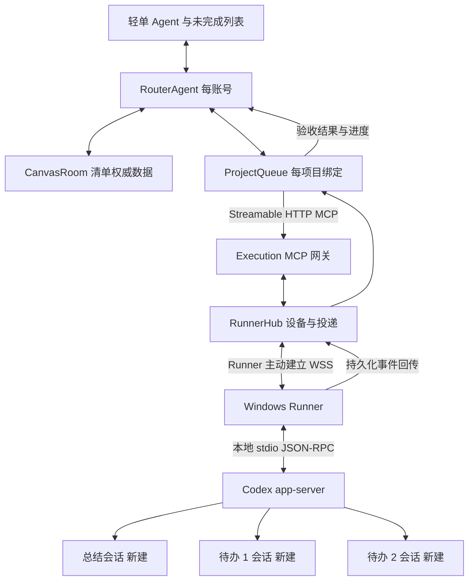

# 轻单 Router 与本地 Codex 实现设计

日期：2026-11-03。适用代码库：`D:/TODO/qingdan-canvas`。本文定义第一版行为、接口和一致性规则，配套开发任务见 [实施计划](D:/TODO/qingdan-canvas/docs/superpowers/plans/2026-11-03-qingdan-router.md)。文中的阈值和技术默认值是本方案的实施选择，可配置；用户已经确定的产品流程列在第一节。

## 1. 已确定的产品流程

轻单内置 Agent 承担聊天、记忆、需求整理和调度。执行端运行在用户自己的 Windows 电脑，使用本地项目与本人的 Codex 登录。

1. 打开 Agent，读取本机 Codex 会话元数据，按工作目录展示候选项目，用户选定项目。
2. 在绑定项目中**新建总结会话**，只读检查当前项目并返回进度摘要；收到摘要后进入项目聊天。
3. 用户正常聊天，Agent 根据当前项目摘要、相关记忆和对话回答。
4. 用户要求整理清单时，直接创建真实的未完成待办，并按依赖与优先级排序。
5. 用户发出“开始执行”后，派发第一项：在绑定项目中**新建一个执行会话**。
6. 当前待办通过预设验收后，更新完成状态，在同一项目中**再新建会话执行下一项**，直到队列结束。
7. 同一待办的澄清、恢复和修复可以继续其自己的执行会话；不同待办使用不同会话。新的项目总结也使用新会话。

“绑定项目”在第一版指绑定已授权的本地工作目录，持久化 `workspaceId`；历史 `threadId` 只用于展示和可选上下文来源。执行不复用选项目时看到的旧聊天。新会话不会自动继承其他聊天，必须显式提供上下文包。

第一版支持一个执行所有者、一台电脑、多个项目；每个规范化工作目录同时运行一个轻单任务。现有画布协作继续存在，其他成员只能看到共享待办与可公开的进度，私人聊天、个人记忆和设备控制权属于执行所有者。

## 2. 方案选择与接入边界

采用 **Cloudflare Agents SDK Router + 云端异步执行 MCP + 出站本地 Runner + Codex app-server**。

| 方案 | 适用性与取舍 |
| --- | --- |
| 本地 MCP 服务经 Tunnel 直连 | 实验代码少；电脑离线时工具端点不可用，排队和回执仍要另建 |
| 云端 MCP 网关加本地 Runner | 本方案；任务意图、离线排队和回传记录在云端，执行环境留在本机 |
| Router 直接绑定 Codex JSON-RPC | 少一层适配，但 Router 与 Codex 协议耦合，无法维持用户要求的统一 MCP 执行接口 |

当前 `codex mcp-server` 已移除。执行 MCP 是轻单自建的服务，内部再转换到 app-server 的 JSON-RPC。官方仍将 app-server 标注为实验接口，首版作为个人使用版本锁定协议、完成真机验收后启用。[Codex MCP 迁移说明](https://learn.chatgpt.com/docs/mcp-server)

已检查的本机基线是 Node.js `24.18.0`、Codex CLI `0.166.0-alpha.5.1`；它们是验证起点，不代表已经跑通集成。按所用 CLI 生成协议类型并固定版本。既有 Codex 登录能否在 Runner 启动方式下正常使用、新线程在桌面端是否可见，都属于第一项真机验收。

产品项目归属以 `workspaceId -> canonicalRoot -> thread.cwd` 为准。app-server 的公开接口与 Codex 桌面的内部项目管理工具不是同一套 API；不能把本聊天可用的桌面插件工具当作产品后端依赖。桌面侧原生项目分组的展示方式在验证记录中单独记录。

## 3. 架构与职责



| 组件 | 权威数据与职责 |
| --- | --- |
| RouterAgent，按 accountId 寻址 | 聊天消息、个人/项目记忆、检索、模型工具循环、生成清单的意图 |
| ProjectQueue，按 bindingId 寻址 | 项目摘要版本、执行批次、当前运行、任务快照、完成判定、事件 inbox 和投递 outbox |
| CanvasRoom，现有每画布一个 DO | 待办正文、done、arrangedOrder、版本；新增执行规格与计划版本，同一次事务写入 |
| RunnerHub，按 runnerId 寻址 | 设备连接、命令投递回执、事件去重、工作目录执行租约；运行结果只是投递记录，业务状态由 ProjectQueue 决定 |
| D1 | 现有账号/权限，加设备注册、项目绑定、可撤销执行授权和查询索引 |
| R2 | 大型日志与附件；关系型状态只保存带权限的引用、摘要和哈希 |
| Runner 本地 SQLite | 工作目录注册、收到的命令、thread/turn 映射、待上传事件、进程与工作目录锁 |

RouterAgent 使用 Agents SDK 的 `Lifecycle`、`State`、`WebSockets`；ProjectQueue 使用 Lifecycle 与 Scheduler 处理重投、超时和恢复，使用 MCPClientManager 调用执行网关。模型循环由轻单控制，避免默认加载命令行或任意文件执行工具。[Cloudflare 接入方式](https://developers.cloudflare.com/agents/getting-started/add-to-existing-project/)、[MCP Client](https://developers.cloudflare.com/agents/model-context-protocol/apis/client-api/)

新增独立 DO 类，不把 Lifecycle 直接装进已有 CanvasRoom：当前 CanvasRoom 已有自己的 fetch 和 alarm，且其 alarm 服务于删除恢复。SDK 生命周期与现有 handler 必须明确协作，第一版通过独立 DO 避免互相覆盖。

DO 可以休眠。所有进度依据存储和事件恢复；浏览器打开、模型请求仍在进行、本机在线，都不能代替持久化状态。

## 4. 项目发现与首次总结

### 4.1 项目绑定

Runner 首次通过轻单账号进行设备配对。用户在本机选择允许的目录，Runner 解析真实路径，创建不可由模型伪造的 workspaceId，并注册检查命令的 checkId。Windows 路径别名、大小写、junction 和目录边界在本地规范化检查。

项目列表来源是已注册目录与 Codex 会话元数据。读取 `thread/list` 时分页，并显式覆盖需要的来源类型，包括 CLI、IDE、exec、appServer；不能依赖默认过滤得到所有会话。只把授权目录内的标题、时间、cwd 和状态发到轻单。无历史会话的目录也可手动加入。

用户选择的是项目。历史会话是辅助信息，不要求选一个旧 thread 作为执行目标。目录、设备或绑定变更后增加 bindingRevision，旧队列不会自动迁往新目录。新绑定只在原 activeRun 已终止并完成对账后生效；“做完当前项后暂停”期间还不能切换执行目标。

### 4.2 总结请求

调用 `codex_create_run(kind=summary)` 后立即得到 runId。Runner 在指定 cwd 调用 `thread/start`，保存 threadId，再以只读权限发起 `turn/start`，命名为“轻单 · 项目总结 · 日期”。

总结输入包含项目根目录标识、已有轻单项目摘要、用户明确允许提供的历史摘要。首轮默认检查项目说明、AGENTS、关键目录、Git 分支和变更状态，并区分已验证事实、历史说法和推测。没有自动执行实现任务、安装依赖或推送代码的要求。

总结返回结构固定为 `overview`、`completed[]`、`inProgress[]`、`pending[]`、`blockers[]`、`verification[]`、`uncertainties[]`，每项可附 evidenceRef。Runner 补充真实 cwd、Git 基线、threadId、turnId、capturedAt，模型不能替换这些字段。

ProjectQueue 保存新的 summaryRevision，Router 才把该项目标记为 ready。超时或失败显示原因和重试入口；旧摘要只能在用户选择“使用上次摘要”后使用，并显示时间。首次绑定、显式新建一个轻单项目聊天、点击刷新项目进度，会创建新的总结会话。页面刷新或返回同一个 chatId 恢复已有初始化状态和最近事实增量；重放同一次请求不重复创建，也不会打断执行期间的正常聊天。

同一目录已有运行时，总结排队等待空闲，防止读取一半修改中的状态。摘要不会宣称覆盖未读取的历史聊天。

## 5. 聊天与记忆

### 5.1 正常对话

聊天消息先保存，再调用模型；流式文本通过 WebSocket 回传。每个 messageId 都有回执，断线重发不产生第二次同内容操作。原始对话按账号、项目、chatId 隔离。当前项目切换只改变对话视图，不改变正在执行的队列目标。

Router 的意图有 `chat`、`create_plan`、`reorder_plan`、`edit_task`、`start_queue`、`pause_queue`、`resume_queue`、`refresh_summary`。普通讨论只回答；明确“整理成清单”才调用创建；明确“开始执行”才激活队列。工具参数经 Zod 校验，账号身份、目标权限、当前计划版本由服务器确定。

首版采用可替换 ModelPort，默认接 OpenAI Responses API，`ROUTER_MODEL` 与独立的 `OPENAI_API_KEY` 配置在云端；不把本机 Codex 登录令牌上传用于 Router。模型名是部署配置，先测试其工具调用与结构化输出能力。每轮最多 6 次工具步骤；达到上限保存状态并返回解释，后台长任务不占用模型连接。[Responses 工具调用](https://developers.openai.com/api/docs/guides/function-calling)

### 5.2 记忆层级与生命周期

| 类型 | 内容 | 写入规则 |
| --- | --- | --- |
| user_preference | 语言、交互习惯、常用执行方式 | 明确表达或用户手工保存；不能推测凭据、权限或自动执行许可 |
| project_decision | 确认过的目标、技术选择、产品约束 | 保存来源消息 ID、项目 ID、版本；后续明确更正使旧版本失效 |
| chat_summary | 长对话的阶段摘要 | 累计新增内容超过 12,000 字符后压缩早期消息，保留最近 12 条原始消息 |
| project_snapshot | Codex 项目总结与任务完成后的进度增量 | 每条带来源运行、时间、证据及 summaryRevision |

`MemoryRecord` 字段：id、ownerId、projectId（个人偏好可为空）、kind、key、value、sourceRefs、status（active/superseded/deleted）、revision、updatedAt。第一版 projectId 取 bindingId；同一目录在不同画布中的绑定不会自动共享私人项目记忆。记忆更新采用 expectedRevision。任务完成事实来自运行事件；模型提出的长期记忆先作为候选，只将符合上述来源规则的条目激活。

每次回答构造上下文：系统规则 + 最近对话 + 当前项目最新有效摘要 + 相关明确决策 + 个人偏好。候选记忆按项目/类型/关键词查询并限量，首版不依赖向量数据库；同时对中英文输入保留关键词检索降级能力。

硬上限：组装文本输入最多 48,000 字符；最多注入 12 条长期记忆、每条 1,000 字符。优先保留用户当前要求和执行约束，超长资料用引用按需读取；不能静默截断改变权限或验收含义。上述是输入控制阈值，不等同于 token 数；记录真实用量用于调参。

记忆面板支持查看来源、修改、删除和项目记忆清空。忘记与删除原始聊天是不同操作。原始聊天默认保留到用户删除；运行事件保留 90 天，详细附件保留 30 天，保留期为本方案默认值且应在设置中可见。

忘记不能只删 MemoryRecord：Router 在同一事务写入 `memory_tombstones(key, sourceRefs, deletedAt, memoryEpoch)` 并增加账号 memoryEpoch。消息、阶段摘要、项目摘要分段和前序任务增量都维护来源链；含被遗忘来源的段落立即禁止注入，重新生成后才恢复。第一版采用保守的来源级排除：包含该内容的历史消息或段落整体退出自动检索、摘要和记忆提取，用户仍可主动查看原文。被删除 key 的自动提取被抑制，只有用户后来明确重新提供并要求记住的新输入才能恢复。

ProjectQueue 的上下文包记录 memoryEpoch 与 sourceRefs。派发前读取 Router 当前 epoch；不一致就重新组装，不发送旧包。历史项目摘要、任务增量和聊天压缩均使用同一过滤规则，不能通过另一个存储重建被遗忘条目。如果移除来源会破坏任务必需约束，则暂停该项，要求明确更新任务要求。

已经发送到 Codex 会话的内容无法通过云端删除撤回。忘记操作展示受影响的活动运行，暂停它们后续自动续轮和派单；用户可以停止原运行并明确创建使用干净上下文的新 attempt。现有会话历史和审计快照不静默改写。

### 5.3 给每个新 Codex 会话的上下文包

包括：项目摘要及版本、与本项相关的项目决策、本条待办要求、验收条件、已完成前序任务的交付摘要、允许目录与检查命令标识、当前 Git 基线。只发送需要的资料，不把全账号聊天作为执行上下文。

上下文包使用不可变 snapshotId 和内容哈希保存。下一项以“初始摘要 + 已验收任务增量”构造新快照；后台润色项目摘要失败不阻止事实增量更新，也不会丢失前项结果。涉及新的关键约束时必须保存后才能派发。

## 6. 清单生成、排序与现有画布集成

### 6.1 数据归属

现有画布正文是 CanvasRoom SQLite 中的权威数据。块字段只有 text/runs、done、日期、arrangedOrder 等；`shared/canvas-contract.js` 会剔除未声明字段。因此新增执行规格放在 CanvasRoom 的 `agent_task_specs` 表，通过 taskRef 关联，不把任意 JSON 塞入现有块。

`taskRef = { canvasId, noteId, taskId }`。每个 Plan 有 planId、ownerId、bindingId、目标 sectionId、planRevision。TaskSpec 有 taskRef、planId、instruction、acceptance[]、dependsOn[]、priority（0 最紧急，至 3）、sourceTextHash、specRevision、specHash、specStatus（ready/stale）、createdByMessageId。taskId 使用服务端 ID；模型临时 ID 在事务内统一映射。

显示在待办上的正文和备注是当前用户要求的权威来源；instruction 是基于该正文生成的补充执行细节，必须记录 sourceTextHash。specHash 包含规范化正文、引用、备注、instruction、验收与依赖，排除布局和 done。普通编辑、公共 MCP、撤销/恢复等所有写入入口最终在 CanvasRoom.commitChanges 中比较语义：正文/备注/引用变化会将已有关联规格标为 stale，增加规格和计划版本，并在同一事务写出变更事件。当前运行继续持有旧快照，但禁止自动认定新版任务完成。

所有者采用新版要求时，必须重新生成或明确编辑 instruction 与验收，保存匹配最新 sourceTextHash 的完整 TaskSpec 才恢复 ready；单纯增加 planRevision 不能使旧规格重新有效。布局改动不使规格失效，done/删除/收纳走对应的队列协调事件。

生成使用一个语义命令 `create_agent_plan`：验证目标与权限、限制最多 50 条、检查依赖图、生成未完成块、写规格和初始顺序、写操作回执与事件 outbox，在同一 CanvasRoom 事务提交。全部新块 `done=false`。超过 50 项由 Agent 解释并建议拆成多个计划，不先写一半。

PlanRevision 覆盖规格、依赖和排序；便签 revision 继续覆盖原有对象。创建、改写和排序需要两者的当前版本；相同 requestId/相同参数返回原回执，相同 ID 换参数报错。

### 6.2 排序规则

依赖是硬约束，先检查不存在的依赖和环。对当前可选节点做稳定拓扑排序，排序键为：用户显式顺序（存在时）、priority、dueAt（无日期最后）、原始顺序、稳定 taskId。依赖始终优先于排序键。用户手工拖动后的顺序只要满足依赖就原样保存；不合法时返回具体依赖冲突，保留原顺序。

相对日期按用户时区解释，本用户初始为 Asia/Shanghai；存储使用带时区输入归一化后的 UTC ISO 时间。日期变化会更新计划排序版本，不直接证明执行内容已经变更。模型返回的时间必须经现有日期校验后才能保存。

持久化顺序落到现有 `arrangedOrder`，前端直接呈现真实顺序。一个执行计划限定在一个目标 section 内；section 中非本计划待办保留相对位置，计划任务用其原来占据的槽位重排，避免覆盖其他人的待办。生成的新计划任务作为连续组追加。规范化时最多修改 200 个便签，遇锁定目标或超限返回解释。

现有“DDL 排序”在无 Agent 计划的列表中维持原行为。含计划时仍先计算原有截止时间顺序，但在提交前校验所有受影响计划的依赖；合法则保存并增加各计划版本，不合法则拒绝整个排序并显示“该顺序与任务依赖冲突”，提供单独的“按依赖和截止时间排序”入口。服务端 commitChanges 同样校验，避免前端、公共 MCP 或其他设备绕过。显示顺序与执行顺序不分成两套。所有者的显式合法排序可同步采用未派发部分；协作者改序暂停自动派发，等待所有者采用。

新增受权限保护的业务命令 `reorder_agent_plan`。现有公共 MCP 没有排序参数；如需对外提供排序，新增明确的 `reorder_tasks` 工具并更新其 schema、授权、回执和契约测试，不能直接传入旧 `update_task` 未支持的字段。内置 Router 可以通过内部业务命令完成第一版，不依赖先扩充外部九工具。

### 6.3 执行中的修改

开始队列时快照本次授权的成员集合与计划版本。执行所有者调整未派发任务的顺序或规格后，更新版本，并由显式操作同步队列；新增待办默认仍是未开始，只有“加入本次执行”才进入活动队列。

当前任务的要求快照冻结，修改时在 UI 显示“本轮仍按原要求执行”，提供暂停并追加要求。协作者修改已授权任务的语义内容时暂停待派发部分，等待所有者采用新版；布局改变和无关任务改动不会触发暂停。

手工勾选尚未派发的任务记录为人工完成并跳过，依赖可以按人工完成满足；重新打开已完成任务不会自动执行第二次。删除、收纳或锁定待执行任务会暂停队列并说明。已派发任务被删除不表示本地工作已停止，需要走取消流程。

## 7. 状态与关键记录

| 记录 | 主要字段与约束 |
| --- | --- |
| ProjectBinding（D1） | bindingId、ownerId、canvasId、sectionId、runnerId、workspaceId、revision、authEpoch、enabled；修改目标须暂停原队列 |
| QueueBatch（ProjectQueue） | batchId、bindingRevision、planId、adoptedPlanRevision、authorizedTaskIds、state、activeRunId、queueRevision、startedBy |
| ExecutionRun（ProjectQueue） | runId、kind（summary/task）、taskRef 可空、snapshotId、specHash、status、attempt、threadId、activeTurnId、resultRef、verifyState |
| Inbox/Outbox（各持有者） | eventId/commandId 唯一、payloadHash、sequence、状态、重试时间；与对应业务变更同一事务写入 |
| RunMapping（Runner） | runId 唯一、threadId、turnId、launchIntent、receivedCommands、事件 seq、workspaceLock |

批次状态：draft、running、paused、blocked、completed、cancelled。运行状态：queued、preparing、running、waiting_input、waiting_approval、verifying、finalizing、succeeded、failed、cancel_requested、cancelled、reconciliation_required。设备连接 online/offline 是独立属性，不能用 offline 覆盖真实执行状态。

只允许当前批次 `activeRunId` 对应的结果推进队列。每个运行可有多个 turn（澄清、修复），正常新任务必须有全新的 threadId；继续同一任务不允许重新建线程造成上下文丢失。超限或协议错误默认暂停，用户可选择继续该任务或创建显式的新 attempt。

## 8. MCP 与 Runner 协议

执行 MCP 地址为 `/executor-mcp`，与现有 `/mcp` 区分，避免被现有前缀路由截获。使用 `agents/mcp/server` 的 stateless handler 和 Streamable HTTP。工具名称均为轻单自定义。

| 工具 | 输入要点 | 返回 |
| --- | --- | --- |
| codex_list_projects | runnerId、cursor | 授权 workspace 元数据及历史会话摘要；本机离线返回带 capturedAt 的缓存 |
| codex_create_run | requestId、runId、bindingId、bindingRevision、kind、snapshotId、payloadHash | 已持久化的 runId、status；不等待 Codex 完成 |
| codex_get_run | runId、afterSeq | 状态与有界事件页、完整结果引用 |
| codex_continue_run | requestId、runId、expectedTurnId、message、mode（reply/steer） | 已接收的 commandId；同一任务延续已有会话 |
| codex_cancel_run | requestId、runId | cancel_requested；确认停止后再返回最终状态 |

snapshotId 指向服务端已保存且已校验的快照。网关不接受任意 cwd、账号 ID、认证密钥、shell 命令或模型指定的执行许可。调用 create_run 必须有已存在的授权批次，或经初始化/刷新动作创建的 summary intent；模型不能直接绕过队列启动代码执行。

云端客户端使用短期内部执行凭证，claims 绑定 owner、binding、用途、audience=/executor-mcp、到期时间和 authEpoch；网关校验实时授权版本。该凭证与已有画布 OAuth grant 分开，不扩大旧 `qingdan:write` 的权限。执行网关初版只供自家云端控制器使用。

Runner 主动连接 `/api/runner/connect`。设备配对码单次有效、10 分钟过期；配对后设备密钥保存在 Windows Credential Manager，云端保存校验材料与撤销状态；短期连接 token 默认 15 分钟。设备撤销立即关闭在线连接并失效后续凭证。

命令信封：protocolVersion=1、commandId、runId、bindingRevision、authEpoch、leaseEpoch、payloadHash、issuedAt、expiresAt、payload。事件信封：protocolVersion=1、eventId、runnerId、runId、threadId、turnId、seq、type、occurredAt、payload。每次连接带 connectionEpoch，旧连接不能继续取得新命令。

事件类型包括 run.accepted、thread.created、turn.started、output.delta、approval.requested、input.requested、turn.completed、verification.completed、run.cancelled、heartbeat。输出 delta 可聚合且不作为可靠完成依据；最终输出、状态、审批和回执必须落地后再 ACK。断线从已确认序号补传；重连发现本地缺段时通过 Codex 持久化轮次历史重建最终状态。

默认 heartbeat 15 秒，45 秒无心跳显示离线。执行许可租约 60 秒，由在线 Runner 每 15 秒续期；过期后本地请求中断，不开启下一项。云端失联不能保证已经发出的外部操作撤回，UI 保持状态待核实，直到本机对账。

## 9. 本地 Codex 适配器

Runner 使用 Node.js 24，在用户交互登录的 Windows 账号下运行；开发期前台调试，安装后可作为隐藏的登录启动任务运行。调用经验证的 Codex 可执行文件，沿用该用户登录与配置；不以 SYSTEM 身份启动，也不复制认证文件到云端。

首版由 Runner 管理自己的 app-server stdio 子进程，使用同一用户的已配置 Codex 环境。新会话需求不要求接管用户正在进行的旧聊天。启动与现有桌面版本共存、线程存储可见性，需要真机测试。普通 Workers 不承担 Codex 本地子进程执行。

| 产品动作 | app-server 调用或事件 |
| --- | --- |
| 初始化连接 | initialize / initialized |
| 列出项目候选 | thread/list，按 cwd 与来源筛选 |
| 总结或新待办 | thread/start 指定绑定 cwd；保存 ID；turn/start |
| 标题 | thread/name/set，标题包含简短任务名称和 runId 标记 |
| 恢复同一任务 | thread/read、thread/resume，按需分页历史 |
| 同一任务追加 | 空闲用 turn/start；正在运行用 turn/steer 和 expectedTurnId |
| 中断 | turn/interrupt；等待事件与进程收尾 |
| 观察 | turn/started、item/*、turn/completed、审批与输入请求 |

这些接口的实际字段由固定版本生成的类型约束；启动后先执行能力检查，版本不匹配时禁用自动派单并给出修复信息。[app-server 协议](https://learn.chatgpt.com/docs/app-server)

summary 使用 read-only；task 使用获授权的项目写权限，保留 AGENTS 约束与审批策略。不能默认提升为 danger-full-access。项目部署若要求人工执行，Agent 必须遵守，执行器不替用户绕过它。

运行快照固定项目目录和 Git 基线，派发前核对。如果分支、HEAD、受影响任务规格或目录绑定发生变化，先暂停对齐。已有未提交更改记录到基线，不能自动 reset/clean 或 stash 掉；第一版保持同一工作目录串行执行，让前项文件修改自然供后项使用。

## 10. 完成判定与自动推进

### 10.1 验收数据

TaskSpec.acceptance 是必填的有序条件数组。每个条件有 id、description、required 和 kind：

- command：引用用户在绑定项目时登记的 checkId，Runner 在真实目录运行固定 argv，记录退出码和输出哈希。模型不能把任意文本升级成自动执行命令。
- artifact：检查指定项目内产物存在、类型及必要内容约束，保存证据引用。文件存在只能证明该条条件，不能代替功能验收。
- human：明确需要主观或人工判断，进入待验收，不能自动宣称通过。

Codex 末轮返回 RunOutcome：runId、taskId、outcome（done/blocked/needs_input/failed）、summary、changedFiles、evidenceRefs、remainingIssues、nextTaskNotes。能使用 outputSchema 时约束结构；否则通过严格解析读取最终消息。格式不合法最多发一次“补充结构化结果”请求，继续同一任务会话，仍不合法则暂停。

自动完成必须同时满足：

1. 对应当前 activeRunId、threadId 和预期 turnId 的轮次正常结束。
2. 最终结果为 done；没有未解决的输入或审批请求。
3. 所有 required 条件有可核对的通过证据；Runner 的验收命令已经结束。
4. 当前任务规格哈希仍等于执行快照；计划/授权仍有效。
5. CanvasRoom 接受本次完成写回并返回持久化回执。

turn/completed 只是轮次结束事件，还可能携带 failed/interrupted；模型普通回复、进程仍存活或命令 exit 0 均不单独等于任务完成。UI 显示具体哪些检查通过，自动验收不承诺覆盖所有潜在软件缺陷。

### 10.2 推进算法

控制器用代码状态机推进，模型只负责计划、解释和必要的语义判断。

```text
接收可靠事件 -> 保存 inbox（eventId 去重）
校验 runId / threadId / turnId / 阶段 -> 保存运行结果
运行验收 -> 通过后进入 finalizing
向 CanvasRoom 提交 finalize_task_run（使用稳定 requestId）
收到画布完成回执 -> 标记 succeeded，记录事实增量
核对批次仍为 running、授权有效、无占用目录
读取最新已采用计划版本，挑选第一条依赖已满足的 pending
保存新 run + context snapshot + create_run outbox
事务提交后通过执行 MCP 投递 -> Runner 新建下一个会话
```

CanvasRoom 的 finalize_task_run 校验任务存在、未被收纳/锁定、语义哈希和当前授权，并保留原作者与其他任务字段。因为另一个块修改导致便签 revision 变化时，可以重读并重新计算当前 revision，但必须再次证明本任务语义没变；语义冲突暂停。已人工勾选且语义未变时返回幂等“已经完成”回执。

跨 DO 没有单次全局事务：本次执行成功后，写回失败就停在 finalizing，只重试写回；不得再次运行 Codex。ProjectQueue 在取得画布回执之前绝不派下一项。记忆增量更新使用相同 runId 去重，运行历史是事实依据，摘要压缩失败可以稍后重试。

用户说“暂停”默认表示做完当前项后暂停；“立即停止”请求中断当前项。取消的确认来自执行端及其受管子进程收尾，不能在请求发出时显示“已经停止”。审批、缺少输入和不可自动修复的失败暂停队列，其他项目聊天仍可正常使用。

自动修复仅适用于 required command 明确返回非零、或 artifact 明确不满足条件，且当前权限、任务规格、工作目录基线仍有效、没有待回答问题、repairCount=0 的情况。控制器先持久化 repairCount=1 和修复命令，再在原任务 thread 新开一轮，提供失败证据；下一项始终等待。修复后重新运行全部 required 检查。第二次验收失败、human 条件未通过、模型明确 blocked/needs_input、配额/认证/网络错误、未知执行状态都暂停，不消耗模型循环“试试看”。普通超时和中断不属于自动修复条件。

## 11. 投递、恢复与并发控制

### 11.1 持久化与不确定发送

每层采用 at-least-once 投递、幂等接收和最终对账。MCP requestId、commandId、eventId 不混用；相同 ID 的 payloadHash 变化属于协议错误。不能宣称 shell 或外部副作用具备通用 exactly-once。

Runner 保存创建意图后调用 thread/start，拿到 threadId 必须落盘才允许发 turn/start。若创建线程响应丢失，可能产生一个未执行的空线程；允许记录并人工清理，不能因追求“没有空线程”而重放未知执行。

turn/start 发送前落盘 launchIntent。如果确认响应丢失，先从已知 thread 的通知和分页历史核对，利用输入中的 runId/commandId 标记关联轮次。无法证明是否已经启动时，进入 reconciliation_required，禁止自动重发；显示“启动结果待核实”。JSON-RPC 的 id 是响应关联，不当作服务端幂等键。

### 11.2 重连与故障

| 情况 | 恢复行为 |
| --- | --- |
| 轻单页面关闭/刷新 | 浏览器重新读取云端快照与后续序号；队列继续由云端驱动 |
| Runner 网络断开 | 显示离线，事件本地落盘；租约到期请求中断，不开新任务 |
| Runner 重启 | 先加载 SQLite 与工作目录锁，查询已知 thread/turn，完成对账后才接新派单 |
| Codex app-server 退出 | 恢复已有 thread，核实上次轮次；只在确定未完成且用户/策略允许时继续该任务 |
| DO 休眠/重启 | 从 inbox/outbox、运行状态和 Scheduler 恢复；不依赖内存 Promise |
| 收到重复完成事件 | 返回已有处理回执，不重复勾选、写记忆或创建下一会话 |
| 权限撤销 | 拒绝新派单和写回、通知在线 Runner 中断；失联时依靠本地租约中止，保留待核实状态 |
| 配额不足或认证失效 | 队列进入 blocked，保留原任务会话，用户修复后再恢复 |
| 运行结束但画布写回暂不可用 | 保持 finalizing，重试业务写回；不重新执行任务 |

### 11.3 同目录互斥

云端 RunnerHub 按 workspaceId 发放带递增 leaseEpoch 的执行许可，本地按规范化 Git 工作树根或实际目录根持有排他锁。不同绑定指向同一目录时共用锁，多个 Runner 进程不能同时获得它。旧 epoch 命令被拒绝；旧运行迟到结果可归档用于对账，不能推动新批次。

连接断开或租约过期不能被视为目录已释放，必须核实旧运行已停止。第一版不自动切换设备执行失联任务。绑定目录中的外部编辑或用户手动启动的其他工具不在该锁的控制范围内；检测到影响 Git 基线或任务范围的外部变化时暂停并提示。

## 12. UI 与控制权限

Agent 入口包含项目选择器、摘要卡片、聊天区、记忆入口和队列控制条。现有未完成列表显示顺序、依赖、执行状态、当前会话链接或 ID、最近结果；点击任务可查看要求、验收条件和证据。

项目初始化状态：未绑定 -> 设备待连接 -> 获取项目进度 -> 聊天就绪。执行队列运行时仍允许聊天；影响运行的工具调用携带明确的 planId、bindingId 和 expectedRevision，不根据浏览器当前标签页猜目标。

语义按钮：生成清单、开始执行、做完当前项后暂停、立即停止、继续、重试当前项、刷新项目进度。重试先复用原任务会话与状态；创建新 attempt 必须是明确动作，保留旧证据。正常通过的项目自动勾选；human 类型条件显示待验收。

审批通过专用 `/api/agent/approvals/:id/respond` 处理，绑定 owner、runId、threadId、turnId、requestId 和有效期。Router 模型没有通用“批准自己请求”的工具。重连或轮次变化后的旧审批答复不能被重新套用。

所有内部业务调用使用服务端构造的 AgentActor（ownerId、bindingId、authEpoch、actionScope）。不得伪造已有 OAuth grant 来调用 CanvasRoom。当前成员权限、设备归属、目录绑定和执行范围在最终提交前重查。

只向共享画布广播任务状态、摘要与已选择的产物引用。个人记忆、原始聊天、本地绝对路径、凭据和完整命令日志不通过画布广播。日志默认脱敏且不保存模型内部推理内容。

## 13. 与现有代码的连接点

| 路径 | 计划改动 |
| --- | --- |
| worker/index.ts | 先路由 executor MCP、Runner Bearer 接口、Agent 浏览器接口，再进入现有 MCP 和网页路由；导出新增 DO |
| worker/types.ts、wrangler.jsonc | ROUTERS、PROJECT_QUEUES、RUNNER_HUBS 新绑定和追加 SQLite DO migration；保留现有 v1；增加 `/executor-mcp` 静态资源优先匹配 |
| worker/room.ts | 挂接 Agent 语义命令、规格表、计划版本与同事务 outbox，继续使用 commitChanges 和现有广播 |
| worker/canvas-commands.ts | 复用已有待办创建/修改规划函数；Agent 专属组合命令放独立模块 |
| worker/mcp/* | 保持现有九工具语义；仅在明确增加公共排序时扩展 schemas/tools，不把执行授权并入画布读写授权 |
| shared/canvas-contract.js | 保留现有字段允许表；执行规格通过专用 DTO 获取，不偷偷向块中写入未支持字段 |
| src/CanvasWorkspace.jsx、src/canvas/ArrangedWorkspace.jsx | 加 Agent 面板、项目绑定和状态展示；拖动排序走同一个有版本的排序业务入口 |
| src/canvas/arranged-model.js | 提取可复用的顺序计算；无计划时保留 DDL 行为，有计划时执行依赖校验，冲突整次拒绝 |
| src/sync/* | 复用既有协作更新；所有 update 提供 source，不能绕过合并和操作回执 |
| migrations/0007_agent_bindings.sql | 新增设备、目录绑定、执行授权、索引；实际编号在开工时核对，当前最大为 0006 |

建议新增目录：`shared/agent/`（契约、排序）、`worker/agent/`（Router、记忆、业务适配）、`worker/execution/`（队列、网关、设备连接）、`runner/`（本机执行器）、`src/agent/`（产品界面）。具体文件与接口见配套实施计划。

## 14. 默认配置与成本控制

| 配置 | 第一版默认 |
| --- | --- |
| AGENT_ENABLED / EXECUTION_ENABLED | false；分别开关聊天与执行 |
| EXECUTOR_PROTOCOL_VERSION | 1 |
| Node.js | 24 系列；当前验证起点 24.18.0 |
| Codex CLI | 先验证 0.166.0-alpha.5.1，通过后固定该协议与安装版本 |
| agents / MCP client / MCP server | 沿用 0.30.1 / 2.3.1 / 2.3.1，升级需单独联调 |
| 每次生成 / 活动批次 | 最多 50 条；每绑定一个活动批次 |
| 并发 | 同目录 1；每台设备默认 1，可明确配置后增加不同目录并发 |
| 总结超时 / 单次任务上限 | 5 分钟 / 30 分钟，达到后请求中断并等待确认 |
| 单任务自动修复预算 | 1 次同会话修复；明确 blocked 或 needs_input 不自动循环 |
| 网络重试 | 1、2、4、8、16、30 秒上限，附随机抖动；已过期命令不重放 |
| 心跳 / 离线 / 执行租约 | 15 秒 / 45 秒 / 60 秒 |
| 详细日志 / 运行事件保留 | 30 天 / 90 天；用户可主动删除 |

Router 只对用户语义请求、重要阻塞和完成汇总调用模型。心跳、状态刷新、事件去重、下一项派发和排序合法性使用代码。每个运行记录模型用量、耗时、检查结果、错误类别，日志以 runId 关联。Watchdog 首版每 60 秒检查待重试事件和异常状态，只有产生可行动变化时通知。

## 15. 开发顺序与验收

1. Codex 真机适配验证：列出授权项目，在同一目录连续新建总结、任务 A、任务 B 三个独立会话；验证 cwd、输出、事件和恢复。先确认接口，再铺 UI。
2. 契约与设备连接：鉴权、目录绑定、持久化命令/事件和本地互斥。
3. 项目初始化与聊天记忆：获取总结、正常聊天、检索/编辑/删除记忆。
4. 清单业务：原子生成、依赖排序、真实未完成列表和并发冲突。
5. 串行队列：每项新会话、独立验收、完成写回、自动推进、暂停/取消。
6. 故障恢复与 UI 联调：断线、重复事件、未知发送、权限撤销和跨项目隔离。

必须通过的端到端场景：选定项目 -> 总结会话 S0 -> 聊天生成 A/B/C -> 用户开始 -> A 在 S1、B 在 S2、C 在 S3 顺序执行。S0/S1/S2/S3 均不同，cwd 相同。B 只能在 A 验收通过且画布写回完成后启动；C 同理。最终三项完成、记忆含三项结果、原始用户旧会话没有被当作执行会话追加消息。

故障验收至少覆盖：重复 start；完成事件重放；thread 创建成功但应答丢失；turn 启动应答丢失；进程/网络中断；画布完成写回失败；任务语义被改动；协作者修改；路径越界；过期审批；删除记忆后的检索；排序环；锁定项；用户手工完成与重新打开任务；页面切换项目。

开发验证沿用独立 workerd 与临时数据库，运行 `npm test`、`npm run check`、`npm run deploy:check`。新增测试应验证状态机、一致性与权限，不用仅匹配源码字符串替代行为测试。真实 Codex 联调使用用户指定的测试目录和合成任务，记录实际 CLI 版本及观察结果，不把模拟测试说成真实模型执行。

## 16. 发布边界与交付物

先在隔离 preview 启用，生产初始两个开关均关闭。新增 D1 迁移先于代码发布；新增 DO migration 追加而非改写旧标签。部署仍由用户按仓库 AGENTS.md 手工执行。

回滚时先停止新批次、完成/中断活动运行并对账，再关闭 EXECUTION_ENABLED；保留聊天、队列与审计数据，不能为了回滚直接删表。Runner 升级与 CLI 升级分别校验协议版本，版本不兼容时停止自动派单。

完整交付包含云端 Router/队列/网关、本地 Runner 与安装说明、Agent 和清单 UI、记忆管理、故障恢复记录、接口文档、模拟及真机验收记录。第一版暂不引入多设备接力、并行 worktree、飞书/GitHub 事件或未经用户触发的主动代码修改。

本文交付的是实现设计；模型、价格与部署区域等运营配置由部署时选择。app-server 的实验状态、桌面会话可见性和具体权限行为在首个真机验证阶段记录，不能用单纯 HTTP/MCP 连通代替验收。

独立工程审阅提出的正文与执行规格同步、记忆删除传播、DDL 与依赖冲突、自动修复触发条件，已分别补入第 5、6、10 节并对应到实施测试。该审阅只检查设计可实施性，不代表产品功能已经实现或通过真机验证。
