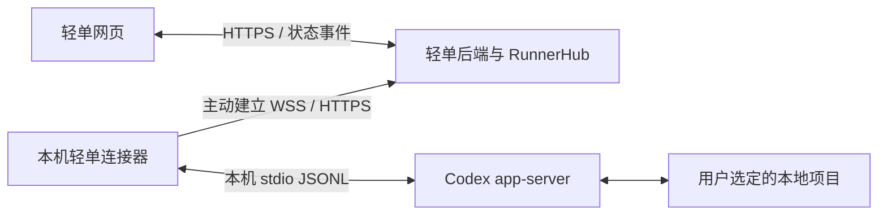

# 轻单网页版与本机 Codex 连接器设计

日期：2026-11-08。状态：设计提案，尚未实现。2026-11-08 根据用户要求补充故障兜底、恢复边界和故障验收。

## 目标与已确认的体验

轻单最终以网页交付。目前在本地运行，是开发阶段的部署方式。新电脑只需安装一次轻单连接器；连接器自动启动、发现该 Windows 用户的本机 Codex，并把设备状态提供给网页。用户选择已有 Codex 会话后，自动关联其项目目录；每次提交创建新的执行会话，不接着修改所选旧会话。

日常使用流程：打开轻单网页 → 进入 Agent → 看到已连接的电脑与 Codex 会话 → 选择会话自动关联项目 → 提交任务。

首次安装、轻单设备授权以及缺少 Codex 时的安装/登录仍需用户操作。普通网页不能独立扫描磁盘、启动任意本地程序，不能承诺“新电脑只打开网址，什么也不安装就能调用本机 Codex”。

设计默认：首版支持 Windows 11 x64、当前 Windows 用户安装；其他系统留待后续。正式域名、安装包签名身份和发布渠道在发布配置中确定。

## 方案比较与选择

| 方案 | 取舍 | 决定 |
| --- | --- | --- |
| 完整桌面应用，内含轻单界面 | 可以控制启动流程，但同时维护桌面界面与网页发布 | 用户明确最终为网页，不采用 |
| 网页 + 本机连接器主动连接服务器 | 界面仍在网页；复用当前 Runner，跨设备与账号管理一致 | 本设计采用 |
| 网页直接访问 localhost 服务 | 便于本地开发，但正式网站依赖本地跨源访问、端口和浏览器策略 | 保留开发诊断用途，不作为正式通信主路径 |

## 当前代码能复用什么

| 现有位置 | 已有能力 | 需要调整 |
| --- | --- | --- |
| [transport.ts](D:/TODO/qingdan-canvas/runner/transport.ts)、[router.ts](D:/TODO/qingdan-canvas/worker/execution/router.ts)、[hub.ts](D:/TODO/qingdan-canvas/worker/execution/hub.ts) | Runner 主动建立 WebSocket、设备令牌、心跳和服务端授权 | 增加受限的会话查询与项目关联请求 |
| [executor.ts](D:/TODO/qingdan-canvas/runner/executor.ts)、[execution-router.ts](D:/TODO/qingdan-canvas/worker/execution/execution-router.ts) | 执行轮询、回执、事件和恢复 | 复用；接入正式连接器生命周期 |
| [supervisor.ts](D:/TODO/qingdan-canvas/runner/supervisor.ts)、[codex-client.ts](D:/TODO/qingdan-canvas/runner/codex-client.ts) | 启动 Codex app-server，通过 stdio JSONL 通信 | 动态查找可执行文件、兼容版本管理 |
| [codex-sessions.ts](D:/TODO/qingdan-canvas/runner/codex-sessions.ts) | `thread/list`，不含 turns 的 `thread/read`，提取项目目录 | 从已授权设备通道调用 |
| [CodexSessionPicker.jsx](D:/TODO/qingdan-canvas/src/agent/CodexSessionPicker.jsx)、[DevicePanel.jsx](D:/TODO/qingdan-canvas/src/agent/DevicePanel.jsx) | 会话选择、设备关联、项目绑定 | 正式环境统一调用轻单后端；移除对 8790 的业务依赖 |
| [agent-install.mjs](D:/TODO/qingdan-canvas/scripts/lib/agent-install.mjs)、[dev-agent.mjs](D:/TODO/qingdan-canvas/scripts/dev-agent.mjs) | 本地启动/停止、进程身份校验和诊断 | 从源码开发启动器拆出可分发安装包 |
| [main.ts](D:/TODO/qingdan-canvas/runner/main.ts) | 独立无界面入口 | 显式注入正式服务地址、状态路径和执行开关 |

现安装器依赖源码目录、Node 与已安装依赖，并记录安装时的 Node/Codex 绝对路径；它尚未提供系统登录自启动。不能直接把当前项目目录压缩后当作新电脑安装包。

## 通信结构

WebSocket 建立后双向收发；图中箭头表示由连接器主动建立连接。无需公网访问用户电脑，也无需用户配置路由器或固定本地端口。

网页只访问轻单后端。服务器验证轻单账号、设备归属、项目权限后，向对应 Runner 转发允许的请求。Codex app-server 保持本地 stdio，不直接暴露给网页或公网。现有执行 HTTP 通道继续使用，不为了统一形式重写执行引擎。

开发阶段仍由 `npm run dev` 启动本地网页后端；连接器的 `serverOrigin` 指向 `http://127.0.0.1:8788`。正式包指向配置好的 HTTPS 域名。两者使用相同业务接口，不让前端根据部署环境猜测本地端口。

## 首次安装与设备关联

1. 网页 Agent 显示“连接这台电脑”，提供通用、签名的连接器安装包。包内不含用户身份或临时配对码。
2. 安装后立即启动连接器，展示登录时自动启动的设置，同时开始本机 Codex 发现。
3. 连接器生成新的安装身份及随机授权挑战，通过 HTTPS 向固定轻单后端发起设备授权，打开该后端的网页授权页。
4. 用户在轻单网页登录并确认把显示名称的这台电脑关联到当前账号。授权页只允许一次性、短有效期的请求，并显示来源电脑与目标账号。
5. 连接器凭自己持有的挑战证明领取设备授权；服务端原子消费授权、登记 owner/runner/authEpoch。网页获得设备编号，设备密钥只留在连接器的 Windows 凭据存储。
6. 连接器主动上线，网页选中此次绑定的设备，按状态进入会话选择或 Codex 安装/授权提示。

首版采用“连接器发起、网页确认、连接器轮询领取”的授权流程，避免把长期凭据放到浏览器 URL。具体协议可复用现有配对表和原子消费逻辑，但必须加入发起端挑战、有效期、限流、重放拒绝及严格的服务域名绑定。浏览器登录会话与设备密钥不互相替代。

注册 `qingdan://` 协议只用于用户点击后的唤起。参数仅允许固定动作和短期关联标识，不接受程序路径、任意服务器或 shell 参数。浏览器可能显示打开本地应用的提示；日常由自启动保证在线，不依赖网页静默唤起。

网页记住上次明确选中的设备。账号只有一台在线电脑也不能证明它就是当前浏览器所在电脑；没有本机授权上下文时显示“已连接：设备名”，允许选择其他设备，不能冒称“本机已连接”。

## 自动发现与 Codex 授权

连接器按次序查找：用户显式选定且仍有效的安装 → 上次验证成功的位置 → PATH 中的安装 → 当前用户官方应用的安装元数据和已知安装位置。缓存仅作为提示，每次冷启动重新验证；路径消失时重新发现，不能固定某个带版本号的 WindowsApps 目录。

发现器返回安装来源、真实路径、版本、配置档案标识和支持能力。只检查有限候选位置，不扫描全盘。候选需验证来源以及 `--version`、app-server 初始化和必要协议能力；不能仅凭文件名就执行任意程序。对多个有效安装保留之前选择；存在不同配置/账号且无法确定时只需选择一次，不悄悄切换账号。

读取会话使用用户已有 Codex 配置档案；尊重其 `CODEX_HOME` 配置，不复制或改写 Codex 凭据。路径、Windows 用户、Codex 配置档案和安装版本分别管理，不能把“找到程序”视为“执行已授权”。首次使用只查询会话元数据，不通过发送真实任务来探测连接。

将授权策略作为 Codex 适配器的一部分：当前本地验证模式检查现有 Codex 账户状态；正式网页发布时选择适用于该集成的官方授权方式。OpenAI 当前文档明确区分本地/开源集成与商业或托管服务的 app-server 身份认证；不能把本机开发验证中的既有订阅登录直接当作托管产品的授权方案。正式发布需完成适用的 Sign in with ChatGPT 接入资格及授权流程验证，或者选用符合官方要求的 API 授权路径。[官方说明](https://learn.chatgpt.com/docs/app-server#auth-endpoints)

官方提供用获授权的 OAuth token 配置 app-server Responses provider 的方式；该模式不要求额外 Codex 登录。实施时使用独立的 provider/auth 适配，不覆盖用户全局 Codex 配置，刷新与凭据处理由对应授权适配负责。[官方接入方式](https://developers.openai.com/siwc/token-sharing-open-source/codex-app-server)

此设计确认连接与发现架构；不把“已获得正式授权资格”或“所有 Codex 版本均兼容”列为已经完成的条件。正式授权可在同一安装向导中完成一次，后续有效期内自动续期；需再次授权时明确提示。

## 项目关联与每次新会话

新增逻辑操作为 `device.status`、`codex.sessions.list`、`codex.session.bind`。这是受限业务协议，不是透传任意 app-server 方法的代理。

会话列表默认每页 50 条，返回标题、时间、来源、项目显示信息和不透明会话标识；不取完整 turns，不批量上传历史内容。网页搜索和分页必须有参数大小与请求频率限制。查询结果在服务端短暂转发，不额外建立完整历史会话数据库。

选择会话时，连接器重新读取该会话的真实 cwd，检查目录存在、规范路径与既有项目权限规则，再保存本地 workspace 并创建轻单项目绑定。前端传会话标识和目标轻单项目，不让客户端提供的任意 cwd 成为执行依据。旧路径已失效则提示重新选择；没有历史会话时允许通过连接器本地文件夹选择器创建项目绑定。

每个请求带 `requestId`、设备连接代次和到期时间。查询默认 30 秒超时；重连后不把旧响应交给新请求。绑定是带幂等键的变更，响应丢失时查询结果或重试同一键，避免重复建 workspace。账号、设备、画布权限在后端和连接器两侧校验。

绑定成功后关闭选择器，提交沿用现有批次/执行队列，调用 `thread/start` 创建新会话。所选旧会话仅提供项目定位，不自动复制全文或调用 `thread/resume` 继续它。连接恢复内部恢复的是本次已有执行，不把一次提交变成第二次执行。

## 生命周期、安装包与升级

首版交付独立的当前用户安装包，内含连接器入口、编译后的 Runner、固定版本 Node 运行时与必需原生依赖。用户无需安装 Node/npm/Git，也无需拉取源码。原生依赖必须在无开发环境的干净虚拟机验证。

安装包不携带 Wrangler、开发服务器、`.tmp`、`.wrangler`、开发数据库、任何既有设备身份或 Codex 凭据。新安装生成新设备身份；旧开发状态不自动导入。保留既有项目文件与 Codex 安装。

使用当前用户登录自启动，不以 LocalSystem 身份运行。可采用 MSIX 的 StartupTask；Windows 会尊重用户在启动设置中禁用该项的决定，程序不能静默重新启用。最终打包工具由实现者选择，但必须实现相同安装、启动、签名、升级和卸载合同。[Windows 官方文档](https://learn.microsoft.com/en-us/windows/apps/desktop/modernize/desktop-to-uwp-extensions#start-your-application-when-users-log-in-to-windows)

连接器有单实例锁，后台启动不弹终端。保留一个小型托盘/设置窗口，提供设备与 Codex 状态、重新检测、登录/授权入口、启动设置、打开日志和退出；业务界面仍在网页。

持久状态统一放在当前用户 LocalAppData 下，以 `serverOrigin`、环境、轻单账号隔离；程序更新目录与数据目录分离。安装身份、设备密钥、工作区记录、执行日志和跨账号项目锁分别管理。初次授权前的数据使用独立未配对命名空间，授权后原子归入账号范围。

首版同一服务环境只启用一个轻单账号档案。网页切换账号不会改写原设备 owner，必须完成新的设备授权才能切换；活动执行或未解决执行状态存在时保留原档案并阻止切换。换账号不是删除旧状态，多个档案也不能绕过同一目录的执行互斥。设备撤销立即停止接收新任务；已有任务按现有安全中断/恢复规则处理。

网络断开按指数退避并加抖动重连。连接器重启先读取执行记录与租约、核对 Codex 状态，再决定恢复；状态不明确的任务显示需要处理，不自动再提交。只停止自己启动并确认身份的子进程。

更新包验证发布签名与完整性。更新检查可以自动进行，安装在无活动/未知执行状态时完成，保留可回滚版本；数据迁移采用向后兼容方案或先做本地备份。卸载移除启动项和协议注册，保留项目与 Codex；提供撤销设备和清除连接器数据的明确选项。

## 状态与故障文案

后端保留分开的连接、发现、兼容性、授权与执行状态，UI 根据这些状态解释原因，不用一个“电脑未连接”代替所有错误。

| 实际状态 | 网页表现与下一步 |
| --- | --- |
| 从未关联设备 | “连接这台电脑”，安装/唤起连接器 |
| 已知设备离线 | “设备离线”，显示名称、最后在线时间和唤起入口；不声称检测到未安装 |
| 连接器在线，未发现 Codex | “未找到 Codex”，提供官方安装入口，安装后自动重试 |
| 发现 Codex，但版本不兼容 | 显示版本与连接器更新入口；不误报账号问题 |
| 授权缺失或到期 | 显示对应的登录/授权操作 |
| 设备属于另一个轻单账号 | 显示账号不匹配，保留原绑定，进入明确的重新授权流程 |
| 可用但无历史会话 | 正常空列表，可选择本地文件夹 |
| 全部就绪 | “已连接：设备名”，显示会话选择器；已有项目绑定则直接使用 |

当前严格固定单个 Codex alpha 版本需要演进为经过验证的兼容清单与版本适配器。能力探测用于确认清单中的协议能力，不以一次握手通过替代完整兼容测试。未知版本可报告发现结果，但不得进入执行就绪状态。官方将 app-server 开发接口标记为实验性，因此兼容验证必须随连接器发布执行。[官方命令文档](https://learn.chatgpt.com/docs/developer-commands)

## 故障兜底与恢复合同

本节为首版必需能力。设计原则是自动恢复可确认安全的步骤、保留任务与用户数据、把无法确认的执行隔离出来。不能用“无限重试”“清空状态重装”或“换一台电脑执行”统一处理失败。连接恢复成功与任务执行成功分别报告。

已有 [executor.ts](D:/TODO/qingdan-canvas/runner/executor.ts) 的 dispatching/uncertain 记录、回执核对和恢复逻辑，以及 [dispatch.ts](D:/TODO/qingdan-canvas/worker/execution/dispatch.ts) 的请求去重可以复用。下面列出的是完整目标合同；不能因为已有这些基础能力，就宣称所有故障场景已经实现或通过验证。

### 分层处理与明确出口

| 故障 | 自动处理 | 用户仍可采取的操作 / 必须保留的状态 |
| --- | --- | --- |
| 安装失败、启动被系统阻止、自启动被禁用 | 保留安装日志；可重试未完成的安装阶段 | “修复安装”“手动启动”“打开启动设置”；说明具体原因，不要求关闭系统安全防护 |
| 自动发现不到 Codex、缓存路径失效 | 清除失效的发现缓存，重新查找有限候选位置 | 连接器提供“选择 Codex 程序”；执行相同来源/版本/协议校验，不绕过兼容检查 |
| Codex 缺少授权、额度不足、被限流 | 可刷新的凭据刷新一次；限流遵守服务返回的重试时间 | 明确区分重新授权、等待额度恢复与安装问题；已开始任务不自动新建替代任务 |
| 账号不匹配、设备被撤销、配对超时 | 停止越权请求；配对响应丢失时先用原挑战核对领取结果 | “切换轻单账号”“重新授权”；保留原设备身份，不能每次重试生成新设备 |
| 会话列表读取失败或超时 | 有限次只读重试；保留上次结果并标注更新时间/已过期 | “重新读取”“本地选择文件夹”；旧列表不能替代提交前的目录与授权校验 |
| 接口 404、协议版本不一致、能力缺失 | 先核对服务入口，再比对网页、后端、连接器版本及能力声明，停止调用不支持的操作 | 区分“服务入口错误”与“组件版本不匹配”，提供修复入口或刷新/更新；不笼统显示“接口不存在”或“电脑未连接” |
| WebSocket 被网络阻断，但 HTTPS 正常 | 首版提供经能力协商的 HTTPS 长轮询备用通道 | 显示备用连接状态；沿用设备认证、连接代次、心跳、回执与去重，不降低权限要求 |
| 服务器不可达、电脑断网或休眠 | 退避重连；恢复网络或唤醒后立即做一次连接检查 | 已打开的网页可继续编辑本地草稿，标明“未提交”；提供复制/导出草稿和手动重连 |
| 连接器或 Codex 子进程崩溃 | 有限次重启自己拥有的进程，先恢复执行记录和核对已有会话 | 超过重启预算进入需处理状态，提供诊断与修复；不能顺便重跑任务 |
| 提交响应丢失、重复点击、网页刷新 | 用同一提交标识查询/重试原请求，服务端返回同一回执 | 显示“正在核对是否已提交”；核对完成前不把相同任务变成新提交 |
| 执行中断、调用已发出但无回执 | 核对原 thread/turn、执行日志、租约与实际状态 | 无法证明结果时显示“执行状态待确认”，隔离该工作区，提供查看原会话与已有改动 |
| 任务已完成但结果回传失败 | 保留本地结果和待发送事件，恢复后按序去重补传 | 显示“结果待同步”；不把回传失败解释为模型执行失败或重新执行 |
| 磁盘满、凭据存储不可用、执行数据库损坏 | 停止接收新执行；必要时请求安全停止现有变更 | 保留原数据，进入只读诊断；清理空间/修复凭据/恢复检查，不自动清空或覆盖执行账本 |
| 连接器更新下载或校验失败 | 继续使用当前可用版本；失败包不进入激活阶段 | 提供重试和诊断；已有任务继续按原生命周期管理 |
| 新连接器启动或健康检查失败 | 在尚未放行任务且数据兼容时回滚到上一个验证版本 | 显示回滚结果；保留身份、最新任务记录和用户项目，不自动降级用户的 Codex |
| 新出现且未分类的异常 | 用统一错误边界展示故障，停止受影响的执行入口 | 保留草稿与任务编号，提供“重新检查”和脱敏诊断；不能把未知异常默认为可重试执行 |

HTTPS 备用通道必须由服务端明确声明支持。切换传输时由后端更新连接代次、使旧通道失效，重复投递仍使用原命令编号；同一设备不能同时有两条可派发通道。若后端不支持该能力，则明确提示连接受阻并提供诊断，不能盲目尝试未知接口、其他域名或其他设备。此备用能力是新增工作，现有执行 HTTP 轮询不能视为完整替代。

### 重试预算与错误契约

以下是本设计采用的初始默认值，实施时以配置集中管理并测试：只读请求每次操作总计最多 3 次尝试，整体不超过 30 秒；后台连接按 1、2、4、8、16、30 秒退避并加抖动，持续失败 2 分钟后降为每 60 秒探测。用户主动重连或网络恢复可以立即触发一次探测，同一时刻只允许一次连接尝试。

进程异常退出最多自动重启 3 次/5 分钟；超过后停止自动重启并提示修复，稳定运行 10 分钟再重置连续失败计数。已知的缺少依赖、权限拒绝、账号不匹配与版本不兼容不消耗后台无限重试；明确等待配置改变或用户操作。限流响应优先遵守 Retry-After。认证撤销不能通过换通道或换账号悄悄绕开。

错误响应统一提供稳定的 `code`、`layer`、`operationId`、`retryable`、`retryAfterMs`、`userAction` 和最近状态时间。后端决定哪些操作可重试，前端不靠匹配中英文报错文本判断。需要处理的错误应有持久状态卡，展示“哪里出错、任务是否已开始、是否会自动恢复、下一步按钮”，不只弹出会消失的提示。未知错误默认不可自动重复执行。

### 提交与执行恢复的边界

1. 网页发请求前保存一次逻辑提交的稳定标识、内容摘要及目标账号/设备/项目。同一次提交中的重复点击、刷新恢复、网络重传始终复用标识；内容摘要用于检查请求一致性，不做永久内容去重。原请求的接收状态核对清楚后，用户明确发起另一轮提交（例如“再次执行”）生成新标识，内容可以相同，按既有队列规则处理；旧执行处于待确认状态时仍不能绕过工作区隔离启动新执行。编辑已提交文本只产生新草稿，不改写旧请求。自动保存失败要显示“草稿未能保存”并允许复制，不能声称已保存。浏览器本地存储按账号与环境隔离，退出后不向其他账号展示旧草稿。
2. 后端持久化接收记录后才返回“已接收”；连接器在调用 Codex 前持久化执行意图。网络重试复用同一标识；相同标识配不同内容必须拒绝，不能依赖禁用按钮实现去重。
3. 后端明确未接收的离线草稿不会在网络恢复后自动提交。已接收的请求按其原提交意图恢复投递，先检查取消、授权、有效期和项目状态。刷新网页通过记录查回原任务，不能凭 UI 丢失就重新创建任务。
4. 断线时立即暂停派发新 turn/新任务；已有 turn 在有效租约内可保留观测，租约到期或授权撤销时走本地停止流程。无法确认停止则保留工作区隔离；重连后必须先核对，再恢复调度。不能仅凭锁/心跳超时判断进程一定没有继续改文件。
5. Codex 已收到调用但本地未获得结果是不可原子消除的故障窗口。此时标为“待确认”，先只读核对原会话、轮次和日志；恢复观测或补传已有结果不等于重发执行。无法确定时禁止自动新建会话和自动重跑，不承诺任意外部副作用的严格恰好一次。
6. 原执行被确认结束且工作区可用后，用户可查看已有改动并明确创建一次新的重试执行；保留与旧任务的关联及重复副作用提示。不能提供绕过状态核对的“强制解锁并重试”。
7. “停止”先显示“停止请求已提交/等待电脑确认”；仅在连接器确认执行终止后显示“已停止”。电脑离线时不虚报完成。等待用户审批的操作保持等待，不因断线或超时自动同意。

待回传结果与关键事件持久化并带序号，只有收到服务端确认才标记已同步。普通日志可轮转，未确认的执行记录和停止意图不能为了腾空间而直接删除；达到存储限额时暂停新任务并提示处理。

### 一键诊断、修复与升级回滚

网页和连接器均提供“诊断与修复”。服务器不可用时，连接器托盘仍能打开本地诊断窗口。诊断按安装、自启动、Codex 路径/版本、授权、网络、工作区和执行状态分层，给出可直接操作的结果。

“自动修复”默认仅重新检测路径、更新已验证的发现缓存、刷新可续期的授权和重连。需要重启时先检查活动/未知执行，只有空闲才执行；其他情况说明影响并由用户选择停止任务后修复。该按钮不清空数据库、不更换账号、不删项目、不卸载 Codex，也不静默修改防火墙或系统权限。修复后重新跑就绪检查，用实际结果显示成功或仍有问题。

诊断包默认仅包含版本、脱敏错误码、时间线、操作编号和组件状态；排除 token、Cookie、授权码、提示词、完整会话正文和原始个人路径。用户可以预览后导出；不自动上传。日志按大小/时间轮转，错误时间线与对应任务关联，便于定位此前“接口不存在”和账号归属不符这样的具体原因。

升级顺序是暂停接收新任务 → 确认无活动/未知执行 → 保存一致状态 → 验证并激活新程序 → 健康检查 → 放行任务。放行前失败可恢复上一版本及兼容的升级前状态；放行后只能在兼容前提下回滚程序并保留最新执行账本，不能还原旧快照导致已执行任务再次运行。无法安全回滚则保留数据进入修复模式。

程序回滚不等于项目文件回滚。Codex 可能已经产生文件改动或外部动作，必须展示实际状态供核对；不得用自动覆盖用户项目来制造“恢复成功”的假象。

## 实施顺序与验收

1. 拆分独立连接器入口，集中处理运行时、服务地址、数据路径、身份隔离与 Codex 动态发现。
2. 在现有 RunnerHub 通道增加会话元数据查询/幂等项目绑定及 HTTPS 备用通道，网页统一使用后端接口；保留现有执行和权限约束。
3. 完成一次性设备授权、唤起、草稿保护和分状态 UI，落实有限重试、任务核对、停止确认与诊断修复；正式授权适配在发布前完成并验证。
4. 生成签名安装包，实现当前用户自启动、有限进程重启、更新回滚与卸载；开发入口保留，但不进入分发包。
5. 在干净 Windows 虚拟机和独立故障测试环境验收。真实账号测试隔离状态，结束后核对用户实际账号和在线设备，不复用此前试验身份。

| 验收情景 | 必须观察到的结果 |
| --- | --- |
| 无 Node/Git/项目源码，已有兼容 Codex | 安装连接器即可发现；无需输入程序或项目路径 |
| 没有 Codex / 缺少授权 | 正确引导；完成对应步骤后继续，不出现笼统离线 |
| Codex 不在 PATH，或升级后安装路径改变 | 从安装元数据重新定位；版本不支持时明确提示 |
| 电脑重启后用户登录 | 连接器自动启动且只有一个实例；用户禁用自启动后尊重禁用 |
| 手机或另一台电脑打开轻单网页 | 能选择账号下在线设备；不会错误宣称远端电脑为本机 |
| 两个轻单账号、开发/正式环境 | 凭据与状态不混用，不覆盖既有 owner；绑定操作拒绝跨账号访问 |
| 选择旧 Codex 会话并两次提交 | 自动绑定实际目录；产生两个新执行会话，旧会话不被继续 |
| 无历史会话或旧目录已删除 | 空列表/目录失效分别说明，可通过本地选择器建立新绑定 |
| 网络断开、服务重启、重复绑定、执行中更新 | 恢复状态一致，不重复提交任务或重复创建 workspace |
| 未安装本地 8790 服务、端口被占用 | 正式网页业务仍可通过出站连接工作 |
| 普通网页伪造唤起/绑定或过期授权重放 | 无法取得设备权限、改写 owner 或执行任意本地程序 |

故障注入必须覆盖以下位置，未通过不得把“自动恢复”列为交付完成：

| 注入故障 | 必须观察到的结果 |
| --- | --- |
| 阻断 WSS，保留 HTTPS | 协商备用连接；旧连接失效；不生成第二份任务，权限条件一致 |
| 提交已入库但响应被丢弃，随后刷新/重复点击 | 查回同一任务；相同提交标识不会创建第二个执行 |
| 原提交接收状态已明确，用户有意再次提交相同内容 | 新提交标识和新执行会话；不因内容相同吞掉合法任务，仍遵守队列与工作区隔离 |
| Codex 收到执行后立刻杀掉连接器，再重启 | 核对原 thread/turn；不确定则隔离，绝不自动再次调用开始执行 |
| 任务完成后阻断结果回传 | 显示待同步；恢复后补传去重，不再运行模型任务 |
| 执行期间休眠、断网超过租约、旧进程迟到回传 | 不派发新任务；保持隔离直到确认；旧代次不能解锁或覆盖新状态 |
| 离线提交草稿、网页关闭重开或账号切换 | 草稿可在原账号恢复且标为未提交；不自动执行、不跨账号泄露；存储失败明确显示 |
| 停止请求发出后电脑掉线 | 显示等待确认，未收到终止证据前不显示已停止 |
| 5 分钟内连续崩溃超过预算，或后端持续 404/401/429 | 停止重启风暴/按分类处理；错误与操作入口明确 |
| 执行数据库写失败/损坏、凭据不可读 | 禁止新执行，保留原数据；自动修复不会擦除账本或账号 |
| 配对确认成功但领取响应丢失 | 用原身份恢复同一绑定；不产生幽灵设备或绑定其他账号 |
| 更新中断、健康检查失败、新版本放行任务后再故障 | 验证不同阶段回滚规则；账号、最新回执和用户项目保留 |
| 诊断包导出与故障日志轮转 | 可预览、无凭据/正文；未同步执行事件与停止记录不丢失 |

由实现者决定且无需改变产品目标的事项：打包工具、托盘技术、具体模块拆分、可观测性存储和限流阈值。正式域名、签名发布身份、首版支持的 Codex 版本清单、官方授权接入资格必须在发布配置/验收中落实，不作为当前已经具备的能力。

本提案不包含自动发布线上环境或在当前电脑注册启动项；交付物是后续实施依据。
