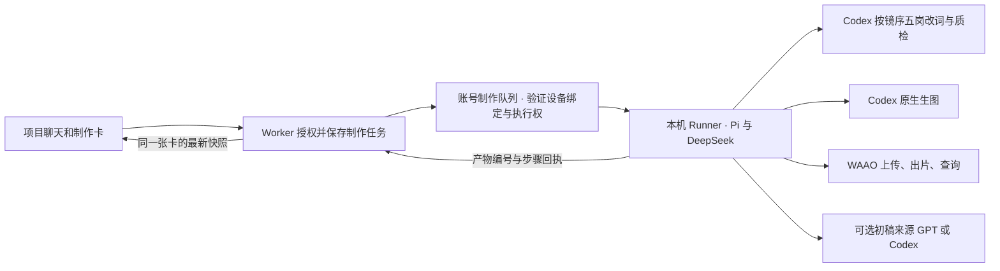
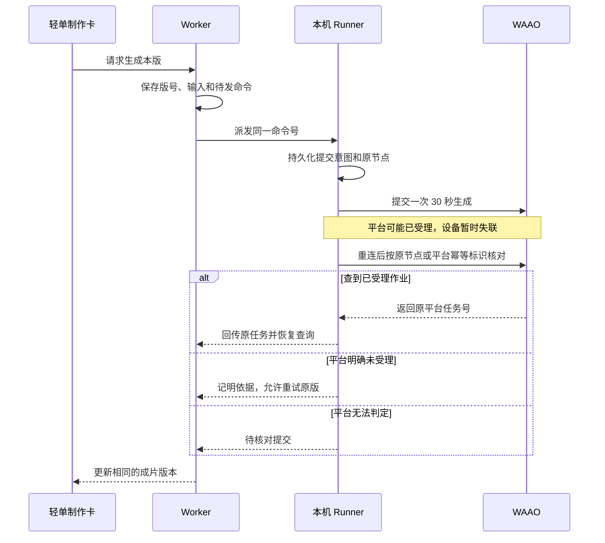

# 轻单 Agent 模式适配设计 · 30 秒 AI 短片

> 存档说明（2026-11-27）：本页是早期设计记录，所列模型、模块和接口示例不代表当前默认配置或全部已实现。接手时以 [维护交接](../../MAINTAINER-HANDOFF.md)、当前代码和验收记录为准。

本页保留早期制作卡的 23 个模块。当前审阅版本已把本机原聊天框接到 Pi，主模型改用星驰的 `gpt-6.1-sol`。Codex 负责改词和生图，WAAO 通过网页 MCP 接收选中原图与定稿。聊天内图片预览、网页登录与本机验收请看[统一 Pi 对话方案](./2026-11-19-unified-pi-agent-review.html)。

2026 年 11 月 19 日模块详细版。现有 Agent 基线按开发分支 `feat/qingdan-mcp` 的 `730c0ef` 核对。下文给出 23 个模块的设计目标、交互、数据和验收样例。当前工作区实现的入口、设备配置、媒体限制和外部联调范围见[制作功能使用说明](../../agent-film.md)。原制作方案（作者本机参考，未随仓库交付）

**轻单负责调度，DeepSeek 是主控，Codex 改提示词和生图，WAAO 接收素材和定稿出片。** 每部短片有一张可反复打开的制作卡。只要提示词，交付到 Codex 定稿为止。有定稿和图，可以直接交给 WAAO。在同一张卡上换图时可查看前后两版。

阅读入口 · [现有功能如何适配](#现有功能如何适配) · [用户操作路径](#用户操作路径) · [23 个模块的详细设计](#逐项功能设计) · [执行与工具接口](#执行与工具接口) · [跨模块交接与回执样例](#模块之间怎样交接) · [数据与恢复](#数据与恢复) · [制作卡示例](#一张卡的实际样子) · [开发与验收](#开发与验收)

## 现有功能如何适配

| 当前代码中的行为                                                                                                                                                                                                                                                                                                               | 适配设计                                                                                                                                                                        |
| ------------------------------------------------------------------------------------------------------------------------------------------------------------------------------------------------------------------------------------------------------------------------------------------------------------------------------ | ------------------------------------------------------------------------------------------------------------------------------------------------------------------------------- |
| Agent 工作区左侧选轻单项目，中间是项目聊天，右侧是「待办与执行」。窄屏已有「项目聊天」「待办与执行」切换。[工作区](../../../src/agent/AgentWorkspace.jsx)                                                                                                                                                                      | 沿用项目导航、聊天栏、待办栏及手机原有两个内容页签。聊天输入区新增「短片制作」小按钮，历史列表和详情复用工作区抽屉。聊天卡和待办行入口都使用同一制作编号。                      |
| 目前挂载的输入区标为「轻单助手」。发送会检查聊天模型和项目摘要就绪状态。当前嵌入式右栏使用 `executionMode=project` 将选中的待办交给 Codex，执行结果进入项目对话。[聊天输入区](../../../src/agent/ChatPanel.jsx) · [待办提交](../../../src/agent/ChecklistPanel.jsx) · [项目时间线](../../../src/agent/ProjectConversation.jsx) | 在聊天输入区的「轻单助手」旁增加「短片制作」入口。制作模式单独判断设备和本步所需服务。已绑定制作目录、具备 Pi 能力时，即使普通聊天模型未配或 Codex 摘要尚未生成，也能开始制作。 |
| 普通聊天接收正文、待办提案和记忆候选。流式和非流式解析都会拒绝非空 `tool_calls`。[聊天响应](../../../worker/agent/chat-model.ts) · [回复结构](../../../shared/agent/chat.ts)                                                                                                                                                   | 普通聊天继续走原接口。制作请求走有明确类型的 Worker 接口，由 Runner 中的 Pi 执行工具。聊天只需能显示「制作任务引用」这种新消息，同一引用刷新后还能打开。                        |
| 现有绑定关联账号、设备和项目目录，派单有不可变快照、项目租约、命令日志与回执。共享校验目前只接受 `task`、`summary`，实际派发会进入 Codex 适配器。[项目绑定](../../../src/agent/ProjectBindingPicker.jsx) · [共享校验](../../../shared/agent/execution.ts) · [实际派发](../../../runner/executor.ts)                            | 制作专用接口复用设备握手、授权目录及绑定修订。Runner 上报制作能力并领取类型化步骤，Codex 专项仍使用既有派单服务。未升级的设备可接原有任务，制作卡显示待设备报告能力。           |
| 已有画布资产接口按房间保存图片，只收 PNG、JPEG、WebP、GIF，上限 10 MiB。项目聊天按账号保存。[图片接口](../../../worker/assets.ts) · [聊天存储](../../../worker/agent/chat-store.ts)                                                                                                                                            | 画布里已有的图在校验读取权限后可被选用。新增按制作任务授权的文件读取与预览，支持稿件、私有参考图和视频播放。成片使用独立的媒体交付路径。                                        |
| 服务器只在 `APP_ENV=local/test` 开放 Agent。生产配置下，页面显示「Agent 正在开发中」，相关 HTTP 路由和后台 Durable Object 均有门控。[服务端门控](../../../worker/agent-availability.ts) · [后台门控](../../../worker/agent-runtime.ts) · [页面入口](../../../src/CanvasWorkspace.jsx)                                          | 首轮在本地和测试环境完成闭环。后续开放生产时，将网页可见性、Worker 路由、后台服务、设备兼容和授权范围作为同一次发布检查。                                                       |

## 用户操作路径

1. **进入当前项目。** 在项目聊天点「短片制作」，编辑区出现「交付目标」和「添加素材」。首次进入时由用户选择目标，也可以直接写“帮我做成 30 秒短片”，发送键随已识别目标显示「开始出片」。普通聊天草稿和制作草稿各自保存。
2. **开始本次制作。** 文字里目标明确就采用原要求，缺少决定性信息时才问一个具体问题。普通聊天里讨论拍法可以继续讨论，想转入制作时点「按此要求制作」带入原文。如果已经在制作入口明确选择出片且计费目标已配置，一次提交即可启动整条流程。
3. **在卡片看产物。** 聊天显示片名、当前阶段、最近一次回执和主操作。点开依次看「分镜与提示词」「参考图」「成片」和折叠的「制作过程」。只要初稿时，直接看初稿和复制按钮。离开页面后可从项目的「制作任务」找回。
4. **在原片上接着改。** 卡片的「继续修改」把片名和选中版本带入输入区。已有短片可以从提示词继续出片，也可以只换一张图、查看旧版、更新定稿。编辑本身保存新版本，产生新成片有独立、可见的「生成新版成片」动作。

| 用户说的话                           | 轻单实际做什么                                                                         | 用户拿到的结果                           |
| ------------------------------------ | -------------------------------------------------------------------------------------- | ---------------------------------------- |
| “这个故事怎么拍比较好？”             | 在普通聊天给建议，可从回复进入制作                                                     | 一条聊天回复                             |
| “给我写个初稿”                       | DeepSeek 写稿并保存                                                                    | 可编辑、复制的初稿                       |
| “把这段故事精修成拍摄提示词”         | 有稿就将全文派给 Codex。只有创意时先由 DeepSeek 起草，Codex 按五岗改稿并在独立轮次质检 | 完整提示词、逐镜时间和质检回执           |
| “只画女孩拿红伞的定妆图”             | 用描述及指定参考图调用 Codex，登记图片用途                                             | 一张可预览、可在以后出片时复用的图       |
| “用 GPT 写初稿，再做成 30 秒短片”    | GPT 仅写本次指定的初稿，DeepSeek 主控，Codex 精修和补图，WAAO 接收真实文件和定稿并生成 | 同一张卡上的稿、引用图和成片             |
| “我的提示词和两张图都定了，直接出片” | 导入定稿和有序图片，校验图号映射与平台参数，提交 WAAO                                  | 使用指定稿和两张原图的成片               |
| “先让 Codex 从项目里的剧本整理一版”  | 已授权的 Codex 子任务读所选项目文件，回执转为稿件版本                                  | 带来源的初稿，以后可继续精修             |
| “昨天那条片好了么？”                 | 在当前项目匹配原卡。有多个候选就列片名、时间、缩略图。按原平台任务号查询               | 原任务状态或播放入口                     |
| “换第二张图，先给我看”               | 在原卡生成或导入新的第二张图，保留第一张，停在预览                                     | 新参考图和受影响镜头，用户之后可以出新版 |

## 逐项功能设计

下面按用户实际操作的顺序展开 23 个模块。各节中的字段名、界面文案和测试情境是本版设计约定。编号既用于跳转，也用于将联调问题定位到负责的模块。

| 从哪里开始           | 模块                                                                                                                                                                                                                                                |
| -------------------- | --------------------------------------------------------------------------------------------------------------------------------------------------------------------------------------------------------------------------------------------------- |
| 打开项目，发起一部片 | [F01 制作目标](#f01-制作入口与目标) · [F02 设备绑定](#f02-设备项目与制作目录) · [F03 简报与附件](#f03-简报附件与已有产物) · [F04 制作卡](#f04-任务卡历史与定位)                                                                                     |
| 从创意得到可用的文稿 | [F05 Pi 调度](#f05-pi-调度与步骤选择) · [F06 初稿](#f06-初稿与-gpt-选用) · [F07 Codex 委派](#f07-codex-专项委派) · [F08 五岗导演](#f08-五岗导演精修) · [F09 质检定稿](#f09-文字质检与采用定稿)                                                      |
| 准备图并提交 WAAO    | [F10 资产清单](#f10-镜头与资产清单) · [F11 选图](#f11-选图顺序与版本) · [F12 Codex 生图](#f12-codex-生图与单图重做) · [F13 WAAO 目标](#f13-waao-目标与生成设置) · [F14 素材导入](#f14-图片导入与提示词映射) · [F15 整片提交](#f15-一次提交整条短片) |
| 查看成片，继续修改   | [F16 进度](#f16-后台进度与主动查询) · [F17 播放](#f17-成片播放与交付) · [F18 版本](#f18-改稿换图与重新出片) · [F19 停止与恢复](#f19-暂停停止与定点恢复)                                                                                             |
| 与轻单原有功能协作   | [F20 待办验收](#f20-关联待办与人工验收) · [F21 项目摘要](#f21-项目摘要与引用) · [F22 记忆](#f22-项目风格与记忆) · [F23 服务设置](#f23-服务设置与诊断)                                                                                               |

### F01 制作入口与目标

- **界面与操作**　在项目聊天输入框旁放「短片制作」。点开后显示项目名、目标选择、简报和附件入口。目标有「写初稿」「精修提示词」「做参考图」「生成 30 秒成片」。主按钮使用相应动词。普通聊天回复的「带入制作」只填入草稿，用户可以改写后再开始。
- **输入与输出**　输入来自这次消息、用户选择的目标和可选的原卡引用。保存 `goal`（`draft / prompt / image / video`）、`briefVersionId` 及 `requestId`。续做另存 `filmRunId`、动作和所选版本。「查进度」「换第二张图」是原卡动作，前者只读，后者修改工作版本。
- **判断与交接**　自然语言中“只要”“直接”“先给我看”“用 GPT”分别决定交付终点、已具备的步骤、预览停点和初稿来源。没有点选目标但原话明确时在主按钮写明识别结果。用户明确点选与原话相抵触时就地列出两个选择。目标已定的提交去制作接口，普通聊天继续按原回复结构返回。
- **失败与验收**　网络未给建卡回执时，保留原文、附件和原请求号，可点击「核对刚才的提交」。输入“只给提示词”，发出后出现一张提示词卡，后台允许的动作中没有生图、出片。输入“昨天那条好了么”且能定位原卡时，新建任务数为零。

### F02 设备、项目与制作目录

- **界面与操作**　在「绑定 agent」显示设备名、在线状态、已授权制作目录和能力。已有有效绑定直接沿用。新用户可选轻单管理的项目目录，手机端选择已经授权给当前账号的远端目录。显示的是设备和目录名称，本机路径交给 Runner 解析。
- **输入与输出**　Worker 从登录会话取 `ownerId`，核对 `canvasId / sectionId / bindingId / bindingRevision / runnerId / workspaceId` 与设备授权代数 `authEpoch`。输出是包含设备能力、允许动作及等待原因的绑定状态。制作命令保存这次绑定快照。目录与设备身份不能由模型参数改写。
- **判断与交接**　首次安装的新 Runner 先完成已有设备握手，再通过版本化能力接口上报 `filmProtocolVersion` 与支持的动作。无制作能力的旧设备显示「升级执行端」且仍能接原 Codex 任务。只有依赖普通聊天或 Codex 的功能才读取对应模型和摘要就绪条件。
- **失败与验收**　离线但授权有效时可以保存云端简报、排队或看归档产物。重连后服务器重新验证授权，再领取原步骤。排队期间若从电脑 A 改绑 B，将旧步骤标记「绑定已变化」，用户可以重新选定 B，系统针对 B 建立新的派单。测试用一台旧设备、一台新设备和一次排队后换绑来覆盖这三个分支。[现有绑定授权](../../../worker/execution/execution-auth.ts)

### F03 简报、附件与已有产物

- **界面与操作**　简报默认展开“故事或要求”。可补画幅、角色设定、必须保留的对白、风格和想预览哪一步。附件的用途可选「初稿」「采用为定稿」「必须引用的图」「启发用的图」。选择「直接出片」时，将定稿与所选图片的缩略图并排显示，可在提交前调整。
- **输入与输出**　简报保存原文和规范化选项，每次提交产生一个 `briefVersionId`。每个附件保存 `artifactVersionId`、来源、用途、文件名、媒体类型及可用状态。上传长稿保留全文供导演台读取，聊天中只显示摘录。已授权项目文件先由设备读取并登记快照，后续文件改动可被识别。
- **处理顺序**　首次加附件时分配草稿卡。上传先取得限时写入地址，写完再校验文件类型、实际内容和大小，成功后分配不可变版本。已有画布图片先做源项目读取校验。对“必须引用”但仍在上传的素材，出片入口显示具体缺项。用户也可以移除与本次目标无关的失败附件。
- **失败与验收**　切换项目后完成的上传只回写原卡。遇到无法解析的剧本文档，保留文件并提示粘贴正文或使用获准的文件整理能力。导入“一份最终稿、两张必用图和一张灵感图”，查看输入快照应能看到四个来源，实际出片只绑定两张必用图。

### F04 任务卡、历史与定位

- **界面与操作**　聊天卡摘要显示片名、交付目标、当前阶段、最近回执时间和一个主动作。详情有「分镜与提示词」「参考图」「成片」，过程默认折叠。生成中主动作是「查看进度」，已交付时是「看定稿」「看图」或「播放」。制作列表可按项目、片名、日期、状态筛选，手机从现有聊天页打开制作抽屉。
- **输入与输出**　一张卡对应一个 `filmRunId`。聊天消息只存制作引用和可选的固定版本，这让聊天清屏、旧消息分页及 Pi 会话切换都不影响找回原片。详情返回工作版本、用户正在查看的版本、已有的可播放版本与服务端允许的动作。选中 V1 查看历史时，V2 的到达只提示有新版。
- **定位与交接**　卡内发言优先指向该卡所选版本。独立聊天中询问“昨天那条”，用账号、当前项目、用户时区下的日期和片名线索查索引。唯一匹配直接打开。多条匹配列片名、制作时间和缩略图，由用户点选。历史多时用游标继续读取，优先显示卡片快照。
- **失败与验收**　找不到匹配时展示当前项目候选并允许更改日期。账号切换后清除上一账号的视图缓存。用两条同名片测试，点第二条的「继续修改」须携带第二条的编号。在另一台设备打开同一卡，应读到相同版本和最后回执。

### F05 Pi 调度与步骤选择

- **界面与操作**　卡片把这一次会做的事写成简短步骤，例如“采用已有初稿 → 导演精修 → 交付提示词”。采用、跳过和等待的步骤可见原因，例如“已有原图”“等你先看稿”。用户能在开跑前修改交付目标，在执行中为下一版补充要求。
- **输入与输出**　调度输入包含本轮简报、指定平台、当前采用的稿件和图版、服务能力与尚未结束的外部任务。DeepSeek 输出本轮目标、需要的工具及参数。Runner 对目标允许的工具、必要输入、依赖版本及操作授权分别验证，并将合法步骤和产物引用保存到卡片。
- **执行与恢复**　Pi 启动或恢复本片会话，只注册当前目标能用的业务工具。允许的工具仍须在执行前读取真实状态。模型流式文字作为过程展示。工具回执入库后推进步骤。`agent_end` 结束本轮模型交互，成片状态继续由平台回执推进。会话中断后，从卡片检查点重新构建输入，已完成的步骤按产物引用复用。
- **验收**　把未选中的生图工具调用注入“只给提示词”的测试回执，Runner 应拒绝该动作并保持目标有效。重启后继续同一份质检通过的定稿，观察导演台历史调用次数保持不变。

| 当前目标与已有输入         | 允许的制作路径                                     | 可直接交付的依据                               |
| -------------------------- | -------------------------------------------------- | ---------------------------------------------- |
| 初稿，只有创意             | DeepSeek 写稿，或点名 GPT／Codex 后采用其稿件      | 完整初稿已保存                                 |
| 提示词，已有初稿           | DeepSeek 派 Codex 按五岗修改全文，另起一轮文字质检 | 定稿正文、镜头时间及质检回执已保存             |
| 单张图，已有静态描述       | DeepSeek 派 Codex 生图，可带指定的基础图           | 返回真实图片，轻单可预览                       |
| 成片，已有最终稿和所需原图 | 登记用户定稿与图版，直接导入、提交和查询           | 只有可播放且时长达标的媒体才交付成片           |
| 原片查进度                 | 直接走登记的查询函数                               | 返回原任务状态，可在模型服务离线时查看已有回执 |

### F06 初稿与 GPT 选用

- **界面与操作**　「初稿」页标明来源，如「DeepSeek 初稿」「GPT 初稿」「用户导入」。提供复制、编辑、比较上一版和「用此稿精修」。在保存完整稿之前，流式区域标记「正在起草」。用户可保留未完成的文字作编辑草稿。
- **输入与输出**　输入为用户故事、时长、画幅、已选项目背景、固定台词和指定的初稿来源。可直接使用用户已有初稿。生成结果登记为 `ScriptVersion`，包含全文、来源、模型配置版本、上游简报编号和父稿版本。流式中间文本保存在本次尝试中，导演台只接收完整且已采用的版本。
- **取舍与恢复**　默认由 DeepSeek 写初稿。点名 GPT 就调用 `draft_with_gpt`，沿用同一套稿件结构。用户一边看输出一边手改时，晚到的模型稿作为并列候选保存，由用户选择采用。GPT 凭据缺失或输出空白时，卡片定位到初稿步骤并保留简报。
- **验收**　“用 GPT 写初稿，先给我看”只产生一份 GPT 来源的稿件，状态为等待预览选择。点「用此稿精修」时传入同一稿版。另测流式连接中断，界面可看到部分文字但导演台调用数为零。

### F07 Codex 专项委派

- **界面与操作**　改提示词、质检和生图默认由 Codex 承担。制作卡显示当前阶段、各版产物来源及最近的原生会话和轮次。若另行指定“让 Codex 整理项目里的剧本”，初稿沿用原有专项派单和执行详情。
- **输入与输出**　改词接收该岗规则、简报和上岗完整稿，返回原生最终正文。生图接收静态描述、画幅和已选图版的原文件，返回成功的 `imageGeneration` 项和可解码原图。两者均记录原任务的 `threadId / requestId / turnId / itemId`。可选初稿专项继续保存原执行 `runId` 和正文。
- **派单与恢复**　Worker 在原生轮次启动前冻结账号、制作版本、步骤、尝试号、会话及请求号。受理后补记轮次。超时或掉线时按原会话和客户端请求号找回同一轮，成功的图片先在设备校验、归档，再通知下一步。
- **验收**　同一父步骤重复投递两次，执行记录只关联一个 Codex 子任务。子任务等待输入时平台生图和出片次数均为零。补充要求后取得有效文稿，父卡能沿原定流程进入导演台。[现有结构化回执](../../../runner/prompt.ts) · [既有执行接口](../../agent-execution-mcp.md)

### F08 五岗导演精修

- **界面与操作**　卡面显示「摄影与运镜 · 第 3/5 岗」。展开可看每岗输入全文、输出全文、修改位置和原因。接受当前步骤后自动走下一岗。用户点某岗的「从这里修改」时，为这次修订建立分支版本，沿用该岗之前仍有效的输入。
- **输入与输出**　`refine_script` 接收选定初稿、画幅、时长、锁定角色与台词及导演规则。每岗把镜序的系统规则、原稿和上岗全文送到独立 Codex 会话。轻单校验并保存完整新稿、岗位、规则版本、修改记录和原生轮次编号。
- **失败与恢复**　有明确的角色锚定就按原文锁定。原稿未写锚定段时，总导演从已有事实整理。任何岗的输出为空、篡改已锁定锚定或缺上游结果，当前岗进入待修。超时重试时使用同一上游版和规则包，已完成的前岗结果继续可用。停止后迟到的结果仅记入原尝试。
- **验收**　让摄影岗第一次返回空正文，卡片应保留已完成的总导演和美术版本。修复后只从摄影岗接着走。用户可在最终稿上追溯五份输入和五份输出，看到每次变动的具体理由。镜序单步执行（作者本机参考，未随仓库交付） · 岗位与输出校验（作者本机参考，未随仓库交付）

| 岗位与现有节点               | 本岗位负责的设计                                                                           | 向下一岗交付的具体内容                                                     |
| ---------------------------- | ------------------------------------------------------------------------------------------ | -------------------------------------------------------------------------- |
| 总导演 `chief_director`      | 明确故事因果、主角意图、动作次序和结局，初定镜头划分，锁定可以从输入中确认的角色事实和拍法 | 例如先交代女孩找人，再通过伞柄名字提供认人的依据。交付含角色锚定的完整初版 |
| 美术与灯光 `art_lighting`    | 统一站台空间、光向、红伞材质和可辨识细节，逐镜补足可见环境                                 | 保留原动作与角色，补出定妆图和伞柄特写需要表现的视觉信息                   |
| 摄影与运镜 `cinematography`  | 给动作匹配景别、机位与镜头落点，使第二镜真的能读清名字，检查和上一镜的空间连贯性           | 逐镜写出可执行的摄影指令，并保留已确定的美术和角色设定                     |
| 剪辑与声音 `editing_sound`   | 把切点、对白、脚步和车站环境声排进同一条绝对时间轴，核对一句台词能否在分配时段说完         | 每镜有起止时间、进出动作和声画安排，固定对白可在原镜头中核对               |
| 提示词统筹 `generate_prompt` | 合并全局和逐镜要求，整理供生成使用的全文，统一角色、动作和素材称谓                         | 一份候选完整提示词及镜头索引，交独立质检                                   |

### F09 文字质检与采用定稿

- **界面与操作**　定稿页上方显示稿版、来源和质检状态。问题列表按镜头或全局段落定位，点问题能打开对应文字。按钮包括「修改对应稿」「重新检查修订版」「复制已采用定稿」。用户给的最终稿单独标「用户定稿」。
- **输入与输出**　把最终候选稿单独交给 Codex 的 `review_prompt` 轮次 并合并确定性检查。记录 `scriptVersionId / passed / issues[]`。每条问题含严重度、位置、原因、建议修订和来源。镜头用全片绝对时间核对，首镜从 0 开始，相邻镜头首尾相接，末镜到 30 秒。角色锚定和固定对白与所依据简报对照。
- **采用规则**　导演路径需要审核通过且无阻断项。建议项可随定稿一并展示。审核不通过就保留问题稿，用户修改后对新稿重检。外部定稿按用户选择直接采用原文，记录来源 `user_final`，检查平台必需项和参考图映射。若原稿明写 60 秒、本次目标是 30 秒，指出具体冲突，让用户修稿或授权调整。用户可以主动让它进入导演精修。
- **验收**　输入时间段 0–8、9–18、18–30，质检必须指出缺少 8–9 秒，即使模型口头说“通过”。修订成连续时间后重新检查即可采用。用用户定稿直接出片时，定稿来源可见，导演与审核模型调用数均为零。镜序确定性检查（作者本机参考，未随仓库交付） · 导演输出约定（作者本机参考，未随仓库交付）

### F10 镜头与资产清单

- **界面与操作**　定稿旁可切换「按镜头看」或「按素材看」。前者显示某镜需要哪些图，后者显示同一张图出现在哪几镜。每项可选择「沿用已有图」「生成缺图」或「本版不用」。用户指定必用的图清晰标记，移除时同步展示影响的镜头。
- **输入与输出**　输入为已采用的 `scriptVersionId`、镜头序列、简报硬性要求及用户可读取的素材目录。输出 `AssetPlan`，每项含 `assetKey`、类别、用途、静态描述、所需镜头编号、是否必用、候选已有图版、依赖的其他图版。`assetKey` 标识“女孩持伞”这一用途，实际图版可随迭代替换。
- **处理与恢复**　DeepSeek 提取角色、场景和道具，Runner 校验镜头引用存在、依赖可满足且没有循环。按确定的来源引用优先匹配用户素材，同名文件只列作候选。已覆盖的素材直接复用，基础图就绪后再做依赖它的特写。选定纯文字出片且模型支持时，空参考图列表也可以提交。
- **验收**　三镜分别用“人物、伞柄、同一人物”，清单应有两项，人物项关联第 1、3 镜。已有定妆图时，补图队列只含伞柄特写。若特写错误指向自身，界面标明依赖冲突并保留其余清单。

### F11 选图、顺序与版本

- **界面与操作**　素材区分「候选」与「本版使用」。每项显示缩略图、来源、版号、镜头和用途，点开可看原图。桌面拖动排序，手机用上移／下移。选择旧版本时同步预览当时图片，退出前能看到实际要送往 WAAO 的图序。
- **输入与输出**　保存有序的 `selectedRefs[]`，每项包含用途编号、`assetVersionId`、出现镜头及显示顺序。图片文件以内容哈希判定字节是否一样，素材编号、业务用途和版本关系单独保存。可在已授权范围内复用同一文件，候选图留在库中。
- **处理与恢复**　已采用成片保存自己的图序快照。调整工作版顺序仅改变下一次提交的映射。取消选择一张被镜头使用的图时列出受影响的镜头，允许改选、将引用移除或撤销操作。文件失去访问权限时标出对应图，修改之前仍可查看原片的用料记录。
- **验收**　将工作版两张图交换顺序，当前工作版显示新顺序，已有 V1 仍显示原顺序。把相同字节的图片以两个文件名导入，文件可复用，界面仍能按用途选择。未选的候选图不会出现在出片清单中。

### F12 Codex 生图与单图重做

- **界面与操作**　单项显示「采用的参考图」「静态描述」「画幅」和「生成这张」。可一次补齐所有缺图。对已有图点「重做这张」后，并排显示原图和新候选，用户可以选择采用哪版。依赖图尚未就绪时展示具体图名。
- **输入与输出**　`generate_reference_image` 读取素材用途、静态描述、画幅和上游图版。Runner 取得实际文件，以有序 `localImage` 交给 Codex。只接受原轮次成功的 `imageGeneration` 项。记录模型、轮次、输出项、素材来源、尺寸、哈希和私有文件引用。
- **处理与恢复**　Runner 按依赖依次补齐缺图。已成功的素材可直接复用。回包丢失先核对原轮次，文件落盘成功而归档失败时复用原文件。若只有文字、文件不可读或无法解码，卡片保留原因和已完成的资产。
- **验收**　定妆图成功、伞柄特写失败，修复特写后只增加一次该项调用。单图目标即使没有 WAAO 连接，也能得到可打开的图。指定旧定妆图做输入时，新图的来源记录须指向旧图的确切版本。[Codex 图像产物协议](../../../runner/protocol/ImageGenerationItem.ts)

### F13 WAAO 目标与生成设置

- **界面与操作**　在「出片设置」依次选择授权连接、团队、项目、画布、计费归属和视频模型，再显示该模型支持的画幅等参数。本方案目标时长为 30 秒。按钮旁写明“生成 30 秒成片 · 使用所选团队额度”。有可验证的价格估算才显示数值，并标明估算来源。
- **输入与输出**　连接信息由 F23 提供，模型能力从该团队授权连接取得。保存 `targetConfigVersion`，含目标团队、项目、画布、计费来源、模型编号、时长、画幅及明确选择的生成参数。切换团队时重新列出该范围的项目、画布及可用模型。
- **处理与恢复**　在当前授权下分别检查能读目标画布、可用素材导入方式、当前模型是否支持 30 秒及所选参考图数、指定计费来源是否可用。失败只阻塞需要 WAAO 的步骤。平台没有估算接口时显示“额度按平台回执记录”。授权或模型更改时，已冻结的成片版本继续保有原设置。
- **验收**　同一模型在本地目录中支持 30 秒、目标团队却只开放短时长模型时，卡上应提示目标模型不可用，提交数为零。切到具备权限的团队时明确显示新计费归属。已有定稿、图和纯文字交付仍可打开。WAAO 本地模型能力目录（作者本机参考，未随仓库交付）

### F14 图片导入与提示词映射

- **界面与操作**　提交预览逐行展示“轻单素材与图版 → WAAO 参考序号 → 使用镜头”。状态区分「等待上传」「平台处理中」「已就绪」「需要处理」。某张图失败只在该行提供继续操作。用户可展开最终将提交的提示词，核对每个 `@图片N`。
- **输入与输出**　输入为本版采用的有序图版及目标配置。每张图建立 `PlatformImport`，记录目标范围、图版、哈希、`uploadId`、`platformAssetId`、上游节点及就绪状态。Runner 回读 WAAO 节点后，将稿版、节点编号、完整提示词及按序排列的图版与平台资产编号存入轻单。卡片在视频生成期间即可展开核对，刷新后仍可查看。
- **处理顺序**　先查同一授权目标下该图版的有效映射。可复用时核对资产仍可读。缺少时按获准方式上传真实文件，记录上传号，再完成固化并等到 `ready`。所有必用图均就绪后连接上游，按平台返回的输入顺序或可核验的有序回执编译引用。原始提示词单独保存。
- **映射规则**　使用“镜头 → 素材用途 → 图版 → 平台序号”的映射。仅改写已识别的素材引用。修改 `@图片1` 不应误改 `@图片10`。平台排序发生变化时优先修正连线以满足用户指定顺序，再核对编译稿。若无法证明对应关系，卡上显示需要核对的两项并停在提交之前。
- **验收**　使用外观明显不同的红伞与伞柄图，核对轻单预览、平台上游与提交正文三处一致。再模拟第二张长期处于 `finalizing`，刷新后沿用该上传号，第一张继续就绪、视频提交数为零。网页上传实现可核对回执格式，目标团队的执行端权限仍须单图联调。WAAO 项目上传实现（作者本机参考，未随仓库交付） · 按输入排序的引用编号（作者本机参考，未随仓库交付）

### F15 一次提交整条短片

- **界面与操作**　第一次用「生成 30 秒成片」，已出过片用「生成新版成片」。提交区域展示本版定稿、缩略图及图序、时长、画幅、目标和计费来源。用户明确选择完整制作且目标就绪时，可从开始一次连续执行到提交。已有任务号后，按钮变为「查看原任务」。
- **输入与输出**　`submit_waao_video` 只接收本片已授权的稿版、图序和成片版号。Worker 冻结输入快照及配置版本，Runner 在一个 WAAO 视频节点写入全片提示词、有序参考和显式的 30 秒参数。记录节点、平台任务号、提交时间和原始状态的必要字段。
- **提交顺序**　① Worker 对比基础修订号，原子预留 `renderVersionId` 和操作回执。② Runner 将该版请求标识、目标节点标识或建节点请求标识落盘。③ 检查节点及其上游输入，再调用一次生成。④ 先落盘平台回执，再回传 Worker。重复命令优先读取本地已有节点和任务记录。创建节点回包丢失也先核对原节点。
- **失败与恢复**　生成请求回包超时即进入「待核对提交」。有平台任务号就查询，无任务号则按原节点、请求标识或平台明确支持的幂等键核对。平台缺少可对账能力时保持可见的待核对状态。在该版本上重新发送的前提是平台能确认原请求未受理。明确的额度不足可回 F13 处理。
- **验收**　两个浏览器从同一工作版同时点生成，随后模拟 Runner 在平台受理后崩溃。恢复后两个页面应指向同一成片版和同一平台任务，平台受理次数为一。三镜输入始终只生成一个整片节点。

### F16 后台进度与主动查询

- **界面与操作**　卡片展示具体活动，如「2 张参考图已有 1 张就绪」「平台已受理，等待视频」「上次更新于 14:32」。可以离开页面。平台只给排队或生成状态时，界面显示当前阶段和更新时间。有真实百分比时再显示数值。
- **输入与输出**　`get_video_status` 接收成片版号，由 Runner 从存档取平台任务号和原目标。记录 `providerStatus / observedAt / nextPollAt`、可公开的错误及返回的资产号。Worker 维护按片递增的事件序号，浏览器先取详情，再按游标补事件。
- **合并与恢复**　每个外部任务只安排一个到期查询。多个浏览器点刷新可共享同一查询结果。遵循平台的重试间隔，暂时的限流或断网标记「稍后继续查询」。设备重连先补回执，再执行到期查询。迟到的“排队中”不能覆盖已证实的终态，冲突的终态证据保留待核对。
- **验收**　关闭所有浏览器，保持 Runner 在线，后台仍能拿到成片。重复刷新十次、两个设备同时查看同版，平台生成次数保持原数。断线时显示上次回执的时间，重连后查同一平台任务号。

### F17 成片播放与交付

- **界面与操作**　成片页显示封面、播放器、实际时长、版号、「本版用料」以及在平台允许时显示的「下载原片」。桌面和手机打开相同版号。播放暂时失效时优先提供「恢复播放」，用户随时可查看稿图和原生成回执。
- **输入与输出**　输入为 WAAO 成功状态、成片资产号和当前账号可用的取片方式。记录 `deliveryStatus`、`platformAssetId`、`measuredDuration` 和 `verifiedAt`。归档版本写入 `mediaObjectId`，托管版本写入可续签的 `playbackSourceRef`。最终稿、实际图序和计费目标通过同一成片版本关联。缩略图作为封面单独存储。
- **验证与恢复**　优先取媒体元数据、验证可解码画面，再用媒体时间基准核对 30 秒。建议容差为已知帧率下的一帧，时长或帧率无法确认时进入待核对。平台允许归档时保留原文件字节，私有读取支持分段。只允许托管播放时按资产号换临时地址。已经验收的版本遇链接过期，更新可播放状态和续签时间，历史成功回执继续保留。
- **验收**　平台返回封面但无视频，状态为等待交付。能解码但只有 15 秒，显示实测值和「待核对时长」。30 秒成片在桌面和手机可起播、拖动并播放到结尾，过期地址恢复后仍显示同样的用料和成片版号。

### F18 改稿、换图与重新出片

- **界面与操作**　详情顶部区分「当前编辑版」「正在生成」「可播放的成片」。从历史版点「基于这版修改」会建立工作版本。改稿、换图或重排后展示差异和受影响的镜头，只想先看图可以停在此处。
- **输入与输出**　编辑请求携带 `baseRevision`、采用的稿图版本和本次变更。保存新稿版或图版及依赖关系。重新出片再冻结一份 `RenderVersion`。只改标题等展示信息不修改媒体输入。
- **并发与恢复**　同一工作版被两端同时编辑时，用期望修订号检测冲突。回传最新值和本次修改，允许保留另一份编辑版。迟到回执按 `renderVersionId` 写入对应版本。默认播放器优先用户手选的版，其次为版本号最新且已验证可播的交付。
- **验收**　V1 生成中换了伞柄图，V2 先完成，随后 V1 回报成功。两版均可播，V2 仍引用新伞柄图，V1 仍引用旧图，聊天中的 V1 固定引用继续打开 V1。

| 用户改动                     | 重新检查什么                                               | 可以继续复用什么                 |
| ---------------------------- | ---------------------------------------------------------- | -------------------------------- |
| 只换第二镜的伞柄特写         | 该图、直接依赖它的素材及第二镜引用                         | 定稿、人物定妆图和其余镜头       |
| 更改角色外观或伞的颜色       | 更新简报中对应约束，复核涉及该外观的镜头、基础图和衍生图   | 与角色和伞无关的场景素材         |
| 只改一句对白                 | 导演路径重新检查涉及的台词、时段及声音描述，重编视频提示词 | 无视觉依赖的所有图版             |
| 同样输入明确要求“再生成一条” | 预留新的成片版本，提交一次新的生成                         | 上次冻结的定稿和已就绪的有序图片 |

### F19 暂停、停止与定点恢复

- **界面与操作**　“先给我看稿”设置稿件预览停点，“先看图”设置素材停点。到点显示「采用并继续」和「继续修改」。运行中可以「停止后续制作」。已交给外部平台的任务另显示平台状态和最近回执。
- **输入与输出**　动作附制作编号、目标成片版或步骤、请求号和当前修订。预览等待记录 `pauseAfter` 及等待的稿／图版本。程序记录操作请求、确认的本地停止位置、已知的外部作业和是否收到平台取消确认。
- **停止语义**　排队未派发时撤销该步。本地模型或上传在执行时发出中断并持久化最后一个完整检查点。外部已受理且可取消时进入「取消请求已发送」，以平台回执确定终态。没有远端取消能力时停止后续步骤，继续查询已经受理的作业。若受理状态本身未知，先核对原提交。
- **验收**　用户在五岗第三岗停止，恢复后沿最后一次有效交接继续。用户在 WAAO 生成后点停止，模拟平台稍后成功，应能看到「后续流程已停」及该版最终结果。重复「采用并继续」只消费一次预览停点，并继续一次。

### F20 关联待办与人工验收

- **界面与操作**　单条待办的更多菜单提供「制作短片」，预填待办原文和验收要求。制作卡显示来源待办链接。交付后提供「查看成果」和「验收并完成待办」，用户也可先保留待核对状态。
- **输入与输出**　记录 `canvasId / sectionId / noteId / taskId / generation / specRevision` 与本次采用的成果版本。验收写回使用原画布更新通道、对象版本和操作回执。若多个来源关联同一制作卡，每条验收结果分别保存。
- **冲突与恢复**　协作者修改验收条件时，先显示新旧差异，让用户对照成片决定。待办被删除则保留卡片及原文来源标记。待办已从其他端完成时读取当前状态，同一验收操作可重复查询原回执。画布、排列和轻岛读取同一真实待办的完成状态。
- **验收**　从待办 A 出片、待办 B 未参与，验收后只更新 A。测一次出片成功但用户尚未验收，再测一次两端同时确认，前者待办仍待核对，后者只写入一次有效操作。[现有待办来源与版本字段](../../../shared/agent/execution.ts)

### F21 项目摘要与引用

- **界面与操作**　简报中有「引用项目摘要」，显示摘要来源、采集时间、修订号与是否过期。用户可看节选，决定是否作为本片背景。引用某次交付到聊天时默认为当前选中的具体版本，按钮说明将引用哪一版。
- **输入与输出**　保存 `bindingId / bindingRevision / summaryRevision / capturedAt / sourceKind` 及当时实际采用的文本快照。已有摘要可能来自 Codex 历史或项目现状。引用交付物时保存 `filmRunId`、稿件或成片版本、显示标题和来源消息，打开时重新验证访问权。
- **判断与恢复**　摘要缺失时可只凭当前简报开工。有摘要但标为过期时展示采集时间。用户选择更新摘要后，只有明确采用的新简报才引用新修订。同时支持「查看当前制作卡」和「查看这次引用的版本」，以便聊天里的历史讨论有准确落点。
- **验收**　V1 简报使用摘要第 3 版，后续项目摘要升级到第 4 版，V1 仍能复核使用过的文本。将 V1 成片引用到聊天，V2 发布后，从这条旧消息仍能打开 V1。[现有项目摘要来源](../../../shared/agent/project.ts)

### F22 项目风格与记忆

- **界面与操作**　用户说“这个系列以后都用竖屏”时，展示可编辑的「记到项目」候选。也可选择沿用现有的个人／项目记忆操作。普通的“这条用竖屏”直接记在本片简报。下次预填时标明来源，允许在当前片覆盖。
- **输入与输出**　候选有作用域、键、值和来源消息。用户采纳后写入现有记忆存储。本片简报保存实际解析出的字段和来源快照，例如“画幅 9:16，来自项目偏好”。本次明确要求优先于项目设置和已采纳偏好，通用默认值最后补齐。
- **冲突与恢复**　已有同一键的值时显示旧值和候选值，由用户决定更新。一次性覆盖只进入本片，删除或修改长期记忆只影响以后读取。API Key、团队扣费授权和目录授权通过 F02、F13、F23 管理，记忆只提供创作背景。
- **验收**　项目默认竖屏，本次明确要求横屏，本片采用横屏且下一部仍预填竖屏。只在项目 A 保存的角色用色，切到项目 B 不能出现。更改项目风格后，旧片的实际参数可追溯。[现有记忆作用域](../../../shared/agent/chat.ts)

### F23 服务设置与诊断

- **界面与操作**　在制作卡展开「设备制作服务」，按 DeepSeek 主控、Codex 改词、Codex 生图、WAAO 出片和可选 GPT 查看设备报告。改稿和生图各自记录最近一次真实调用结果和时间。
- **输入与输出**　云端记录连接别名、可公开模型信息、能力版本和验证结果。密钥或授权由设备端环境或系统凭据库管理，远端客户端显示该设备已报告的状态。配置按连接及版本保存，运行记录只引用本次实际使用的配置版本。
- **验证方式**　区分“填了参数”“能鉴权”“能使用某项能力”。能列模型只说明读取成功，片长和目标权限另检。普通「检查连接」执行只读诊断。需要实际生成才能验证的能力标注「待实际使用验证」。用户执行真实制作后可用该次回执更新诊断记录。
- **失败与验收**　只有 Codex 生图不可用时，已配置文本能力仍可改稿，用户可采用现成图出片。更换 WAAO 账号后保留原版计费归属，新版显示它使用的目标。检查设备能力与真实生成回执分别记录。

| 服务             | 可直接展示的已验证能力                                   | 遇到缺项时可继续的部分               |
| ---------------- | -------------------------------------------------------- | ------------------------------------ |
| DeepSeek + Pi    | 已识别模型、支持本次声明的制作工具、最近一次真实工具回执 | 已存产物的查看、复制和原任务状态查询 |
| Codex 改词与质检 | 本机程序兼容性、镜序规则、最近成功岗位和独立质检回执     | 可继续编辑已有稿件                   |
| Codex 原生生图   | 本机图像功能及最后一次原生图像回执、尺寸和哈希           | 可采用已有图继续出片                 |
| WAAO             | 目标范围、模型、导入就绪、已受理视频和可读取结果分别记录 | 文稿、生图、已有归档成片仍可用       |
| 可选初稿来源     | GPT 连接或已有 Codex 专项派单                            | 默认初稿由 DeepSeek 交付             |

## 执行与工具接口



**Worker 管用户意图和可恢复的业务记录。** 按账号的 AgentChatRouter 在同一 SQLite 事务内保存制作卡、冻结的版本、操作回执与可领取的步骤。Runner 以已登录设备身份及连接代数领取步骤，每次领取生成唯一执行凭证。Codex 专项通过原 RunnerHub 建立子任务，按原编号核对回执。

**Runner 管执行和外部平台回执。** 在 Runner 的分发依赖中固定 Pi SDK `@earendil-works/pi-coding-agent@0.83.0`。用 `createAgentSession`、项目绑定目录、按制作编号保存的 `SessionManager` 和明确的 `customTools` 创建或恢复会话，订阅 `session.subscribe`，通过 `session.prompt` 发送本轮要求。启用的 `tools` 随目标收窄。恢复时指定原会话文件。会话丢失也可以从已保存的简报、产物、待处理步骤重建调度上下文。本机全局安装可供开发时核对 SDK，用户设备使用随 Runner 分发的版本。本机 Pi SDK 文档（作者本机参考，未随仓库交付） · [Runner 构建](../../../scripts/build-runner.mjs)

**DeepSeek 管下一步选择。** 工具在本机执行，Pi 把成功或失败回执交回模型。Runner 将初稿、资产清单等结构化文字输出校验并保存。只有写入成功才发「稿件已保存」等事件。向文字模型传稿件、素材用途和编号，向 Codex、WAAO 传需要的真实文件。卡片展示用户可理解的步骤、产物和错误。DeepSeek 官方列有 `deepseek-v4-pro`，并提供模型选择工具、宿主执行并回传结果的协议。[DeepSeek 模型说明](https://api-docs.deepseek.com/zh-cn/) · [工具调用](https://api-docs.deepseek.com/zh-cn/guides/tool_calls/)

### 工具合同

以下为制作工具名。账号、项目、设备、平台连接和本次操作权限由宿主注入。新制作默认由 DeepSeek 调度 Codex 改提示词和生图。GPT 或 Codex 整理初稿按用户指定的初稿来源调用。

| 工具或宿主动作             | 最小输入                                   | 成功回执                                                         | 失败或重入规则                                                                                               |
| -------------------------- | ------------------------------------------ | ---------------------------------------------------------------- | ------------------------------------------------------------------------------------------------------------ |
| `refine_script`            | 初稿版本、时长、画幅、角色约束、规则包版本 | Codex 原生最终答复、各岗位版本、完整候选定稿、质检意见和采用状态 | 按岗位保存检查点。质检失败回传待修稿，屏蔽后续自动出片。                                                     |
| `generate_reference_image` | 素材项、静态描述、参考图版本、画幅         | Codex 图像输出项、轻单图版、文件引用、预览、尺寸                 | 同一素材请求读取已有回执，显式「再画一张」分配新版本。模型若只返回文字，界面仍显示未生成图片。               |
| `submit_waao_video`        | 成片版本、定稿版本、有序素材版本           | WAAO 视频节点、平台任务号、实际参数和提交时间                    | 复核素材已就绪、平台目标与冻结输入一致。对受理不明的提交，按本版原节点核对。                                 |
| `get_video_status`         | 制作编号、成片版本                         | 平台状态、最近查询时间、错误或产物引用                           | 只查询已记录任务号。未取得任务号的提交进入核对流程。                                                         |
| `draft_with_gpt`           | 指定的 GPT 连接、用户简报、所选背景        | 与默认初稿相同结构的稿件版本                                     | 失败时可修复原连接或由用户改用另一来源。                                                                     |
| Codex 委派（复用执行服务） | 专项要求、允许读取的文件、产物约定         | 子执行编号、结构化回执、经提取的稿件版本                         | 父任务保存等待点、释放本次工作目录执行权，再让子任务取得租约。子任务结束后按原编号唤醒父任务，避免父子互等。 |

Pi 的 `tool_execution_end` 表示当前工具返回，`agent_end` 表示本轮模型交互结束。视频可能还要继续生成。制作卡分别读取「工具已返回」「平台已受理」「媒体可播放」三种依据。用户仅点「查看进度」时，界面也可以调用同一个状态查询函数，直接读取事实。

当前适配器使用 WAAO 官网 MCP 核对画布、模型、上游图片、计费来源及平台受理记录。本机 Pi 的 `waao` 工具通过官网授权、上传和查询，原制作卡复用同一协议。调用方式和配置见[制作功能使用说明](../../agent-film.md)。

**配置与诊断。** 新版设备上报制作协议 2。按 DeepSeek、Codex 文本、Codex 图像、WAAO 及可选 GPT 分行展示配置和最近回执。Codex 使用本机执行账号，轻单保存来源和版本号。旧设备继续领取协议 1 的原任务。新版可核对历史任务已提交的操作，防止在升级时重复生成。

### 面向界面的接口草案

| 建议接口                                                                                         | 用途与回执                                                                                                                                                                                         |
| ------------------------------------------------------------------------------------------------ | -------------------------------------------------------------------------------------------------------------------------------------------------------------------------------------------------- |
| `POST /api/agent/films`                                                                          | 用 `requestId`、项目及绑定版本、聊天来源、简报、目标建卡。先返回 `filmRunId`、`revision` 和初始状态。相同请求重放返回原卡。                                                                        |
| `GET /api/agent/films/capabilities?bindingId=…`                                                  | 返回原设备上报的制作协议版本、各服务可用状态及验证时间。用于设置页和各目标的就绪检查，仅返回可展示的信息。                                                                                         |
| `GET /api/agent/films?sectionId=…` 与 `GET /api/agent/films/{id}`                                | 分页读取该账号在项目中的制作索引，或读取一张卡的当前版本、产物及可用动作。筛选片名和时间用于“昨天那条”的定位。                                                                                     |
| `POST /api/agent/films/{id}/actions`                                                             | `action` 指明继续、采用定稿、换图、出新版、停止或刷新状态，携带 `requestId`、`baseRevision` 和选中版本。冲突时回传最新修订号供界面比较。查询类动作只读原平台任务。                                 |
| `POST /api/agent/films/{id}/uploads` 与 `POST /api/agent/films/{id}/uploads/{uploadId}/complete` | 附加首个文件时先建草稿卡。上传入口按文件类型、大小和任务归属签发限时写入地址，客户端或 Runner 上传原文件后提交完成回执。服务端校验内容和文件标识，返回轻单产物编号与版本。中断按同一上传记录恢复。 |
| `GET /api/agent/films/{id}/events?after=…`                                                       | 按顺序增量读取阶段回执。事件携带制作编号、作用的版本、序号、时间、阶段和产物引用。已发事件可重放，断线用游标续接。                                                                                 |
| `GET /api/agent/films/{id}/artifacts/{version}/content`                                          | 校验当前账号和项目访问权后返回正文、图片或可播放的原片。私有归档视频支持 Range 请求。平台托管版本按稳定资产编号刷新临时播放来源。                                                                  |

## 模块之间怎样交接

### 前端、Worker 与 Runner 的写入边界

| 模块                 | 从哪里接收什么                                                 | 必须完成的写入与检查                                                                                                                            | 交给下游什么                                                 |
| -------------------- | -------------------------------------------------------------- | ----------------------------------------------------------------------------------------------------------------------------------------------- | ------------------------------------------------------------ |
| 项目工作区与聊天     | 当前登录会话、用户选的项目、用户原话、指定产物版本             | 独立保存当前项目的聊天／制作草稿，发写请求前生成一次操作号。切项目时取消旧视图订阅，异步回包按其原任务归属处理                                  | 制作意图，或按同一制作编号打开的详情请求                     |
| 云端制作记录         | 经过会话认证的请求、原卡修订、设备绑定、该账号可访问的素材版本 | 在同一账号的存储事务中写业务状态、操作回执、事件、待派发记录。作用域由服务端解析。相同操作号和内容返回原结果，同号改内容返回冲突                | 一个稳定的制作编号、可读快照，以及带不可变输入摘要的设备命令 |
| 设备派发与租约       | 当前设备的连接凭证、连接代数、制作能力及到期步骤               | Worker 重新核验工作区和绑定，在账号制作队列中认领、续租与去重。原有 `task`、`summary` 协议继续承接 Codex                                        | 含绑定快照、制作版本、步骤、采用产物及当次执行凭证的命令     |
| 本机 Runner          | 云端命令、已授权目录、设备侧连接和本地执行日志                 | 先记录收到命令并核对快照，再执行有副作用的步骤。每次外呼前记意图，收到结果先写本地待回传队列。等待外部生成或 Codex 子任务时归还工作目录的执行权 | 已保存产物、真实供应商回执或明确的等待原因                   |
| Pi 与模型            | 简报、应用已授权的工具集合、已登记的输入与产物引用             | 每次工具调用解析参数并验证属于本卡。一个业务步骤使用可跨会话恢复的操作号，Pi 的 `toolCallId` 只帮助关联本轮调试记录。恢复时先检查已有操作回执   | 经过校验的初稿／资产计划，或一次具体工具请求                 |
| Codex 与 WAAO 适配器 | Runner 注入的固定稿版、图版及已授权目标                        | Codex 交付完整改稿或原生图片。WAAO 核验上传就绪、有序连线、提示词、平台受理及可播放原片                                                         | 稿件或图像版本、WAAO 节点、任务号与影片                      |
| 文件与媒体读取       | 任务授权、待写文件及校验信息，或已登记的产物版本               | 上传凭据限定本任务及本对象。文件写入和读取确认后登记版本，账号或项目范围内复用。对象未就绪保留待处理上传标识，画布图、制作图和视频分别校验类型  | 可授权读取的正文／图像／媒体引用，或可恢复的上传记录         |

**协议兼容。** 制作协议在原设备握手后使用独立的已认证入口。网页能在设备离线时读写简报，执行步骤依赖对应设备上报的制作能力。旧版设备继续使用已有的 Codex 协议。当前生产 Agent 门控按原规则生效。[制作协议](../../../shared/agent/film.ts) · [制作接口](../../../worker/agent/film-route.ts)

### 一次直接出片的请求与回执

以下是拟议轻单接口的样例。编号是示例值。用户已把定稿和两张图保存到制作卡 `film-01`，正基于修订 12 开始出片。浏览器提交 `POST /api/agent/films/film-01/actions`。

```json
{
  "requestId": "action-41",
  "baseRevision": 12,
  "action": "start_render",
  "targetConfigVersion": "target-3",
  "scriptVersionId": "script-2",
  "selectedRefs": [
    { "assetKey": "girl-with-umbrella", "assetVersionId": "girl-1" },
    { "assetKey": "umbrella-handle", "assetVersionId": "handle-1" }
  ]
}
```

Worker 核对这些版本位于当前账号可用范围，冻结用户选定的稿、图序及目标，并预留本次成片版本。此时向界面返回“准备参考图”。

```json
{
  "filmRunId": "film-01",
  "revision": 13,
  "renderVersionId": "render-1",
  "state": "preparing_inputs",
  "latestEventSeq": 24
}
```

Runner 将两张图的上游节点核对到位后，保存实际编译的提示词、节点输入顺序和 30 秒参数，再调用 WAAO。收到平台任务号后向 Worker 报告事实。下例为 Worker 已去重、已分配序号的用户可读事件。前端按该事件显示“平台已受理”。

```json
{
  "eventId": "event-submit-41",
  "seq": 28,
  "filmRunId": "film-01",
  "renderVersionId": "render-1",
  "type": "video_submitted",
  "payload": {
    "videoNodeId": "node-77",
    "providerJobId": "job-908",
    "requestedDurationSeconds": 30,
    "orderedAssetVersions": ["girl-1", "handle-1"]
  }
}
```

平台返回输出后，依次记录「已取得成片资产」和「可播放、时长已验证」。后者触发用户目标完成。用户仅是替换伞柄时，只增加 `handle-2` 并修改工作版的选图。只有新的出片动作会产生 `render-2`。这样可以在每次提交之前展示用户真正要消耗额度的操作。

### 回执丢失时如何防止重复生成



### 让开发和测试能定位一次失败

| 出错位置               | 可写入事件的证据                                 | 卡片反馈和下一步                                                           |
| ---------------------- | ------------------------------------------------ | -------------------------------------------------------------------------- |
| 用户命令与工作版不一致 | 基础修订、当前修订、所选稿图与原操作号           | 展示最新工作版及差异，可保留用户修改，付费请求尚未发出                     |
| 导演或生图输出不可用   | 岗位／素材、输入版本、尝试编号、具体校验问题     | 在相应位置重试或修改。只有文字回包时，参考图继续显示未就绪                 |
| 平台请求结果未知       | 请求时间、原节点、目标配置、提交意图及可对账标识 | 核对原请求，清楚表明受理状态待确认                                         |
| 平台明确失败           | 原平台任务号、终态错误、平台给出的具体原因       | 保留本次记录，修复可定位的素材、参数或账户配置后再作选择                   |
| 成功后取片失败         | 原成片资产号、最近取片时间及错误类型             | 恢复同一资产的播放或归档。已有资产足以继续交付，无须重新生成               |
| 云端更新失败           | 本地保存的事件号、步骤号、待发状态               | Runner 重投同一回执。Worker 对同一事件只分配一次有效结果，浏览器按游标补全 |

## 数据与恢复

### 一张卡怎样保存一部片的多个版本

一张卡的 `filmRunId` 跨修订保持稳定。Runner 的 `runId` 标识一段需要取得项目执行权的工作，Pi 会话标识模型上下文，`providerJobId` 标识 WAAO 已受理的某次出片。等待 Codex 子任务或等待平台生成时，先保存业务检查点并结束当前派单步骤，释放云端项目租约及本机执行锁。下一步凭制作编号和产物版本恢复，无需长期占用整个项目。

| 记录                                      | 关键字段                                                                                                                                                 | 谁写、何时读                                                                                                               |
| ----------------------------------------- | -------------------------------------------------------------------------------------------------------------------------------------------------------- | -------------------------------------------------------------------------------------------------------------------------- |
| 制作任务 `FilmRun`                        | `filmRunId`、账号、画布、轻单项目、聊天来源、设备、绑定版本、目标、简报版本、当前阶段和修订号                                                            | Worker 建卡。聊天和列表都按此编号读取。一个聊天可有多张卡，一张卡可多次向 Runner 派发步骤。                                |
| 步骤与会话 `FilmStep`                     | 制作编号、步骤、依赖版本、步骤请求号、尝试次数、设备命令号、可选 Pi 会话或 Codex 子任务号、结果摘要                                                      | Worker 记录意图，Runner 在本地日志记执行点并回传。重启时核对最后已落盘的步骤。外部任务等待期间可以释放工作目录租约。       |
| 稿件版本 `ScriptVersion`                  | 类型、父版本、作者或模型、最终全文、逐镜时间、固定约束、规则版本、质检结果、来源引用                                                                     | 初稿、导演每岗、用户编辑和自带定稿都留来源。用于读全文、对比或选定某一版出片。                                             |
| 素材计划与图片 `AssetPlan / AssetVersion` | 依赖的稿件、镜头编号、用途、素材编号、图版、上游图版、文件对象、哈希、尺寸和就绪状态                                                                     | 定稿后提取计划，用户或 Codex 产出真实图版。实际图像保存在项目可授权的文件存储。改图后可以沿依赖找到受影响镜头。            |
| WAAO 导入映射 `PlatformImport`            | 授权连接、团队、项目、图版、内容哈希、上传号、平台素材号、就绪状态，以及该画布上的上游节点                                                               | 上一次成功导入可复用。换团队或项目时重新核对资产的可用范围。上传未完成按原上传号查。                                       |
| 成片版本 `RenderVersion`                  | 制作编号、成片版号、冻结稿版、有序图版、实际提交的完整提示词、模型、时长、画幅、计费归属、请求标识、画布节点、平台任务号、成片资产号、实测时长和播放状态 | 提交前先保存输入快照。平台回执按本版归档。卡片分别保留「正在编辑」「正在生成」「最近可播放」的版本引用，允许三者同时存在。 |
| 事件与操作回执 `FilmEvent / Receipt`      | 制作编号、版本、操作号、单调序号、来源、时间、错误类别、产物引用                                                                                         | Runner 可重复回传，Worker 去重再更新快照。浏览器按游标续读，直接取终态快照即可看到成片。                                   |

建议云端由同一账号的制作记录持有业务状态，Runner 本地 SQLite 保存命令、外部请求标识、平台回执和待回传记录。媒体使用独立的私有对象空间，数据库只存编号和元数据。账号切换、同名项目、设备换绑时，服务端都重新校验读取和操作范围。首版制作卡按发起账号与轻单项目可见，共享画布上的待办只带有权限控制的引用。协作者无法借该引用使用发起人的平台额度。[现有本地执行日志](../../../runner/execution-store.ts) · [现有执行授权](../../../worker/execution/execution-auth.ts)

### 数据约束与写入时机

| 记录             | 约束与写入时机                                                                                                                           | 解决的具体问题                                                               |
| ---------------- | ---------------------------------------------------------------------------------------------------------------------------------------- | ---------------------------------------------------------------------------- |
| 用户操作回执     | 在账号作用域内以 `requestId` 唯一定位，保存请求摘要和原响应。写命令先检查该回执，再比较 `baseRevision`                                   | 同一点击因丢包重放，即使卡片已升级版本也能找回原响应。同号换内容可明确报冲突 |
| 卡片和工作版本   | 编辑按预期修订号更新。保留已采用的稿图与配置版本，正在查看的历史版本由用户界面单独保存                                                   | 同一账号在两端同时编辑可发现冲突，浏览历史不会改变下一次要提交的工作版       |
| 稿图与文件       | 使用稳定的产物编号及不可变版本。上传完成并通过读取校验后，才把它标成可交付。内容复用限定在当前授权范围                                   | 防止把上传中的图当成已选素材，也能复原旧片当时的文件内容                     |
| 成片和外部任务   | 每张卡上的成片版号唯一。一次正常出片对同一工作修订只建立一个预留，明确的再次出片是新的用户操作。按连接和平台任务号反查唯一对应的成片版本 | 双端同时点击时合并同一提交，V1 的晚回执也能准确找到 V1                       |
| 事件和待回传记录 | 生产者在外呼前后持久化操作标识和结果。Worker 为首次接受的事件分配该片的序号，回放用生产者事件标识去重                                    | 断线时允许重复发送，阶段只推进一次。刷新先取快照再补事件，无需复读整段聊天   |

### 任务状态、界面反馈与完成条件

| 用户看到的状态     | 触发依据                                                                                                                               | 用户可做什么                                         |
| ------------------ | -------------------------------------------------------------------------------------------------------------------------------------- | ---------------------------------------------------- |
| 草稿／等待设备     | 简报已保存，制作尚未发送或设备暂离线                                                                                                   | 编辑、开始、查看已存产物                             |
| 制作中             | 某个步骤取得执行权并开始，显示具体岗位或素材，如「生成伞柄特写」                                                                       | 看过程、编辑下一版、停止后续制作                     |
| 等待补充／等待采用 | 缺特定信息、连接、用户要求的预览确认，或质检发现具体问题                                                                               | 补资料、修稿、选素材版本、从该步继续                 |
| 导入中／待核对提交 | 图片在平台固化，或视频提交已发出但受理回执缺失                                                                                         | 看具体素材、核对原上传号或原节点                     |
| 平台生成中         | 已记录平台任务号及目标节点                                                                                                             | 查询原任务、开始编辑下一版、请求停止                 |
| 验证成片           | 平台已报成功，轻单正在取播放源、解析媒体、核对实际时长                                                                                 | 看平台回执。播放源暂不可用时恢复交付                 |
| 已完成             | 初稿目标有可读正文。提示词目标有通过质检的导演定稿或用户明确采用的现成定稿。出图目标有可解码图片。成片目标有能播放且时长符合要求的原片 | 复制、预览、下载可取回的原片、继续制作、查看本版用料 |
| 失败／已停止       | 有明确错误或停止依据，分别记录本地步骤状态和平台状态                                                                                   | 从失败步修复或重新安排新版本，已完成产物可回看       |

时长验收建议用媒体时间基准记录实际值。30 秒目标可以容许一帧的封装误差，并把精确读数存入回执。读不到可信时长或差值更大时，卡片保留视频供核对。以播放器能加载并解码画面检验播放能力，验收样片还要实际播到结尾。平台仅允许托管播放时，按资产号续签短期播放地址。此时 Runner 离线且旧地址过期，卡片提示「等待设备恢复播放链接」。已有私有原片归档时可直接播放。

### 重复点击、断线和修改中的任务

| 发生什么                               | 处理规则                                                                                                                                                                                                                                                          |
| -------------------------------------- | ----------------------------------------------------------------------------------------------------------------------------------------------------------------------------------------------------------------------------------------------------------------- |
| 双击提交、两个客户端同时点同一版       | 一次界面操作生成一个 `requestId`。Worker 比对请求内容，重复请求返回原回执。Worker 根据基础修订号原子预留成片版号，同一 `filmRunId + renderVersion` 只有一个有效提交者。两端同时提交同一编辑版时，后一端读取已预留的版本。用户明确点「再生成一版」分配新成片版号。 |
| WAAO 提交超时、Runner 在回包前重启     | 提交前持久化原请求标识、输入快照、视频节点及待回传记录。平台支持幂等键时复用原键。有任务号就查询，无任务号就按原节点和请求线索核对。若平台无法判断，保留「待核对」，展示原目标和提交时间。确认原任务未受理后才允许重新提交。                                      |
| 外部任务用时很长、用户离开页面         | 提交回执落盘后释放本次工作目录租约，后台只按原任务号查询。卡片单独显示活跃步骤，普通聊天仍可发送，新任务按设备队列调度。设备重连先发送积压回执，再恢复到期查询。                                                                                                  |
| 某张图失败、凭据失效、用户要求更换模型 | 按素材项和步骤保存错误。明确失败可按服务建议退避重试。权限或额度问题跳到对应连接修复，仍有效的图稿继续使用。换模型或计费目标要在卡上显示，并对将要提交的版本重新冻结配置。                                                                                        |
| 生成中换图、同时改稿、旧回执晚到       | 用户编辑带基础修订号。有并发冲突时展示新旧稿，允许另存编辑版。冻结的成片输入只读，旧回执绑定旧成片版号。上游图变动后，使用它的衍生图标记「需核对」，其余素材继续可用。                                                                                            |
| 项目改绑、撤销平台授权、切换账号       | 新的执行命令只能使用有效绑定。保留原片版本的归属和已有回执。要继续操作旧平台作业，先核验原平台目标和当前授权。跨账号读取卡片或媒体时由服务端拒绝访问。                                                                                                            |

## 一张卡的实际样子

以附件中的「女孩在车站归还红伞」为例。下列版号、状态和时长均为界面示例。

```text
车站的红伞                                  已完成 · 成片 V1
交付目标　30 秒短片                       [播放原片] [继续修改]

分镜与提示词    采用定稿第 2 版 · 文字质检通过       [查看全文]
参考图          2 张已用于本版                     [查看顺序]
成片            V1 · 实测 30.00 秒                 [查看本版用料]
制作过程        导演 5 岗已完成 · WAAO 已交付       [展开回执]
```

| 镜头     | 冻结稿件的画面         | 本版实际用料                              |
| -------- | ---------------------- | ----------------------------------------- |
| 0–8 秒   | 女孩持红伞跑进车站找人 | `@图片1`，女孩持伞定妆图第 1 版           |
| 8–18 秒  | 镜头靠近伞柄，读到名字 | `@图片2`，基于定妆图制作的伞柄特写第 1 版 |
| 18–30 秒 | 女孩认出失主并递回红伞 | 再次引用 `@图片1`，复用同一张定妆图       |

用户说“伞柄上的名字看不清，换一张，其他照旧”。从 V1 点第二张图，生成「伞柄特写第 2 版」并显示前后对照。此时 V1 仍可播放，卡片只标记第二镜有新图可用。用户点「生成新版成片」后，V2 使用同一份定稿、定妆图第 1 版和伞柄特写第 2 版。它在单个新视频节点上生成完整的 30 秒，V1 的用料记录和播放器继续指向原片。

## 开发与验收

### 开发落点

| 部位            | 应修改的现有入口                                                                                                                                           | 建议新增的最小实现                                                                                                                                             |
| --------------- | ---------------------------------------------------------------------------------------------------------------------------------------------------------- | -------------------------------------------------------------------------------------------------------------------------------------------------------------- |
| 前端            | `AgentWorkspace.jsx`、`ChatPanel.jsx`、`ProjectConversation.jsx`、`ProjectBindingPicker.jsx`。待办关联从 `ChecklistPanel.jsx` 发起                         | 制作输入区、项目制作列表、卡片详情及逐版素材选择。主按钮按当前目标判断可用条件，卡片上的停止与 Codex 的停止各自定位到真实任务。                                |
| 协议与 Worker   | `shared/agent/contracts.ts`、`schemas.ts`、`execution.ts`，以及 `worker/execution` 的授权、派单、事件接收。制作入口仍受 `agent-availability.ts` 约束       | 新增按 `kind` 区分的制作快照、类型化回执和按账号隔离的制作存储。增加设备能力协商与 `film` 专属入口。已有 v1 请求、旧数据和无能力声明的 Runner 仍按原协议读取。 |
| Runner 与适配器 | `runner/device-controller.ts` 装配设备传输，`runner/film/runner.mjs` 分发制作阶段，`runner/film/journal.mjs` 保存本机回执，`scripts/build-runner.mjs` 打包 | 设备同时支持已有 Codex 执行与制作队列。DeepSeek/Pi、Codex 改词与生图、WAAO 通过类型化阶段回执交接，下游按固定稿版和图版读取                                    |
| 文件与播放      | 已有 `worker/assets.ts` 用于画布图。制作文件用单独的任务授权读写入口                                                                                       | 文稿版本、图版、私有媒体对象、分段读取与按资产号更新播放来源。只有文件写入且可读时才发布相应产物事件。                                                         |

### 分阶段交付

| 阶段                        | 用户当时能做什么                                                         | 通过条件                                                                                                                                         |
| --------------------------- | ------------------------------------------------------------------------ | ------------------------------------------------------------------------------------------------------------------------------------------------ |
| **1　走通真实调用**         | 从本地轻单建制作卡，看 Pi 在绑定设备上执行一个只读测试工具并返回真实内容 | 使用打包 Runner，看到成功的 `tool_execution_end` 及与测试文件一致的答案。未升级设备得到明确提示。普通聊天、原 Codex 待办分别通过回归。           |
| **2　交付第一份导演定稿**   | 粘贴故事，拿到可复制、可重新打开的 30 秒拍摄提示词                       | 五岗版本和一次质检可查看，镜头连续覆盖 0–30 秒。质检失败停在对应稿件。仅提示词场景的 Codex 生图与 WAAO 视频生成次数均为 0。                      |
| **3　跨平台使用同一张图**   | 生成或上传参考图，在轻单预览，并在目标 WAAO 画布查看同一图               | 用目标团队获准的执行端上传／导入一张真实图片，拿到 `asset_id`。再用两张易区分的图核对顺序和提示词引用。未就绪图不能进入已受理的生成任务。        |
| **4　交付首条真实成片**     | 从同一卡播放 WAAO 返回的原片，查看采用的稿、图和时长                     | 在获准团队做一次真实出片。检查一个视频节点、一份完整提示词、一组有序上游、一次受理、一个可播到末尾且时长达标的文件或授权播放源。刷新后找回同版。 |
| **5　补齐委派、重做与恢复** | 点名 GPT 或 Codex，用现成稿图直接出片，断线后续查，改图后出新版          | 通过下表的恢复与权限用例。专项子任务、旧版回执和并发提交均能回到原对象。用普通项目、旧设备和旧历史再做一次兼容回归。                             |

### 关键验收用例

| 场景                                           | 应观察到的结果                                                                                                                         |
| ---------------------------------------------- | -------------------------------------------------------------------------------------------------------------------------------------- |
| 只写初稿／只做提示词／只画一张图               | 各自交付文稿、定稿或一张图。初稿和提示词两条路径的生图、视频调用数均为 0。只画图时导演台和视频生成调用数均为 0。                       |
| 用户已有定稿和两张图并指定顺序                 | 采用原文原图，Codex 改词和生图的调用数均为 0。WAAO 的 `@图片1`、`@图片2` 与实际相连的输入一致，生成只受理一次。                        |
| 指定 GPT 缺凭据、Codex 等待审批                | 分别看到缺项或对应的 Codex 子任务入口。修复后沿用父卡，稿件来源能追溯，原工作目录的租约能释放。                                        |
| 第二张图上传未就绪或失败                       | 第一张和定稿保留，能从第二张恢复，WAAO 视频提交数为 0，直到两张选定图均可引用。                                                        |
| 双击、跨端并发、提交超时后刷新                 | 同一版本最多一个平台作业。场景覆盖平台已受理但回包丢失、以及平台明确未受理这两种结果。已受理的找回原任务号，明确未受理的可以安全重试。 |
| Runner 断线、浏览器重开、播放链接过期          | 重开即见原卡和最后回执。重连按原任务号查询。过期链接能从稳定资产恢复或提示等待设备，不会触发重新出片。                                 |
| V1 生成时编辑图、V2 先返回                     | 两版结果分属各自快照。V1 的迟到通知不会替换 V2 播放器。只换伞柄时，已采用的角色定妆图继续复用。                                        |
| 返回成功但只有封面、文件不可解码或实际时长偏离 | 卡片展示待恢复交付或待核对时长，保留平台回执与实际读数。正式验收播放的是影片。                                                         |
| 跨账号、撤权、旧版设备、手机窄屏               | 媒体和付费操作受对应账号授权约束。旧 Runner 仍可执行原 Codex 任务。手机能开卡、看图、播放、续做，项目间状态正确隔离。                  |

先用可控回执覆盖成功、失败、重复提交及回包乱序，再在开发或测试环境使用打包 Runner 核对真实链路。仓库已有 `npm run runner:check`、`npm run runner:build`、`npm run test:runner`、`npm run test:execution`，新增制作用例需加入测试入口，并以 `npm test`、`npm run check` 做整体验证。[项目脚本](../../../package.json)

**首个可以交给用户试用的版本**是“输入一个故事，在原卡得到一份导演定稿”。**完整验收**是“同一张卡展示定稿、真实引用图和一条可播放的 30 秒原片，刷新后仍能找回，再换一张图也能说清新旧两版各用了什么”。目标团队的上传、计费及真实生成能力列入阶段 3、4 的实测项。当前可运行入口与验证边界见[制作功能使用说明](../../agent-film.md)。
