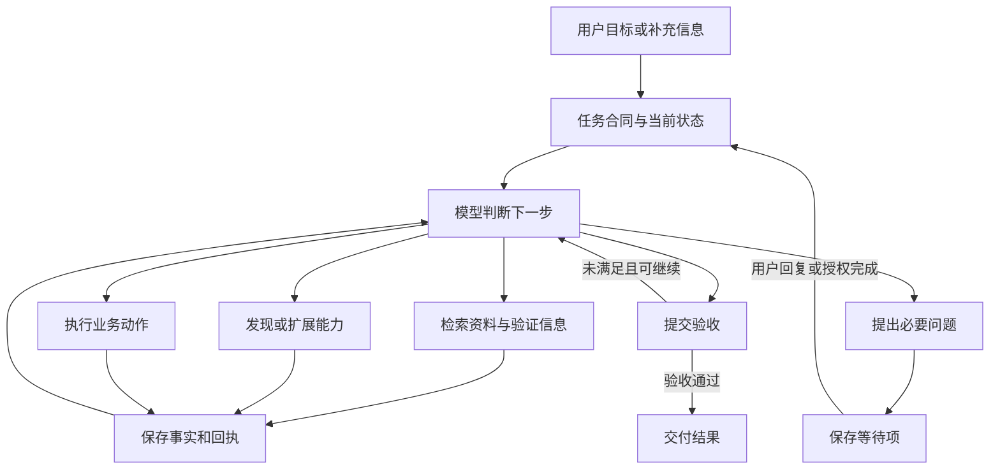

# Pi 通用任务 Harness 设计

> 存档说明（2026-11-27）：下文保留设计过程；当前预算、确认机制及已知问题以 [任务说明](../../agent-task-harness.md) 为准。

设计日期：2026-11-24。状态：已接入原主聊天并保留账号、模型与 MCP 配置，完整使用说明与当前边界见[任务 Harness](../../agent-task-harness.md)。下文保留整体设计方向。

建议继续使用 Pi，由轻单补齐目标管理、信息获取、能力扩展、交互恢复和结果验收。主模型负责判断与选择，宿主负责执行约束、保存状态和验证证据。短片制作作为一种领域工作流接入，后续可承接研究、文件处理和项目开发任务。

本方案基于当前工作区代码及公开实现。目标是让用户交付一个任务后，Agent 能持续判断下一步需要什么、主动补齐可获取的信息，并在确实需要用户决策时提出具体问题。

## 技术路线

| 路线                    | 已有能力及参考价值                                                              | 对当前项目的判断                                                                                                     |
| ----------------------- | ------------------------------------------------------------------------------- | -------------------------------------------------------------------------------------------------------------------- |
| Pi 扩展加轻单任务控制层 | Pi 已提供模型工具循环、扩展、会话和运行事件；可通过扩展接入业务状态             | 首选。保留已有模型连接、MCP、Codex、WAAO、回执与恢复代码                                                             |
| Deep Agents JS          | 现成的规划、文件上下文、子任务和上下文管理能力，建立在 LangChain / LangGraph 上 | 可作为另一个实现候选，但替换当前主循环需要迁移模型适配、状态、权限和事件；框架仍需业务验收逻辑                       |
| Codex App Server        | 复用 Codex 的会话、工具执行、双向事件、交互协议与持久化 Goal                    | 如果决定由 Codex 直接担任主控，这是可行路线；保留 Pi 多模型主控时，可借鉴 Goal 运行机制并继续将 Codex 作为专项执行端 |

Pi 将自身定位为可扩展的最小 harness；现成扩展接口是本方案的起点。[Pi 官方仓库](https://github.com/earendil-works/pi)

Deep Agents 有 TypeScript 实现，因此不需要为了评估它引入 Python。其规划、上下文及 middleware 设计可独立借鉴。[Deep Agents JS](https://github.com/langchain-ai/deepagentsjs) · [官方架构与能力说明](https://docs.langchain.com/oss/javascript/deepagents/overview)

Codex 的公开架构包括模型工具循环、会话生命周期、持久化、配置认证和执行扩展。模型选择工具，执行结果回到上下文后再判断下一步。[Codex agent loop](https://openai.com/index/unrolling-the-codex-agent-loop/) · [Codex harness 与 App Server](https://openai.com/index/unlocking-the-codex-harness/)

当前公开实现还包含独立的 Goal 扩展。`on_thread_idle` 调用 `continue_if_idle`，根据目标状态及运行条件决定是否启动后续轮次；目标、预算与用量持久保存。因此，基础模型轮次结束不意味着启用 Goal 后的任务结束。这是本方案 Coordinator 可以直接对照的实现。[Goal 生命周期代码](https://github.com/openai/codex/blob/main/codex-rs/ext/goal/src/extension.rs) · [续跑运行时](https://github.com/openai/codex/blob/main/codex-rs/ext/goal/src/runtime.rs) · [App Server 目标接口](https://learn.chatgpt.com/docs/app-server#manage-a-thread-goal)

Goal 的公开续跑提示词要求模型根据当前状态检查进展、逐项寻找完成证据，证据不足时继续工作。目标工具的完成处理负责状态和用量更新；这些代码不能被解读为通用程序已经自动证明任意业务目标完成。下文将需求与证据结构化、接入视频等领域验收器，是轻单的具体增强。[公开的完成检查指令](https://github.com/openai/codex/blob/main/codex-rs/ext/goal/templates/goals/continuation.md) · [目标工具处理](https://github.com/openai/codex/blob/main/codex-rs/ext/goal/src/tool.rs)

Codex 还公开了用户提问、MCP 授权、技能读取与动态工具等接口，其中部分接口标记为实验性或开发中。这些机制可用于构建能力扩展流程；本文提出的自动发现、生成候选、验证、激活及回滚全流程属于轻单设计，不能直接归为 Codex 所有客户端的既有保证。[App Server 接口文档](https://learn.chatgpt.com/docs/app-server)

长任务还可借鉴 Anthropic 的初始化、进度记录、增量交付及验证做法，将目标与检查点保存在对话之外。[长任务 harness 公开实践](https://www.anthropic.com/research/effective-harnesses-for-long-running-agents)

## 当前实现的具体限制

| 位置                                                                 | 已观察到的行为                                                          | 改造方向                                                   |
| -------------------------------------------------------------------- | ----------------------------------------------------------------------- | ---------------------------------------------------------- |
| [rpc-chat.mjs](../../../scripts/pi-local/rpc-chat.mjs)               | 收到 `agent_settled` 后读取最后回答并结束调用                           | 分开记录模型本轮结束和用户任务完成                         |
| [rpc-chat.mjs](../../../scripts/pi-local/rpc-chat.mjs)               | 使用 `--no-session`，关闭自动加载项目上下文与技能；由自定义扩展导入历史 | 增加按任务保存的会话或等价的完整上下文恢复；技能按需加载   |
| [rpc-chat.mjs](../../../scripts/pi-local/rpc-chat.mjs)               | 关闭 retry 与 compaction                                                | 增加任务级恢复与上下文策略，明确恢复责任所属层             |
| [rpc-extension.mjs](../../../scripts/pi-local/rpc-extension.mjs)     | 将文本历史和本轮工具消息拼成模型输入；普通会话最多 7 次模型请求         | 由任务预算与检查点控制续跑；上下文保持事实来源和消息配对   |
| [mcp-connections.mjs](../../../scripts/pi-local/mcp-connections.mjs) | 每轮只暴露已选中、状态 ready 的工具，并在执行前重新检查授权             | 增加可发现的能力目录与运行中的目录更新，继续复用执行前校验 |
| [chat-contract.mjs](../../../scripts/pi-local/chat-contract.mjs)     | 工具不可用时主要让用户去工具面板处理                                    | 先自动区分未加载、未授权、未安装和故障，再采取对应动作     |
| [pi-session.mjs](../../../runner/film/pi-session.mjs)                | 业务步骤要求调用指定工具，并在回执后结束本轮                            | 将可靠的业务动作保留为执行器，把下一步选择交给通用主控     |
| [worker.mjs](../../../scripts/pi-local/worker.mjs)                   | 等待一次 HTTP 请求得到最终文本，有 575 秒超时                           | 持久化任务、问题和外部等待；HTTP 请求结束后任务仍可恢复    |

当前并非没有恢复能力：[连接器维护](../../agent-connector-maintenance.md)已实现有限的声明式协议修复、验证、回滚和投递状态记录。这部分应复用，并推广其“提出候选—宿主验证—生效”的模式。

[package.json](../../../package.json)中同时存在制作 SDK `0.83.0` 和聊天 CLI 别名 `1.5.2`。本机 1.5.2 的文档及类型声明提供 `agent_before_settle`，并支持运行时工具注册。首轮改造针对聊天路径；旧制作路径使用适配器，不能直接假设两者事件接口相同。已安装扩展文档（本机依赖参考，未随仓库交付） · [1.5.2 上游文档](https://raw.githubusercontent.com/earendil-works/pi/v1.5.2/packages/coding-agent/docs/extensions.md)

## 运行结构



这些是可选择的动作，不是每个任务必经的固定阶段。信息足够时直接执行；只需回答的问题可直接交付。一个步骤缺少信息时，其余没有依赖的步骤仍可推进。

职责分为三层：

- **Task Coordinator**：持有目标、状态、预算、问题、唤醒事件和完成判定；同一任务只允许一个有效运行租约。
- **Pi Runtime Adapter**：负责模型推理、工具循环、事件与上下文恢复；边界钩子向 Coordinator 查询是否继续。
- **执行与信息工具**：MCP、Codex、WAAO、项目资料、检索、领域验收器和经过验证的新增能力。

Coordinator 不再另起一套模型工具循环。Pi 负责一段运行内的模型循环；Coordinator 在等待、重启、预算耗尽和外部事件到来时管理任务生命周期，避免两层各自无限重试。

## 信息是否充分的判断

主模型在开始任务、收到关键工具结果、遇到失败、用户改动要求和准备结束时，更新简短的结构化评估。评估记录结论、依据与下一步，不保存模型的私有推理过程。

每项需求至少关联：已知事实、来源、是否仍有效、缺口、受影响的步骤和验收方式。判断标准是“当前信息能否支持下一步，以及是否足以证明交付完成”。

| 缺口类型                     | 默认处理                                                         |
| ---------------------------- | ---------------------------------------------------------------- |
| 项目内已有的信息             | 查询项目摘要、聊天中可见的产物、选定文件及已有回执，避免重复询问 |
| 可从外部核实的事实           | 使用已授权的检索或对应服务；重要信息记录来源与获取时间           |
| 用户偏好或存在实质歧义的目标 | 提供少量具体选项，说明哪一步依赖答案；继续其他可推进的工作       |
| 低影响且可逆的细节           | 采用明确说明的默认值，并将其标记为假设；允许用户修改             |
| 权限、登录、计费主体等缺口   | 先检查现有授权；需要新增授权时准备准确的连接或授权请求           |
| 工具能力缺失或故障           | 进入能力发现、修复或扩展流程                                     |

来源分为用户明确要求、工具观察、推断和假设。互相矛盾的证据保持可见；需求或输入版本改变后，使受影响的验证失效。不能用模型给自己的高置信度替代实际证据。

检索以与任务相关的授权范围为边界。长文件、工具输出和技能正文按需读取；外部内容作为资料输入，不取得更改目标、权限或执行策略的权力。

## 工具不够时如何补充

增加 Capability Registry，统一描述 `capabilityId`、工具来源和版本、能力用途、输入输出、启用状态、授权范围、费用性质、健康状态及验证记录。发现目录只返回用户有权知道的能力信息。

处理顺序如下：

1. **已有且可执行**：直接使用，优先复用任务已有成果。
2. **已授权但尚未加载**：宿主注册工具、更新可执行目录，在下一次模型请求前提供 schema。授权未变化时无需再次询问。
3. **已配置但当前项目未授权**：生成具体的启用请求。当前项目勾选仍是有效边界；只有用户预先授予的自动启用范围内才可自行启用。
4. **连接故障**：分类处理。协议字段变化可复用现有维护流程；登录失效进入授权等待；网络故障做有限重试。
5. **存在可信的现成连接器或技能**：读取用途与权限，准备安装方案、固定版本、验证方法和回滚方式。已有安装授权覆盖时可自动完成；新增账户、费用或权限范围时只询问缺失部分。
6. **仍缺少能力**：先尝试组合已授权工具或创建声明式适配器；必要时生成可执行工具候选，测试后注册使用。

技能承载操作方法；检索接口、文件访问和执行工具承载实际能力。安装一个技能不会自动产生访问网络、账户或文件的权限。

新增工具采用 `proposed → validated → active → disabled/rolled_back` 生命周期。候选包含 schema、实现或组合定义、版本摘要、权限需求、验证结果和来源。声明式组合只能调用许可范围内的工具，不能修改授权器或验收器。

可执行工具候选必须在实际具备文件、网络和进程限制的执行环境中验证，再通过宿主代理调用。普通 Node 子进程不构成安全沙箱。当前环境若没有这种执行能力，先保存候选并使用已有工具继续，不能把未经验证的代码直接载入持有凭据的 Pi 扩展进程。可信扩展和新增执行工具分开管理。

现有 `remoteSpecs` 与执行映射在每轮开始时固定，因此动态扩展需要同时更新宿主目录和子进程注册表，并带上目录版本。只调用 `pi.registerTool()` 而不更新宿主执行许可，会出现模型看见工具却无法执行的问题。每次真正调用仍检查最新的项目选择、来源与授权。

## 面向模型的最小控制接口

| 拟新增接口                        | 用途                                 | 宿主约束                                                     |
| --------------------------------- | ------------------------------------ | ------------------------------------------------------------ |
| `update_task`                     | 更新需求、计划、缺口、假设和简短进度 | 保留用户目标版本；模型不能为了通过验收删除未完成要求         |
| `search_context` / `read_context` | 定向搜索和读取项目资料、产物与回执   | 按当前项目、聊天可见性及授权范围过滤                         |
| `find_capabilities`               | 查找能解决某个缺口的已有或可安装能力 | 返回真实目录状态，不凭空生成可调用工具                       |
| `request_capability`              | 申请加载、修复、安装或创建能力       | 返回 `ready`、`waiting_auth`、`candidate` 或有依据的失败原因 |
| `ask_user`                        | 提出问题及选项，关联受阻步骤         | 保存请求标识和目标版本；无回复不视为回答或授权               |
| `submit_result`                   | 提交交付物与验收证据                 | 调用宿主验收门；工具返回成功不能直接将任务标记完成           |

这组接口是新设计的轻单工具名，并非宣称 Pi 已内置这些 API。Codex、WAAO 和其他 MCP 继续通过已有业务工具调用。较多工具使用可搜索目录和按需加载，避免将整个目录塞进每次提示词。

## 状态、等待和恢复

任务标识与聊天消息、模型轮次、HTTP 请求标识分开。一次用户任务可以包含多次模型运行、多次用户补充和多个异步外部任务。

```ts
// 设计用数据结构；具体 schema 在实现时定义。
type TaskStatus =
  | "running"
  | "waiting_user"
  | "waiting_auth"
  | "waiting_external"
  | "paused_budget"
  | "completed"
  | "failed"
  | "cancelled";

interface TaskState {
  taskId: string;
  revision: number;
  goal: string;
  goalRevision: number;
  originMessageId: string;
  scopeRef: string;
  status: TaskStatus;
  requirements: Requirement[];
  evidence: EvidenceRef[];
  gaps: InformationGap[];
  steps: PlanStep[];
  pendingRequests: UserRequest[];
  externalJobs: ExternalJobRef[];
  effectReceipts: ReceiptRef[];
  runtimeSessionRef?: string;
  budget: TaskBudget;
  lastProgressSignature: string;
}
```

`scopeRef` 指向宿主持有的账号、项目、目录和权限信息，不把凭据放进模型上下文。Evidence 保存产物版本、来源与观察时间；Receipt 引用既有调用回执，不另造一份相互冲突的执行事实。

本机 Coordinator 的 SQLite 保存任务快照与追加事件。聊天存储保存展示投影和任务关联，通过事件编号去重；先选择一个状态写入权威，避免本机和 Worker 各自推进同一任务。未来多设备迁移需要显式转移租约与检查点。

`ask_user` 创建持久化请求并返回等待记录，不让一个工具调用和 HTTP 连接一直挂着。回答以 `requestId` 和 `goalRevision` 关联原任务；纯补充信息不会被当成一个无关新任务。新要求修改受影响的计划与验证。若仍有可执行步骤，任务保持运行，只将依赖答案的步骤设为等待。

外部生成任务由宿主订阅通知或定时查询，保存 `nextCheckAt`。进度没有变化时无需每次唤醒模型；完成、失败或需要用户输入时再恢复 Pi。聊天回复“平台已受理”时，聊天轮次可结束，任务仍保持 `waiting_external`。

恢复先处理在途调用，再恢复模型。继续复用已有 `not_sent / sent / received / unknown` 投递语义：明确未发出可重试，收到结果可复用，结果未知先查询对账；未知结果不能自动重新发起付费或其他有副作用操作。幂等键绑定任务、逻辑动作和输入版本，不能绑定每次重启的新轮次。

用户取消优先于续跑、工具加载和验收。每次写入使用任务版本与运行租约防止旧进程覆盖新要求；已经被外部平台受理的工作单独记录其取消或待对账状态。

## 如何判断任务真正完成

用户提出任务时，由模型提取可检验的需求，简单任务可以只有一项；宿主保存需求与原始请求的对应关系。模型提出下一步和完成候选，宿主使用实际证据决定状态。

完成条件包括：当前目标版本的必需交付物存在、必需检查已通过、无影响交付的未决问题、无目标要求继续等待的外部任务、关键操作回执可核对。只要求“提交生成”的任务可以在提交证据齐全后结束；要求“拿到成片”的任务需要等待成片。

验收按领域配置：代码使用要求覆盖的检查及运行证据；视频检查任务结果、媒体可访问性、版本、时长和画幅等要求；资料整理检查覆盖项、来源与内容一致性。主观质量可增加有针对性的模型复核或用户验收，不宣称固定程序能证明所有内容质量。

在 Pi 1.5.2 的 `agent_before_settle` 边界中，向宿主请求一次确定性的结束检查：

```text
用户已取消 → 停止
已有明确等待项且没有其他可执行步骤 → 保存等待状态
预算不足 → 保存检查点，标记预算暂停
存在已通过验收的完成候选 → 标记任务完成
存在明确未完成项且允许继续 → 注入具体缺口，请求下一轮
没有合格完成候选或可执行决定 → 有限次要求补充结构化评估
仍无进展 → 保存检查点与具体原因，停止自动空转
```

`agent_settled` 保留为运行停止通知。宿主在最终写入 `completed` 时仍做一次独立检查，因为扩展错误、进程退出或取消可能使边界钩子无法正常执行。钩子只帮助续跑，不承担唯一完成保障。

准备结束时发现问题，应告诉模型哪项验收没有通过、依据是什么，以及可用的恢复动作。循环中不机械追加“继续努力”或“再想一遍”。

## 上下文与预算

任务合同、已验证事实、待回答问题、授权引用、版本和产物索引持久保存；历史讨论可以压缩，原始资料通过引用读取。模型会话保存工具调用与结果的完整配对。当前重写消息列表的 `context` 钩子需要一起改造，不能仅打开 compaction 开关。

沿用当前选定模型连接，按其实际能力建立上下文和输出预算。预算覆盖模型调用、累计 token、耗时与可确定的工具费用；服务未提供可靠价格时使用 token、调用次数和费用上限授权控制，避免伪造精确成本。新 Pi 进程和恢复运行继承已用预算。

取消固定“7 次请求即失败”的任务控制方式，保留底层硬保护并由宿主下发本段可用额度。为状态保存和交付摘要保留预算。等待用户或外部生成时不继续消耗模型请求额度。

无进展判断结合相同动作与输入摘要、相同错误类别、证据和产物版本是否变化。正常的外部等待不计作模型空转。有限重试、恢复和验收复查共用任务预算；阈值需要通过真实任务评估确定。

## 接入顺序

第一阶段完成一个可用的通用闭环：任务状态、信息缺口、项目资料读取、结构化提问与恢复、结束前验收。复用现有 Pi RPC 和执行工具；添加任务级身份与授权延续规则，替换“只能按最新消息操作”的过窄假设。用户后续补充不会丢失原任务授权，用户撤销立即生效。

第二阶段补齐能力发现与动态加载，复用连接器维护，支持已授权能力自动启用以及必要的授权交接。同时完成异步任务唤醒、上下文恢复和长任务预算。

第三阶段增加经过验证的能力组合与新工具候选，先支持声明式组合，再接入具备真实隔离能力的可执行工具环境。技能复用和专项执行可以在这层扩展。

建议模块边界：

| 拟新增模块                               | 责任                                |
| ---------------------------------------- | ----------------------------------- |
| `runner/harness/task-store.mjs`          | 任务快照、追加事件、版本、运行租约  |
| `runner/harness/coordinator.mjs`         | 启动、等待、恢复、预算和停止决策    |
| `runner/harness/context.mjs`             | 事实索引、信息缺口、按需资料读取    |
| `runner/harness/capabilities.mjs`        | 工具发现、加载与扩展生命周期        |
| `runner/harness/verification.mjs`        | 通用完成检查及领域验收器            |
| `scripts/pi-local/harness-extension.mjs` | 将控制接口及边界钩子接入当前聊天 Pi |

现有 `rpc-chat.mjs`、`rpc-extension.mjs`、`chat-input.mjs`、`mcp-connections.mjs` 和聊天 Worker 接口需要配套调整。前台展示目标、当前动作、待回答问题、能力连接状态和可查看的验收依据，不把内部长篇评估铺满聊天。

从本机聊天路径分阶段启用，保留旧路径用于对照；首次实现前固定现有行为基线。制作 Runner 通过领域适配接入，在确认 0.83.0 与 1.5.2 兼容差异后再决定是否统一依赖版本。

## 验收案例

| 输入或故障                     | 应观察到的行为                                         |
| ------------------------------ | ------------------------------------------------------ |
| 任务所需信息已在项目资料中     | 自行找到依据并继续，不向用户重复提问                   |
| 缺少影响交付的偏好             | 问一个具体问题；重启后仍能关联答案并继续               |
| 某步骤等待回答，其他步骤无依赖 | 继续其他步骤，等待项持久保存                           |
| 已授权工具未加载               | 发现并加载，下一轮真实调用成功，无额外授权弹窗         |
| 已安装工具未获项目授权         | 给出准确启用请求，不能以自动发现绕过项目选择           |
| 动态加载后权限被撤销           | 实际调用前阻止执行，任务调整下一步                     |
| 模型提前说“完成”但交付物缺失   | 验收拒绝完成，指出缺失项并继续或记录具体阻塞           |
| 平台仅返回任务编号             | 保存外部等待；根据用户要求决定等待成片还是交付提交结果 |
| 提交成功后连接中断             | 恢复后查询或复用回执，不重复付费提交                   |
| 相同错误反复发生               | 改变恢复策略或停止空转，提供可操作的原因               |
| 新工具候选不满足验证           | 不激活，原有工具仍可工作                               |
| 用户改目标、取消或任务超预算   | 旧执行不能覆盖新状态；取消和预算检查能终止自动续跑     |

使用隔离状态和模拟模型/MCP 先验证恢复、权限、幂等及状态转换，再用代表性真实任务检查模型是否会识别缺口、选择正确来源并接受验收反馈。指标包括真实完成率、提前结束率、重复询问率、重复副作用次数、恢复成功率和每项任务的成本与耗时。加入与现有入口的对照，区分 harness 改进与模型差异。

已落地任务状态与证据、结束前续跑、资料搜索读取、工具发现与动态加载、受限工具组合、问题卡片与恢复、WAAO 原任务轮询和自动验收唤醒。当前接入本机聊天的 Pi 1.5.2；旧制作 SDK、任意代码工具的沙箱安装、其他平台的自动等待适配仍属于后续扩展。真实 Pi 配合隔离模拟端点已通过测试，真实主模型联调遇到星驰接口 503，尚未验证真实模型的任务完成率。
