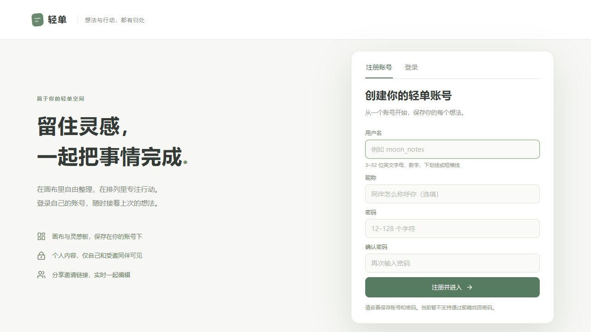
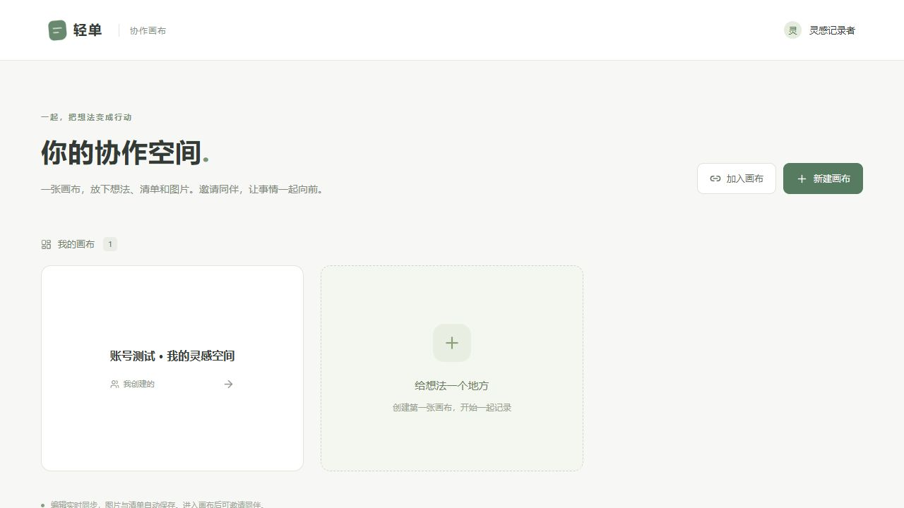
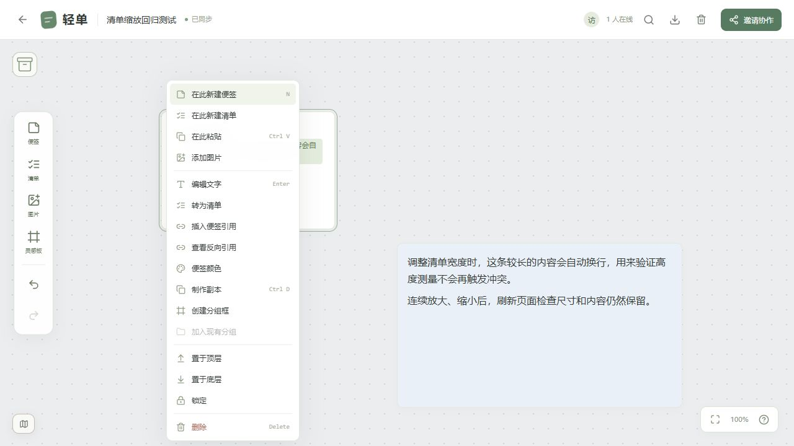
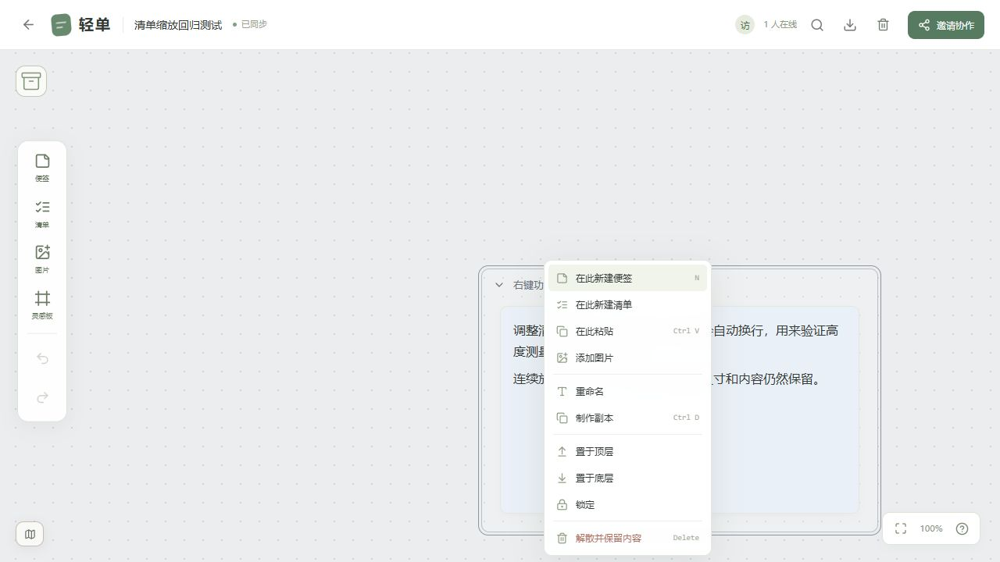
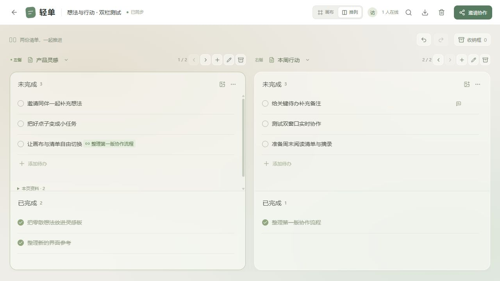
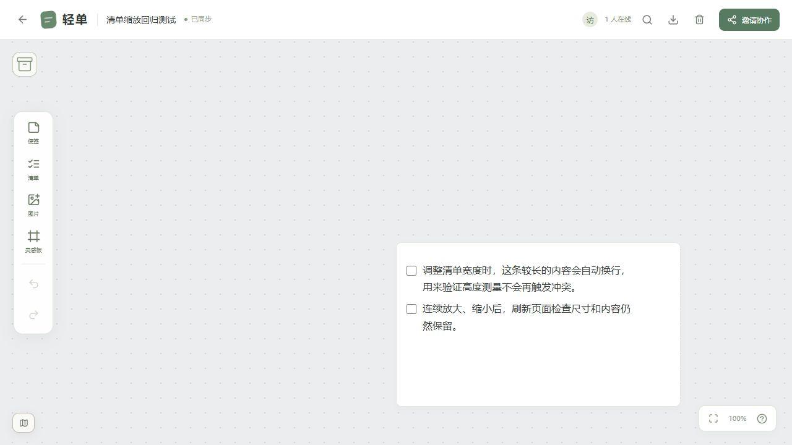
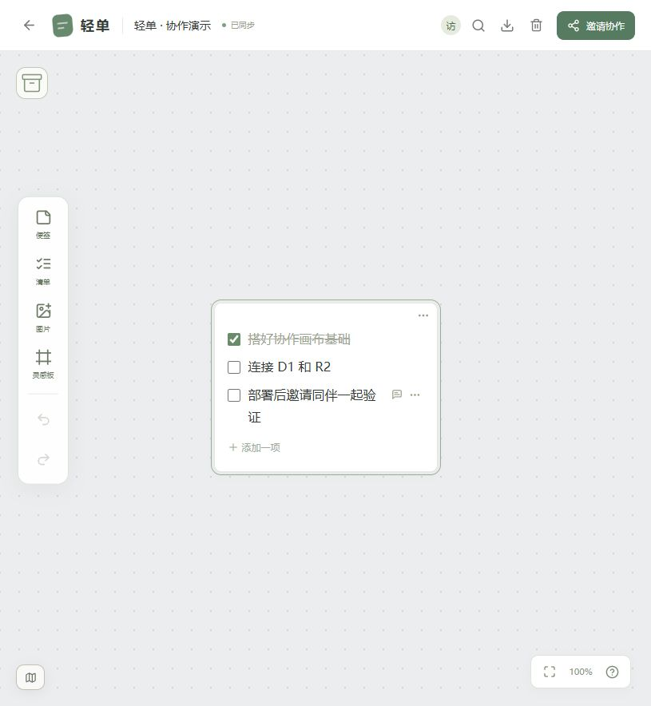

# 本地验证记录

## 2026-10-21：账号注册、登录与个人画布

- `npm test`：112 项通过，0 失败；`npm run check` 与 `npm run deploy:check` 通过，预检查只打包，没有部署云端。
- 真实 workerd 集成测试在独立数据目录中运行，使用 `APP_ENV=production`，验证注册后无需旧创建口令即可创建画布。
- 验证未登录拒绝访问、用户名规范与重复、跨设备登录取回画布、其他账号无法访问快照/图片、邀请编辑权限、R2 原文件及 DO 内容重启后持久化。
- 迁移测试验证持有有效旧访客 Cookie 才可认领；注册保留原 ID，登录已有账号合并旧成员关系，旧 Cookie 不可重复认领，过期身份不自动认领。
- 验证退出后 HTTP 权限失效，旧 WebSocket 进入关闭流程且不再接收广播；修改密码必须验证旧密码，所有旧设备会话与旧连接写权限失效，新会话可用。
- 检查 D1 中仅保存带独立随机盐的 scrypt 哈希；测试不存在账号与错误密码使用相同错误信息，以及连续猜测受到限流。
- 独立代码审查发现并修复账号切换期间迟到的创建响应泄露旧画布与邀请的问题；新增 2 个直接执行 App 处理函数的异步回归，覆盖迟到创建与登录过程中旧列表返回。邀请缓存按账号/画布隔离。
- 浏览器在 `127.0.0.1:8792`、`.tmp/accounts-ui-20261021` 验证注册、直接创建个人画布、排列清单保存、退出、携带邀请注册后自动加入、成员权限和重新登录原账号。最终构建捕获的警告/错误为空。
- 注册页在 1280×720 下完整显示表单与提交按钮；截图 `accounts-register.jpg`、`accounts-home.jpg`。
- 本地工作不替代线上 CPU 配额与真实网络的验收；云端升级需要用户依次执行 D1 的 `0002_accounts.sql` 迁移和部署。当前没有邮箱找回密码功能。

## 2026-10-21：恢复画布对象的右键菜单

对照原项目 `D:/TODO/src/Workspace.jsx` 确认，独立项目的菜单只迁移了复制、组合、锁定和删除，没有按右键目标的类型恢复原有操作。浏览器在修改前复现了便签缺少颜色和编辑等选项。

本次恢复便签/清单的编辑、类型转换、颜色、插入引用、反向引用，容器的重命名和解散保留内容，以及分组、加入现有分组、移出容器、层级和右键位置创建等画布内操作。空白处菜单不会沿用旧选区；执行操作时重新读取对象和锁定状态；解散框与子对象同时选中的选区也保留内容。

- `npm test`：85 项通过，0 失败，含新增的 10 项菜单回归测试。
- `npm run check`、`npm run deploy:check`：通过，未部署云端。
- 独立本地环境端口 `8791`：验证颜色修改、清单转文字、编辑入口、右键位置新建、创建分组、重命名、插入引用与反向引用、加入与移出分组、解散保留内容。
- 第二个标签页接收到类型转换和名称更新；刷新后保留内容、引用和解散结果。两个标签页共享浏览器身份，已捕获的控制台错误均为空。
- 原项目“移动到项目”涉及跨协作画布迁移，当前云端版本尚未实现，不在此次画布内菜单中提供。

## 2026-10-21：画布与双栏排列

在独立项目加入「画布 / 排列」视图。排列复用原 Agent 的清单编辑器、备注菜单、引用、收纳、图片与完成动效，左右显示不同灵感板，不包含聊天、模型或 Codex 执行逻辑。

- `npm test`：102 项通过，0 失败。新增 12 项排列状态/操作回归、2 项图片格式检查及 3 项图片撤销回归；稳定排序、格式识别、图片撤销均先复现失败再修复。
- 验证命令应顺序执行：曾将构建与集成测试并行运行，`dist` 更新触发测试 Worker 热重载，导致一次 WebSocket 消息超时；运行日志确认了重载，停止并行构建后完整 102 项通过。
- `npm run check`：通过。相关 JS、JSX、CSS、测试及说明的 Prettier 检查通过。
- `npm run deploy:check`：Vite 构建及 Wrangler dry-run 通过，没有部署，也没有修改 Cloudflare 资源配置或 D1 迁移。
- 浏览器验收使用本地 `8791`、独立数据目录 `.tmp/resize-ui-20261021-5d2b`，新建「想法与行动 · 双栏测试」，不使用日常开发画布的数据。
- 验证两栏创建灵感板、多行新增、回车插入、编辑器多行粘贴、勾选与完成动效、备注自动保存、`[[` 插入引用及跳转、行菜单删除、Delete 删除单行和撤销。
- 验证整张清单收纳/取出、图片导入及另一窗口收到图片。错误扩展名的真实图片会按文件签名使用正确 MIME，避免阻塞上传。
- 实测并修复上传完成后图片无法撤销的问题：撤销比较会补齐同一不可变文件的上传信息，标题、位置、原文件等真实协作修改仍受冲突保护。上传完成后撤销、重做、再次撤销均通过。
- 两个标签页同时编辑同一清单的不同行，两次修改都保留；刷新仍显示同样的两栏选择、完成状态和内容。两个标签页共享浏览器身份，独立成员权限继续由 workerd 集成测试覆盖。
- 在画布与排列之间来回切换，读取并比较 6 个画布对象的 DOM 位置、尺寸和变换，完全一致。最新构建捕获的浏览器警告/错误为空。
- 输入法切换采用 composition 事件延后导航，自动化未覆盖真实中文输入法候选窗。手机保持横向双栏滚动，未做真实手机触控验收。

## 2026-10-21：调整清单大小时的冲突修复

缩放手势期间，浏览器自动测量的 `layoutHeight` 被当作共享内容进行合并，可能与手势开始时的快照冲突。同时，共享对象遗漏了 `fixedHeight`，导致手动调整后的固定高度无法完整保存。

修复后，自动测量高度只用于本地渲染；手动设置的宽度、高度和固定高度标记正常同步。旧草稿、旧服务端对象中的测量值不再参与冲突判断，已发送但未确认的操作仍保持原样重放。冲突提示也不再误报“请缩短内容”。

- `npm test`：75 项通过，0 失败。新增 5 项回归测试，并加强真实 workerd WebSocket 集成测试；相关场景均先复现失败，再通过修复。
- `npm run check`：通过。
- `npm run deploy:check`：Vite 构建和 Wrangler dry-run 通过，没有发布到云端。
- 浏览器使用独立本地数据目录 `.tmp/resize-ui-20261021-5d2b`、端口 `8791`。新建两项长文本清单，连续调整到宽高 `410 × 236`、`240 × 206`、`460 × 266`，换行和缩放未出现冲突。刷新后仍为 `460 × 266`，两项内容完整，状态为“已同步”，已捕获的控制台错误为空。

## 初始基础验证记录

日期：2026-10-20。目录：`D:/TODO/qingdan-canvas`。

## 自动验证

| 命令                   | 结果              | 范围                                                              |
| ---------------------- | ----------------- | ----------------------------------------------------------------- |
| `npm test`             | 67 项通过，0 失败 | 提取的画布回归、同步合并、重连、草稿身份、撤销和真实 workerd 集成 |
| `npm run check`        | 通过              | Worker、Cloudflare 绑定、共享代码的 TypeScript 检查               |
| `npm run deploy:check` | 通过              | Vite 生产构建、Wrangler Worker 打包及绑定检查；没有部署           |

集成测试在独立 `.tmp/integration-*` 数据目录中启动本地 Wrangler，不使用预览中的画布数据。实际覆盖：

- 独立会话创建、邀请加入、非成员拒绝访问。
- 两个 WebSocket 客户端同步；相同操作重复发送不重复产生版本。
- 版本冲突、无效批量操作的原子回滚。
- PNG 上传和下载、非成员图片读取被拒绝、SVG 被拒绝。
- 只有创建者可以重置邀请；旧邀请失效；已加入成员继续访问。
- 跨来源修改请求被拒绝。
- 服务停止并重新启动后，DO 对象、操作回执、R2 图片仍可恢复。

## 浏览器验收

在 `http://127.0.0.1:8788` 的本地模拟环境中完成：

1. 创建“轻单 · 协作演示”，新增三项清单，页面显示“已同步”。
2. 两个标签页打开同一画布；第二页勾选事项后，第一页立即更新；刷新后仍保留。
3. 通过文件选择器上传 PNG，另一页出现对应图片。
4. 删除图片并刷新后，导出 `.qingdan` 完整备份。重新解析备份，确认含 2 个活动对象、1 个回收对象、1 份图片资源，图片字节为 67。
5. 搜索清单并点击结果，正确返回画布定位该对象。
6. 最终前端构建的已捕获日志中没有错误。

两个标签页共享浏览器身份；独立成员鉴权由上述独立会话集成测试覆盖。

## 审查后的修复

独立代码审查指出的问题已修复，并分别增加失败后通过的回归测试：

- 拖拽和缩放从旧快照计算时，保留其他成员刚更新的内容。
- 刷新后恢复回收站所引用的图片，确保完整备份可导出。
- 本地草稿暂时保存失败后，重试重新发送同一份待确认操作。
- 超大文本在发布到本地界面前校验，避免出现“显示了但无法保存”的内容。
- 复制标签页时区分草稿身份，避免不同标签页覆盖同一草稿。

## 尚未验证的环境

本轮没有创建远程 D1、R2 或发布 Worker，因此尚未完成公网、多设备、Cloudflare 账号权限、线上配额和负载验收。没有接入 Cloudflare Access，也没有字符级 CRDT。

下一步按 [部署指南](cloudflare-setup.md) 从登录开始配置资源，部署后再用两个独立浏览器验收。
